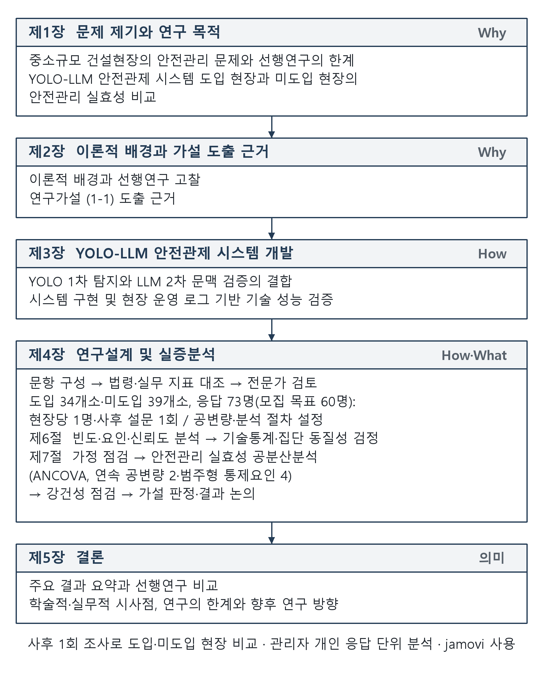

# 제1장 서론

> **작성 상태:** 2026-11-07 사용자 승인에 따라 제1절에 재구성 4차 초안, 제2절에 연구의 목적 승인 문안을 반영하였다. 제3절에는 시스템 개발 범위와 개발·평가·설문 비교 절차를 보완하고 조사 시점 문장을 정리한 뒤, 설계 사실을 유지하며 보완 전 분량에 맞춰 압축하였다. <표 1-2>의 제1장 검토 자료 범위를 맞추었다. 2026-11-08에는 Kim et al.(2022)의 현장 운영 결과를 근거로 제1절의 CCTV 활용 한계와 관제 필요성을 보완하였다. 이번 보완분의 HWPX 반영은 대기 중이다.
> **분량 목표:** 제1절 2p, 제2절 1p, 제3절 2p(표·흐름도 포함).

---

## 제1절 연구의 배경 및 필요성

정부는 2030년까지 사고사망만인율을 근로자 1만 명당 0.29명으로 낮추는 목표를 제시하였다(대한민국 정부, 2025). 2025년 전 산업 사고사망만인율은 0.38명이었다(고용노동부 3월 발표, 2026). 2025년 유족급여 승인 기준 사고사망자 872명 중 건설업은 361명으로 41.4%를 차지하였다(고용노동부, 2026). 건설현장의 위험을 적시에 파악하고 대응하는 일은 사망사고 감축의 주요 과제다. 현장 영상을 확인하고 위험을 판단하여 담당자의 대응을 돕는 안전관제는 이 과제를 수행하는 수단이 될 수 있다.

선행연구에서도 개별 장비와 함께 이를 활용하는 관제 기능의 중요성을 확인할 수 있다. 맹인영 등(2021)이 조사한 공공기관 10개 현장 모두에서 ‘고정식/이동식 CCTV’ 항목의 장비를 사용하였다. 같은 연구에서 장비 활용 경험이 있는 현장 관계자가 장비별 재해 예방 효과를 계층분석법(AHP)으로 비교한 결과, 통합관제 플랫폼과 모바일 기반 관제 플랫폼이 공통 순위 1·2위, CCTV가 3위였다.

<표 1-1> 스마트 안전장비 재해 예방 효과의 공통 상위 5개 항목

| 공통 순위 | 장비·플랫폼 | 공통 가중치(AHP) |
| ---: | --- | ---: |
| 1 | 통합관제 플랫폼 | 0.174 |
| 2 | 모바일 기반 관제 플랫폼 | 0.091 |
| 3 | 고정식/이동식 CCTV | 0.069 |
| 4 | 중장비 접근경보기 | 0.066 |
| 5 | 근로자 위치 확인 센서 | 0.057 |

CCTV가 설치되어 있더라도 영상을 위험의 조기 인지와 대응에 연결하는 데에는 한계가 있다. Kim et al.(2022)은 중소규모 건설현장 3곳의 스마트 건설안전기술 시험 운영에서 이동형 CCTV가 위치·추락위험 센서와 연계되지 않은 채 개별적으로 작동하여 위험 발생 여부를 사람이 육안으로 확인해야 한다고 지적하였다. 또한 관리·모니터링 전담 인력을 배치하기 어려워 안전관리보다 공정 확인에 주로 활용되는 문제를 보고하였다(Kim et al., 2022, p. 20). 이러한 운영상의 한계를 보완하려면 지속적인 영상 확인의 부담을 줄이면서, 기존 CCTV 영상에서 위험 정보를 선별하여 담당자의 대응으로 연결하는 관제 방식이 필요하다.

자동 영상분석을 관제에 결합할 때는 오탐으로 인한 불필요한 경보를 고려해야 한다. 류정·박인선(2025)은 YOLOv4 기반 AI CCTV를 운영한 선정 13개 건설현장에서 고양이와 옷, 허리를 굽힌 작업자 등을 위험으로 잘못 탐지한 사례를 보고하였다. 객체의 외형만으로 위험 여부를 판단하기 어려운 상황에서는 작업 장면의 문맥을 활용한 추가 검증을 고려할 수 있다. 이때 불필요한 경보를 걸러내는 정도와 실제 위험 경보의 손실을 함께 확인할 필요가 있다.

이러한 관제 시스템은 재해가 집중된 중소규모 현장의 인력·예산 제약을 고려하여 개발할 필요가 있다. 고용노동부(2025)의 2024년 산재보상 승인 통계에서 건설업 업무상사고 사망자 328명 중 공사금액 120억 원 미만 현장은 235명으로 71.6%를 차지하였다. 본 연구에서 중소규모 현장은 안전관리자 전담 선임 기준을 고려하여 총공사비 120억 원 미만, 토목공사업은 150억 원 미만으로 정의하였다(김용선, 2022).

여러 카메라 영상을 함께 살피고 필요한 장면을 자세히 확인하는 영상관제에 자동 위험 판단을 결합하면, 관리자가 화면을 계속 지켜보기 어려운 상황을 보완할 수 있다. 특히 추가 장비 도입 부담을 줄이기 위해 기존 CCTV와 범용 PC를 활용하면서 YOLO의 위험 탐지와 LLM의 문맥 검증을 연계하는 안전관제 시스템의 개발이 요구된다.

안전관제 시스템의 필요성은 탐지 성능뿐 아니라 현장의 안전관리 업무에서 살펴야 한다. 탐지 정확도가 높거나 불필요한 경보가 줄었다는 사실만으로 관리자가 위험을 제때 파악하고 대응하는지를 알 수는 없다. 관련 선행연구는 탐지 정확도·기술 수용 의향·관제 효율 등을 다루었으나, 도입·미도입 현장에 동일 척도를 적용하여 관리자가 지각한 안전관리 실효성을 비교한 근거는 부족하다. 따라서 영상관제와 위험 판단·전달을 연결하는 시스템 개발과 함께, 현장의 안전관리 실효성을 검토할 필요가 있다.

---

## 제2절 연구의 목적

본 연구의 목적은 기존 CCTV와 범용 PC를 활용하는 YOLO-LLM 안전관제 시스템을 개발하고, 도입 현장과 미도입 현장의 관리자가 지각한 현재 안전관리 실효성의 차이를 검증하는 데 있다. 이를 위한 구체적인 목적은 다음과 같다.

첫째, 인력과 예산이 제한된 건설현장의 관제 업무를 지원하도록 여러 카메라의 영상 확인과 위험 판단, 담당자 알림을 연결하는 안전관제 시스템을 설계·구현하고자 하였다.

둘째, 현장 운영 과정에서 YOLO가 탐지한 위험 후보를 대상으로 LLM 문맥 검증의 오경보 감소와 실제 위험 경보 손실을 함께 평가하여, 위험 후보를 선별하는 성능과 그 한계를 확인하고자 하였다.

셋째, 도입 현장과 미도입 현장에 공통 척도를 적용하고, 응답자·현장 특성의 차이를 감안하여 관리자가 지각한 안전관리 실효성을 비교하고자 하였다. 이에 도입 현장의 관리자가 지각한 안전관리 실효성은 여섯 통제변수(C)를 조정한 후에도 미도입 현장보다 높을 것이라는 연구가설 (1-1)을 설정하였다. 가설의 근거는 제2장 제4절에, 통제변수와 분석 절차는 제4장에 제시하였다.

이를 통해 시스템의 기술적 성능과 현장 관리자가 평가한 안전관리 업무 수준을 함께 살펴보고, 연구 결과가 뒷받침하는 범위에서 시스템의 도입·운용과 후속 연구에 필요한 기초 자료를 제공하고자 하였다.

---

## 제3절 연구의 범위 및 방법

본 연구는 A공사 경기지역본부 산하 건설현장을 대상으로 하였다. 도입·미도입 각각 30개소 이상, 총 60개소 이상에서 현장당 1명씩 60명 이상 모집을 목표로 하였으며, 실제 분석 표본은 73명(도입 34개소·미도입 39개소, 현장당 1명)이다. 응답자는 두 집단 모두 담당 현장의 안전관리 업무를 맡은 시공사 현장소장(관리감독자)·안전관리자와 발주청 공사감독·감리원이다. 같은 기관의 현장을 비교하여 발주기관의 관리 방식에 따른 차이를 줄이고자 하였다.

설문조사는 2026년 10월 12일부터 10월 23일까지 1회 실시하였다. 도입 현장에서는 YOLO-LLM 안전관제 시스템 설치 후 조사하였으며, 도입 전 조사는 실시하지 않았다. 도입 현장은 설치 후 응답일 현재 3개월 이상 정상 운용을 확인한 현장이다. 도입·미도입 현장 모두 안전관리 실효성 문항은 설문 응답일 직전 1개월을 기준으로 평가하였다.

내용적 범위는 시스템 개발·성능평가와 도입·미도입 현장의 안전관리 실효성 비교이다. 개발 범위는 기존 CCTV 연계, 범용 PC의 다중·단일 영상관제, YOLO 위험 후보 탐지, 외부 LLM API의 문맥 검증과 담당자 알림이다. 안전관리 실효성은 위험의 조기 인지, 초동 대응, 원격 상황 파악, 순찰·확인 업무의 효율, 위험 통제를 묻는 8문항의 평균 하나로 측정하였다. 도입 현장 관리자의 시스템 특성과 경보 피로도 완화 인식은 제3장에서 시스템 개발의 효과로 보고하였다. 여섯 통제변수(C) 중 만 나이와 건설현장 경력(년)은 연속형 공변량, 소속·성별·역할·총공사비 4구간은 범주형 고정요인으로 투입하였다. 위험 인지 경로·시점을 묻는 A-7·A-8은 운용 실태 확인 지표, 지시 전달 시간을 묻는 A-9는 과정 지표로 조사하여 연구가설 (1-1)의 해석에 참고하였다(제4장). 총공사비 120억 원 이상 현장도 포함하였으며, 조사 대상 전 현장에 본 시스템 외 다른 스마트 안전장비는 없고 도입 현장의 운용 설정은 동일하다.

본 연구는 문헌 고찰과 현장의 인력·비용 제약에 따른 요구사항 정리, 시스템 설계·구현, 현장 적용과 운영 로그 평가, 도입·미도입 설문 비교 순서로 진행하였다. 문헌 고찰로 변수·가설의 근거를 정리하고, 로그로 YOLO 위험 후보에 대한 LLM 2차 검증의 조건부 성능을 평가하였다. 두 집단에 같은 척도의 자기응답 설문을 적용하여 관리자가 지각한 안전관리 실효성을 횡단 비교하였다. jamovi 2.7.41의 공분산분석(ANCOVA)으로 여섯 통제변수(C)의 차이를 감안하여 두 집단의 조건을 같게 맞춘 평균(조정 평균)을 비교하였다[연구가설 (1-1)]. 척도 검토·결측 처리·가정 점검의 세부 기준은 제4장을 따랐다. 장별 구성은 <표 1-2>와 같다.

<표 1-2> 연구의 방법과 장별 구성

| 장 | 내용 | 방법·자료 |
| --- | --- | --- |
| 제1장 서론 | 연구의 배경과 필요성(문제 제기), 연구의 목적, 연구의 범위와 방법 | 정책·재해 통계 및 CCTV·관제 선행연구 검토 |
| 제2장 이론적 배경 | 개념 정의, 시스템의 기술 특성, 안전관리 실효성 측정문항의 근거, 선행연구와 가설 도출 근거 | 문헌 고찰 |
| 제3장 시스템 개발 | 요구사항, 설계, 구현, 시스템 개발의 효과 분석 | 시스템 개발, 운영 로그 평가, 도입 현장 관리자 인식 조사 |
| 제4장 연구설계 및 실증분석 | 연구 모형, 가설, 조작적 정의, 설문 설계, 표본, 분석 절차, 조사 대상 특성·기초통계 분석, 가설 검증 결과, 분석결과 및 논의 | 도입·미도입 현장 비교 ANCOVA 설계·분석(jamovi), 설문조사(응답 73명) |
| 제5장 결론 | 연구 요약, 시사점, 한계, 향후 연구 방향 | 결과 종합 |

본 연구는 본 시스템 전체를 운용하는 현장과 통상 방식으로 안전관리를 하는 현장을 비교하였다. 전체 연구 절차는 <그림 1-1>과 같다.

<그림 1-1> 연구의 흐름도

제2장에서는 스마트 안전관리와 AI 영상관제 기술, 시스템 기술 특성, 안전관리 실효성의 선행연구를 고찰해 이론적 근거를 정리하였다.

---

## 작성 메모(제출 전 확인 사항 — 본문 아님)

- [x] **윤영석 논문연도 확정(2026-11-04 사용자 직접 확인):** 인용·서지연도는 2026으로 통일하였다. 원문에서 확인한 2025학년도와 2025년 12월 제출·인준 표시는 그대로 유지한다(경기대학교 공학대학원 건축·안전공학전공 석사학위논문, 지도교수 박종용). 사용자 확인 뒤 같은 날 RISS T17395920(석사, 2026. 2; 발행 2026)으로 공식 서지도 대조하였다.
- [x] **(2026-11-04 확정) 학위논문 연도는 학위 수여 연도로 통일한다(RISS·DBpia 기준). 박종학(2025)·이형도(2024)·윤영석(2026) 유지, 류수영은 2023→2024로 변경.** **박종학 인용 연도 재확정(2026-07-12 표지·제출면 재대조):** 표지는 "2024학년도 석사학위논문"이나 제출면이 "2025년 6월"이므로 인용 연도는 수여·발행 연도 기준 **박종학(2025)**로 최종 확정(경기대학교 공학대학원 건축·안전공학전공, 지도교수 문유미). 이전 "2024 확정" 기록은 표지 학년도만 본 오판이었음. 전 장 표기를 2025로 통일 완료(학회논문 참고문헌 [05]의 2025와도 일치)
- [x] 실제 미도입 현장 확보 수(39개소)와 측정 구조 확인 방법(탐색적 요인분석)을 제4장과 함께 확정하였다(2026-10-24).
- [x] **과거 반영 이력(2026-10-10, 현재 제1절·표 구성과 구별):** 배경 통계는 고용노동부(2025) 원문 추출자료에서 확인한 2024년 건설업 업무상사고 사망자 328명과 <표 1-1>의 공사금액 규모별 구성비(120억 원 미만 71.6%, 3억 원 미만 34.8%), 같은 자료의 공사금액별 사망만인율(3억 원 미만 4.92‱, 1,000억 원 이상 0.80‱)을 사용하였다. 만인율은 전체 사망자 기준이어서 <표 1-1>과 분모가 다르다는 점을 본문에 밝혔다. 전 산업의 50인 미만 사업장 통계는 건설업 규모별 근거로 사용하지 않았다(2026-10-10 현행화).
- [x] 상황실 구축 1,200만 원은 국토교통부·국토안전관리원(2024) 가이드라인 인쇄 23쪽(PDF 27쪽)에서 서버·네트워크·방송시설 포함 단가로 확인하였다. 현행 제3장에는 대안별 비용 비교를 수록하지 않는다.
- [x] 연구흐름도(<그림 1-1>)의 구 ANCOVA PNG 연결을 당시 혼합모형 Mermaid 도식으로 대체함(2026-09-13 MD 수정). 2026-10-03에는 현장당 1명·60명과 ANCOVA를 반영하여 위 Mermaid 도식을 수정하였다. HWPX 반영은 별도 작업이다.
- [x] **과거 반영 이력 — 2026-10-04 지도 반영(2026-10-07 MD 수정, 당시 구성):** <표 1-1>을 '건설업 공사금액 규모별 업무상사고 사망자 분포(2024년)'로 교체하였다(고용노동부 2025 인쇄 336쪽 원표, 비율은 연구자 계산, 120억 원 미만 누적 71.6%). 이로써 종전 표 주에 남아 있던 규모별 원표 확인 표기(CITE_TODO)를 해소하였다. 김석기(2026)의 2023년 68.5%는 재인용하지 않았다. 제1절은 인용 없는 주장 문단으로 시작하고 선행연구 인용 9건을 요약 서술로 바꾸었으며(해당 문헌은 제2장에 있음), Zhou et al.(2023)의 통계 불일치 논평은 제2장 <표 2-5>·작성 메모로 넘겼다. 제2절은 6문단으로 바꾸고 마지막 문단을 확정 목적 문장으로 시작하였다. 제3절은 공간·시간·내용 범위와 <표 1-2> 장별 구성을 신설하고 흐름도의 제1장·제2장 노드를 분리하였다. 한계 서술은 제5장으로 넘기고 두 문장만 남겼다. HWPX 반영과 00_목차의 표 목차·초록 목적 문장 동기화는 별도 작업이다.
- [x] **2026-11-07 제1절 4차 초안 반영:** 정부 목표·건설업 재해 비중, 관제 선행연구, 관제 인력·오탐 문제, 중소규모 제약과 개발·실효성 검토 필요성을 반영하였다. 현행 <표 1-1>은 맹인영 등(2021)의 상대효과성 공통 상위 5개 항목이며, 2024년 규모별 재해 통계는 본문 문장으로 유지하였다. 표 목차·신규 서지 110~112는 MD에 반영했고 HWPX는 대기 중이다.
- [x] **2026-11-07 제2절 승인 문안 반영:** 총괄 목적→구체 목적→활용 순서로 교체하였다. 연구가설 (1-1)과 제2장 제4절·제4장 연결을 유지하였고 제1·3절 본문은 변경하지 않았다. HWPX 반입은 대기 중이다.
- [x] **2026-11-07 제3절 개발 범위·방법 보완:** CCTV 연계·PC 관제·YOLO 탐지·외부 LLM API 검증·담당자 알림의 개발 범위와 요구사항 정리부터 설계·구현·현장 적용·평가·설문 비교까지의 절차를 명시하였다. 조건부 성능평가와 횡단 지각 실효성 비교를 구분하고 조사 시점 문장을 정리하였다. 기존 측정·통제변수·표본·ANCOVA 설명은 보존하였으며 HWPX 반입은 대기 중이다.
- [x] **2026-11-07 제3절 분량 조정:** 개발 범위·절차, 후보 조건부 성능평가와 지각 실효성 횡단 비교를 유지하며 표본·통제변수·방법 설명을 압축하였다. 보완 전 산문 분량의 ±5% 이내로 조정하였고 HWPX 반입대기 제31항에 연결하였다.
