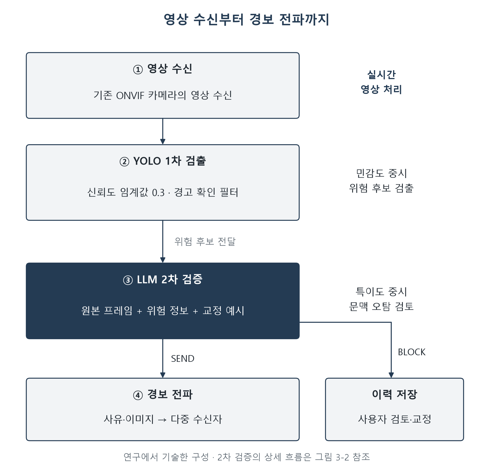
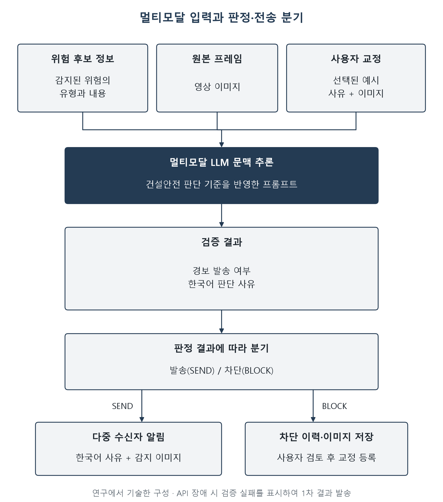
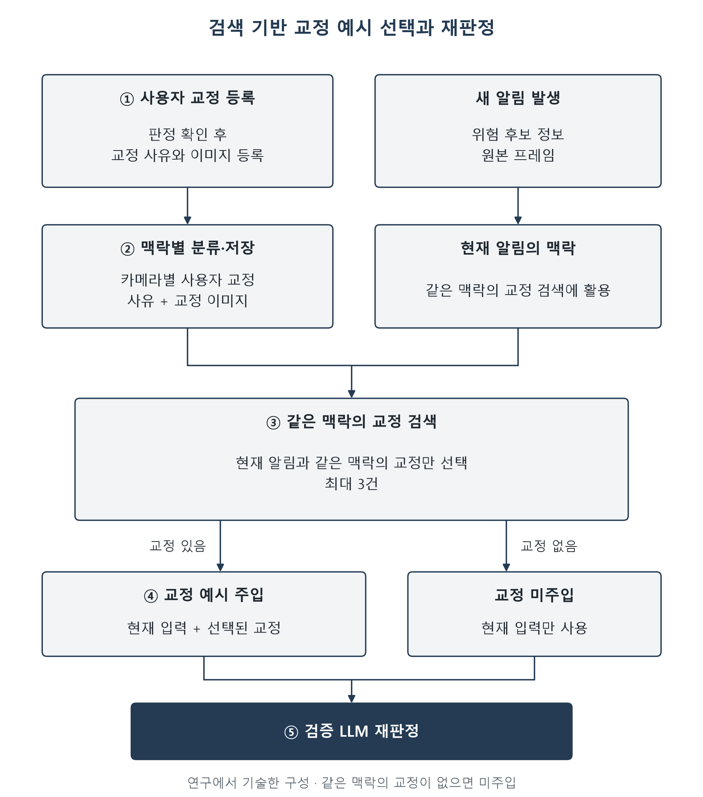
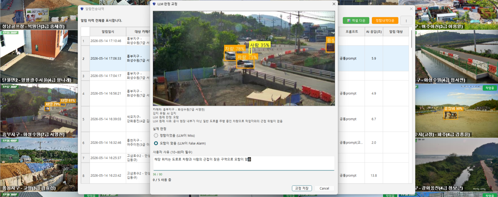

# 제3장 YOLO-LLM 안전관제 시스템 개발

> 본 장은 연구자가 직접 개발한 AI CCTV Viewer(YOLO-LLM 안전관제 시스템)를 개발 목적과 요구사항에서 출발해 어떤 설계 원리로 구현하고 성능을 어떻게 검증하였는지 서술하였다. 이 내용은 제4장의 도입 현장 전용 참고 문항(Part C)의 근거를 이루었다.

## 제1절 시스템 개발 방향 및 요구사항

### 제1항 시스템 개발 개요

본 연구가 개발한 시스템은 범용 PC 위에서 구동되는 YOLO-LLM 안전관제 시스템이다. 전담 안전관리자와 예산·데이터를 갖추기 어려운 중소규모 건설현장이 이미 설치된 CCTV 인프라만으로 실시간 위험을 감지하고 신뢰할 수 있는 경보를 받도록 하는 것이 개발의 궁극적 목적이다. 이를 위해 본 연구에서는 고가의 전용 AI 서버나 현장별 재학습을 요구하지 않고, 일반 사무용 PC 한 대와 기존 ONVIF 카메라, 그리고 인터넷으로 호출해 쓰는 상용 거대언어모델(LLM) 서비스(API)만으로 동작하는 데스크톱 응용 프로그램을 설계하였다.

개발의 방향은 "많이 잡되 정확히 거른다"는 두 단계 분업으로 요약할 수 있다. 단일 인공지능 모델은 위험에 민감하게 설정하면 오탐(실제 위험이 아닌데 경보한 것, false positive)이 폭증하고, 오탐을 줄이려 둔감하게 설정하면 미탐(실제 위험을 놓친 것, false negative)이 늘어난다. 단일 모델은 이 상쇄(trade-off) 관계에서 벗어나지 못하므로, 본 시스템은 서로 다른 기준을 가진 두 단계를 결합하여 이 관계의 개선을 목표로 하였다. 1차 단계는 놓침을 최소화하도록 민감도(sensitivity)를 극대화하고, 2차 단계는 잘못된 경보를 걸러내도록 특이도(specificity)를 극대화하였다. 이러한 역할 분리는 결정 기준값(criterion)의 위치에 따라 적중(hit)과 오경보(false alarm)가 상쇄된다는 신호감지이론(SDT)에 근거한다(제2장 제2절 참조). 다만 1차를 통과한 후보만 2차에서 거르는 구조(직렬 필터)에서는 2차가 실제 위험까지 걸러 버릴 수 있다. 따라서 SDT에 근거해 설계하였다는 사실만으로 위험을 놓치지 않으면서(민감도) 오경보도 줄인다고(특이도) 볼 수는 없다.

개발 전략은 세 가지 원칙으로 구체화하였다. 첫째, 저비용 원칙이다. 본 시스템은 기존 ONVIF 카메라와 범용 PC를 재활용하여 추가 장비 도입 부담을 줄이는 것을 목표로 하였다. 둘째, 무학습 적응 원칙이다. 현장마다 라벨 데이터를 구축하고 모델을 미세조정(fine-tuning)하는 대신, LLM에 판단 지침(프롬프트)과 사용자가 바로잡아 준 사례 몇 건을 함께 보여 주는 것만으로 현장에 맞추었다. 이는 LLM이 예시 몇 개만 보고도 그에 맞추어 판단하는 능력(맥락 내 학습, In-context Learning)을 활용한 것이다. 셋째, 사용자 검증 가능성 원칙이다. 현장 사용자가 판정의 타당성을 직접 확인하고 교정할 수 있도록 2차 검증 결과와 한국어 자연어 사유를 함께 제시하였다.

### 제2항 현장 요구사항

본 연구는 중소규모 건설현장의 구조적 제약을 다음 네 가지로 보고, 이에 근거하여 시스템 요구사항을 도출하였다. 첫째, 전담 안전관리자가 상시 배치되지 못한다(김석기, 2026; 윤영석, 2026). 둘째, 안전관리비 준수율이 낮아 고가 장비 도입 여력이 부족하다(조도빈, 2026). 셋째, 이미 설치된 CCTV가 노후 ONVIF 카메라 수준에 머물러 있다. 넷째, 현장별 위험 상황의 학습용 라벨 데이터 확보가 제약될 수 있다. Chen과 Zou(2026)는 건설안전 점검용 VLM을 평가·미세조정할 공개 데이터셋의 부족을 지적하고 건설현장 이미지 데이터셋을 구축하였다. 이 연구에서 제시한 건설안전 영상의 데이터 확보 문제를 참고하여, 예산·인력과 현장별 라벨 데이터 확보 여건을 함께 고려한 시스템 요구사항을 설정하였다.

본 연구는 이러한 제약에 대응할 다섯 가지 핵심 요구사항을 설정하였다. 요구사항은 일반 사무용 PC에서 구동될 것(R1), 기존 ONVIF IP 카메라의 RTSP 스트림을 처리할 것(R2), 현장별 재학습 없이 현장 적응이 가능할 것(R3), 위험 누락을 함께 점검하면서 후보 오경보를 줄일 것(R4), 프레임 처리와 경보 전달의 적시성을 확보할 것(R5)이다.

이 가운데 실시간성(R5)은 처리 속도가 빠르다는 뜻이 아니라, 위험에 대응할 수 있는 시간(reaction window) 안에 경보가 도착한다는 뜻의 적시성(right-time)으로 정의하였다(Teizer, 2016). 이때 시간 창은 위험 유형에 따라 달라진다. 본 연구는 충돌·협착·추락과 같은 순간형 위험을 설계 대상에서 제외하였다. 본 시스템은 안전모 미착용이나 위험구역 체류처럼 위반이 지속되는 동안 개입할 수 있는 상태형 위반을 대상으로 하였다.

상태형 위반에서는 관찰 창을 늘릴수록 판정 정확도가 높아지는 대신 경보가 느려지는 상충이 발생한다. 개인보호구 착용 상태를 판정한 Pisu et al.(2024)은 영상을 1.41∼6.40초 동안 지켜본 뒤 판정하는 여러 설정을 비교하여, 정밀도(경보 중 실제 위험 비율) 98%에 지연 약 6초가 걸리는 설정을 운영 기준(운영점)으로 채택하였다. 본 연구에서 정한 알림 10초 이내의 목표는 한국인터넷진흥원의 영상정보 분석 성능시험이 일반분야 침입·쓰러짐 등의 정상검출 시각을 이벤트 시작 시각 이전 2초부터 이후 10초 이내로 정한 시험 기준을 참고하여 정하였다(한국인터넷진흥원, 2026, p. 12). 이 기준은 이벤트 발생부터 검출까지의 시각 범위이고, 본 연구의 10초는 위험 검출부터 담당자 단말의 알림 전달까지를 합한 시간이다. 따라서 본 연구의 알림 10초 이내는 안전이 보장된다고 검증된 기준값이 아니다. 상태형 위반에서 오탐을 줄이려면 지연이 늘어나는 관계를 고려한 위 운영 기준과 위 시험 기준을 함께 참조하여 정한 R5의 공학적 설계 목표치다. 벤더 운영 자료(Bosch Security Systems, 2024, p. 8)는 추가 검증 단계의 지연 상한을 10초로 두지만, 이는 운영 설정이며 본 연구의 검출부터 알림 전달까지 합한 시간이나 안전 허용시간과 같지 않다.

제4절의 정량 평가 표본은 중장비 접근과 차량 접근의 두 경고 유형으로 구성하였다. 이 유형은 충돌·협착 위험과 관련되어 앞서 정한 상태형 위반의 설계 대상과 차이가 있으며, 스냅샷을 기준으로 평가하였다. 이러한 평가 대상과 시간적 범위를 요구사항별 평가 범위와 함께 <표 3-1>에 제시하였다.

이상의 요구사항은 서로 독립적이지 않고 하나의 설계 원리로 수렴하였다. 저비용(R1·R2)과 무학습 적응(R3)에는 범용 하드웨어와 LLM 기반 무학습 검증으로, 저오탐(R4)과 적시성(R5)에는 민감도·특이도의 역할을 분담한 이중 단계 구조로 대응하였다. 각 요구사항을 충족하였는지는 근거의 종류가 서로 다르다. R1∼R3은 기능을 구현하고 구성하였다는 설명으로, R4는 YOLO가 먼저 잡아낸 후보에 대한 LLM 필터의 성능 평가로, R5는 처리 구조를 구현한 범위로 한정하여 제시하였다.

중소현장의 구조적 제약과 이로부터 도출한 요구사항의 대응 관계는 기능 요구사항과 비기능 요구사항으로 나누어 <표 3-1>에 정리하였다.

<표 3-1> 중소규모 건설현장 제약과 시스템 기능·비기능 요구사항

| 현장 제약 | 도출 요구사항 | 구분 | 설계 반영 | 본 연구의 평가 범위(제4절) |
| --- | --- | --- | --- | --- |
| 전담 안전관리자 부재 | 자동 위험 감지·경보 전파(R2·R5) | 기능 | 24시간 무인 자동 관제, 다중 수신자 라우팅 | 전파 구성의 구현 설명, 담당자의 확인·조치는 미평가 |
| 예산 제약(안전관리비 준수율 36.7%) | 범용 PC 구동·기존 카메라 재활용(R1·R2) | 비기능 | 사무용 PC 데스크톱 앱, ONVIF/RTSP 표준 | 범용 PC·기존 카메라 활용 구성(<표 3-9>) |
| 노후 CCTV 인프라 | ONVIF 호환 스트림 처리(R2) | 기능 | ONVIF 기반 카메라 검색·영상 수신 | 협력 현장 카메라의 후보 로그 수집, 기종별 호환 시험 결과는 미제시 |
| 학습용 라벨 데이터 확보 제약(건설안전 VLM 연구의 일반적 한계) | 무학습 현장 적응(R3) | 비기능 | Few-shot 프롬프트·사용자 교정 샘플 | 6개 카메라 202건의 회고적 교정 조건 비교(<표 3-8>) |
| 오탐에 의한 경보 피로 | 위험 누락과 함께 오경보 감소 평가(R4) | 비기능 | 2차 LLM 문맥 검증으로 오탐 필터링 | 접근 위험 2종의 1차 후보 878건에 대한 조건부 필터 평가(<표 3-7>) |
| 위험 대응 적시성 | 검출부터 알림까지 합한 시간 10초 이내(R5) | 비기능 | 1차 실시간·2차 사후 검증 분리 설계 | 검출·검증·알림 처리 구조 제시, 10초 목표 달성은 미검증 |

### 제3항 관련 기술 선행연구

본 항은 요구사항 R1∼R5의 근거가 된 관련 기술 선행연구를 정리하였다. 의료·일반 관제 연구는 오류와 대응 부담을 설명하는 보조 근거로 사용하고, 그 결과를 건설현장에 그대로 일반화하지 않았다.

국내 선행연구는 YOLO 기반 감지 성능과 관제 시스템 구현을 다루어 왔다(제2장 제2절). 박종학(2025)은 YOLOv8n 기준 mAP50=0.906, F1=0.91을, 이형도(2024)는 안전모 실시간 모니터링에서 30 FPS 이상의 검출 성능을 보고하였다. 류수영(2023)은 기설치 CCTV를 활용한 YOLOv4 관제 시스템에서 IoU 0.25·K-fold 조건의 검출 성능 99%를, 김현수(2026)는 하이브리드 Trigger-Validator 구조가 오탐과 미탐을 모두 감소시킴을 보고하였다.

수용과 전달 측면에서는 이동건(2024)이 노력기대와 스마트 안전장비 수용의도의 정(+) 관계를, 이준호(2024)가 중소 건설현장의 저비용·효율형 장비 도입 합리성을 제시하였고, 김태헌(2026)과 이석희 외(2025)는 감지 결과를 자연어로 요약·전달하는 계층의 효용을 제시하였다.

국외에서는 Kim et al.(2025)이 YOLOv8s와 Florence2를 통합한 화재감지에서 VLM 판단으로 신뢰도 임계값을 동적으로 조절하여 F1=0.8895를, Wu et al.(2025)이 광산 안전 MonitorVLM의 도메인 파인튜닝으로 정밀도 73.33%→89.47%, 재현율 61.11%→82.02%를 보고하였다. Cvach(2012)는 짧은 지연과 다중 매개변수 기반 스마트 알람이 의료 모니터링의 허위 경보를 유의하게 줄인다고 종합하였고, Chong et al.(2023)은 TAM·TPB 통합 모형으로 건설안전 웨어러블의 수용 요인(PU·PEOU 등)을 분석하였다.

선행연구를 기술 특성별로 구분하면 인프라 범용성(A1) 연구군은 범용 PC 구동과 기존 카메라 처리(R1·R2)의, 탐지·제어(A2)와 오탐 필터링(A3) 연구군은 위험 누락을 함께 점검하는 오경보 감소(R4)의, 전달(A4) 연구군은 경보 전달의 적시성(R5)의 근거가 된다. 무학습 현장 적응(R3)은 문헌보다 제2항의 데이터 확보 제약에서 도출한 요구사항이다.

표의 ○ 표시는 해당 연구의 논의를 관련 특성에 연결한 본 연구의 분류를 뜻한다. Kim et al.(2025)의 동적 임계값 조정은 탐지 보완의 설계 근거로 오탐 필터링(A3)에 연결하였다. 수용의도 연구는 도입·사용 조건을 검토하는 근거로 활용하였다.

각 선행연구는 주로 하나 또는 두 특성에 걸친 기능의 성능이나 수용 조건을 다루었다. 이에 본 연구는 네 특성(A1∼A4)을 범용 PC 기반의 한 운용 구조 안에서 함께 구현하는 것을 요구사항 R1∼R5의 공통 목표로 삼았다. 기술 측면 선행연구를 네 기술 특성에 따라 정리하면 <표 3-2>와 같다.

<표 3-2> 관련 기술 선행연구 정리

| 선행연구(연구자, 연도) | 연구 맥락 | 인프라 범용성(A1) | 탐지·제어 안정성(A2) | 오탐 필터링(A3) | 알림 즉각성(A4) |
| --- | --- | :---: | :---: | :---: | :---: |
| 류수영(2023) | CCTV 기반 산업안전 관제(YOLOv4) | ○ | ○ | ○ | — |
| 박종학(2025) | YOLO 모델별 건설현장 성능 비교 | — | ○ | ○ | — |
| 이형도(2024) | 안전모 착용 실시간 모니터링(객체탐지) | — | ○ | — | — |
| Kim et al.(2025) | YOLO+VLM 통합 화재감지 | — | — | ○ | — |
| Wu et al.(2025) | 광산 안전 시각-언어 프레임워크 | — | — | ○ | — |
| Cvach(2012) | 의료 모니터 알람 통합 문헌고찰 | — | ○ | ○ | — |
| 김현수(2026) | 관제센터 하이브리드 구조 실험 | — | — | ○ | — |
| 김태헌(2026) | 건설현장 위험상황 이해·대응 | — | — | ○ | ○ |
| 이석희 외(2025) | 장면그래프 기반 한국어 위험 캡션 | — | — | ○ | ○ |
| 이창남(2025) | Drone·AIoT 융합 안전관리 모니터링 | — | — | — | ○ |
| 이동건(2024) | UTAUT 기반 스마트 안전장비 수용 | ○ | — | — | ○ |
| Chong et al.(2023) | 건설안전 웨어러블 수용(TAM+TPB) | — | — | — | ○ |
| 이준호(2024) | 스마트 안전장비 경제적 효율성 | ○ | — | — | — |
| 국토교통부·국토안전관리원(2024) | 스마트 안전장비 활용 가이드라인 | ○ | ○ | — | — |
| 김용선(2022) | 중소현장 테스트베드 구축·운영 | ○ | ○ | — | — |

## 제2절 시스템 설계

### 제1항 전체 시스템 구조

본 시스템의 구조는 SDT의 민감도-특이도 분리 원칙을 이중 검사 구조로 구현한 것이다. 전체 처리는 영상 수신, 1차 고민감도 검출, 2차 문맥 검증, 경보 전파의 네 단계 파이프라인으로 구성되었다. YOLO 1차 검출 모듈은 ONVIF 카메라의 RTSP 스트림을 입력받았다. 검출 결과는 LLM 2차 검증 모듈을 거치며, 확정된 경보만 알림 앱으로 전파되었다. 이러한 이중 선별은 스마트 알람으로 경보 피로를 낮추는 원리와 같은 발상이다(제2장 제1절 제2항 참조). 이 이중 검사 구조의 전체 구성은 <그림 3-1>과 같다.

<그림 3-1> YOLO-LLM 안전관제 시스템의 이중 검사 구조

영상 처리의 지연을 줄이기 위해 영상 수신·탐지와 검증·알림 처리를 분리하였다.

데이터 흐름으로 보면 이 구조는 "실시간 경로"와 "사후 검증 경로"를 분리하였다. 1차 검출은 영상이 들어오는 대로 바로 처리하는 반면, 시간과 비용이 많이 드는 2차 LLM 검증은 1차가 위험 후보로 걸러낸 장면에만 적용하였다. 이때 LLM의 답을 기다리느라 영상 처리가 멈추지 않도록, LLM 검증은 영상 처리와 별도로 뒤에서 따로 돌아가게(비동기) 연결하였다. 주요 모듈의 구성과 역할은 <표 3-3>과 같다.

<표 3-3> 시스템 모듈 구성과 역할

| 모듈 | 처리 단계 | 핵심 역할 | 처리 내용 |
| --- | --- | --- | --- |
| 스트림 수신부 | ① 영상 수신 | 기존 카메라 연결 | 카메라 검색과 영상 수신 |
| 1차 검출부 | ② 고민감도 검출 | 위험 후보 탐지 | YOLO 객체 탐지(Conf 0.3)와 경고 확인 |
| 2차 검증부 | ③ 문맥 검증 | 후보의 위험 여부 재판정 | 영상 문맥과 교정 사례를 활용한 LLM 검증 |
| 경보 전파부 | ④ 경보 전파 | 담당자에게 경보 전달 | 판단 사유와 이미지를 다중 수신자에게 전송 |
| 지속성·감사부 | 공통 | 운영 기록 보존 | 알림 이력, 설정값, 감사 기록(audit log) 저장 |

### 제2항 YOLO 탐지 및 제어

1차 검출 모듈은 위험을 놓치지 않는 것을 최우선으로 하는 고민감도 객체 탐지기다. 기존 YOLO 기반 건설안전 연구는 오탐을 우려하여, YOLO가 어느 정도 확신할 때 위험으로 잡을지 정하는 기준값(신뢰도 임계값, confidence threshold)을 통상 0.4∼0.5 수준으로 운용해 왔다. 이 때문에 일부 위험 종류에서 실제 위험 중 잡아낸 비율(재현율, recall)이 낮아지는 미탐(false negative) 증가 문제를 안고 있었다(박종학, 2025).

본 모듈은 SDT의 민감도-특이도 분리 원칙에 따라 1차 단계에서 재현율 극대화를 목표로 신뢰도 임계값을 0.3으로 하향하였다. 기준값을 낮추면 오탐이 늘어나지만, 그 오탐은 2차 LLM 검증이 걸러낸다는 전제로 1차를 일부러 민감하게 잡도록 한 것이다. 따라서 이 설정은 그 자체로 완결되는 것이 아니다. 관련 사례로 Kim et al.(2025)은 VLM이 화재·연기를 감지하면 τ_mod=0.3, 그렇지 않으면 초기 임계값을 적용하는 동적 임계값 방식을 사용하였다(성능은 제1절 제3항 참조). 이는 임계값 조정과 VLM 결합의 유사 설계 사례이며, 본 연구의 고정 임계값 0.3의 최적성을 직접 입증하는 근거는 아니다.

1차 검출 모델은 Ultralytics YOLO26m을 기반으로 자체 구축한 건설현장 데이터셋에서 재학습한 가중치를 사용하였다. 검출 클래스는 작업자, 쓰러진 사람, 안전모 착용·미착용, 안전대 착용·미착용, 비계, 사다리, 라바콘, 중장비, 차량의 11종이다. 학습은 COCO 사전학습 가중치를 초기값으로 입력 크기 640픽셀, 배치 20, 100 에포크로 수행하였으며(Ultralytics 8.4.23, 2026년 9월), 학습 데이터셋은 훈련 48,071장과 검증 12,604장으로 구성하였다. 검증셋 기준 성능은 정밀도 0.882, 재현율 0.765, mAP50 0.845, mAP50-95 0.661이다(최고 성능 에포크 91). 이 값은 학습 데이터셋의 검증 분할에서 측정한 내부 평가값이며, 독립된 현장 영상에 대한 성능이나 제4절의 2차 필터 평가와 구별하였다.

이 재학습 가중치는 본 시스템 개발 과정에서 건설현장 공통 라벨 체계로 한 번 구축한 기반 가중치이며, 현장마다 그 현장의 특성에 맞춘 라벨을 만들어 다시 학습하는 것이 아니다. 본 연구에서 무학습 적응은 해당 현장에 맞춘 추가 미세조정 없이 프롬프트와 교정 사례를 활용한다는 의미로 한정하였다.

본 시스템은 2026년 3월부터 현장 카메라에 연결해 운용하였고, 1차 검출 가중치는 운용 중 갱신하였다. 운용 초기 가중치는 공개 데이터셋으로 학습한 YOLO26m이었으며, 2026년 9월에 자체 구축 데이터셋으로 재학습한 가중치로 교체하였다. 낙상 감지는 객체 탐지와 자세 정보를 함께 활용하도록 설계하였다.

제4절은 접근 위험 2종의 1차 후보에 대한 2차 필터 성능을 평가하며, 전체 클래스의 1차 검출 성능을 검증한 것은 아니다.

판정 로직은 한 번만 잠깐 잡힌 오탐을 거르는 확인 필터, 장면의 상황을 판단하는 LLM 검증, 같은 경보가 반복해 울리지 않도록 일정 시간 쉬게 하는 쿨다운으로 구성되었다. 확인 필터는 일정 시간 창 내 재감지 또는 연속 프레임 감지를 요구하고, LLM은 SEND/BLOCK을 출력하였다. 모바일 경로는 경고 확인, 경고음 처리, 텔레그램 쿨다운, LLM 호출, 전송의 순서로 처리되었다. 쿨다운은 동일 사건 식별이 아니라 같은 카메라의 같은 경고 유형을 기준으로 하므로, 같은 유형의 다른 위험도 억제될 수 있다. 경고음 300초와 모바일 알림 600초는 구현 설정값이다. 따라서 'YOLO가 처음 잡은 1차 후보', '확인 필터를 통과한 경고', 'LLM이 발송하기로 한 검증 경보', '담당자 단말에 실제로 도착한 경보'는 서로 다른 수로 구별하며, 모바일 알림이 줄었다고 해서 PC 화면의 경고음·팝업까지 줄어든 것으로 해석하지 않았다.

### 제3항 LLM 문맥 검증 및 현장 적응

2차 검증 모듈은 본 연구의 핵심 기여에 해당한다. 이미지와 글을 함께 읽는 멀티모달 LLM이 YOLO가 잡은 장면을 다시 보고 실제 위험인지 아닌지를 재판정하였다. LLM은 그림과 말을 함께 이해하고, 규칙을 미리 정해 주지 않아도 일반적인 산업안전 상식을 적용하며, 판단 이유를 한국어로 써 줄 수 있다. 이 능력으로, 물체만 찾는 YOLO가 다룰 수 없는 '사람과 장비의 관계'나 '지금 어떤 작업 중인가' 같은 상황 문맥을 보완하여 후보 오경보를 줄이는 것이 목표다. 이를 위해 이 모듈은 두 축으로 구성하였다. 하나는 장면의 상황을 읽어 잘못된 경보를 걸러 내는 것이고, 다른 하나는 별도 학습 없이 예시만으로 현장에 맞추는 무학습 현장 적응이다.

**가. 검증 필요성과 입출력 구조**

1차 YOLO 검출에서는 네 가지 유형의 구조적 오탐이 발생한다. 나뭇가지를 사다리로 보는 자연 배경 오인식, 줄무늬를 안전조끼로 보는 작업복 패턴 오인식, 쪼그려 앉기를 낙상으로 보는 정상 자세 오인식, 그리고 문맥과 무관한 오인식이다. 임계값 상향만으로 이 오탐들을 해결하려 하면 미탐이 증가하므로 별도의 검증 단계가 필요하다.

LLM은 1차 검출의 위험 후보 정보, 원본 프레임 이미지, 카메라별 사용자 교정 샘플을 입력받아 위험 여부를 재판정하였다. 판정 결과는 발송(SEND) 또는 차단(BLOCK)으로 구분하고, 한국어 판단 사유를 함께 제공하였다. 판단 사유는 담당자가 경보 내용을 이해할 수 있도록 알림 메시지에 포함하였다. 이 입출력 구조와 판정 흐름은 <그림 3-2>와 같다.

<그림 3-2> LLM 2차 검증 입출력 구조와 판정 흐름

**나. 프롬프트 엔지니어링과 검증 폴백**

본 시스템은 건설안전 검토 역할과 위험 판단 기준을 반영한 구조화된 프롬프트를 사용하였다. 이를 통해 LLM이 영상의 작업 상황을 검토하고 일관된 기준에 따라 경보 발송 여부와 판단 사유를 제시하도록 하였다.

LLM 서비스에 장애가 나도 시스템이 멈추지 않도록 하는 대비책(폴백, fallback)도 판정 로직에 포함하였다. LLM 서비스(API)에 장애가 나면 1차 검출 결과만 발송하되 "LLM 검증 실패" 표시를 붙여, 사용자가 그 경보는 2차 검증을 거치지 않았음을 알 수 있게 하였다. 또한 한 회사의 LLM 서비스가 안 되면 다른 회사의 상용 멀티모달 모델로 자동 전환하는 구조(다중 프로바이더 폴백)를 두어, 특정 서비스의 장애가 시스템 전체의 중단으로 이어지지 않도록 하였다.

**다. RAG 기반 Few-shot 현장 적응**

본 시스템은 미세조정 없이 현장에 적응하기 위해 건설 현장용 시스템 프롬프트와 카메라별 사용자 교정 샘플을 결합하였다. 이는 소수의 예시만으로 과제 수행을 학습하는 Few-shot 학습의 맥락 내 학습 능력(Brown et al., 2020)을 현장 적응에 응용한 것으로, 현장별 대규모 추가학습용 라벨 구축 부담을 줄였다. 사용자는 오판 사례의 이미지와 교정 사유를 확인하여 카메라별 교정 샘플로 등록하였다.

다만 쌓인 교정 사례를 매번 모두 LLM에 함께 보여 주는 방식은 부작용을 낳는다. 관련 없는 교정이 끼어들어 새로운 오판을 유발하거나, 동일 방향의 교정이 과다하게 쌓여 판정이 한쪽으로 쏠리는 과교정(over-correction)이 발생한다. 본 시스템은 이 부작용을 방지하기 위해 현재 알림과 같은 상황으로 분류된 교정만 찾아서 함께 보여 주는 방식(RAG, Retrieval-Augmented Generation)을 채택하였다. 교정을 등록할 때는 해당 알림의 맥락을 분류하여 함께 저장하였다. 새 알림이 발생하면 같은 맥락으로 분류된 교정만 최대 3건까지 검색하여 검증 LLM의 프롬프트에 원본 프레임과 함께 주입하였다. 같은 맥락의 교정이 없으면 교정 사례를 덧붙이지 않고 프롬프트와 원본 프레임만으로 판정하였다(미주입 fallback). 이러한 RAG 기반 Few-shot 교정 절차는 <그림 3-3>과 같다.

<그림 3-3> RAG 기반 Few-shot 교정 절차

같은 상황의 교정만 골라 보여 주는 방식은 엉뚱한 교정이 끼어드는 것을 줄이려는 장치일 뿐, 시간이 갈수록 정확해진다거나 판정이 한쪽으로 치우치는 과교정을 막아 준다고 보장하지는 않으며, 사용자 교정에는 이미지 확인과 사유 작성에 드는 운영 인건비도 발생한다.

### 제4항 경보 전파

경보 전파 모듈은 2차 검증을 통과한 확정 경보를 관련 담당자에게 즉시 전달하는 마지막 단계를 맡으며, 제2장 제2절 제4항의 알림 전파 즉각성을 구현하였다.

확정된 경보는 미리 정해 둔 여러 담당자에게 자동으로 나뉘어 동시에 전송되었다(다중 수신자 라우팅). 수신자가 알림만으로도 상황을 직관적으로 파악할 수 있도록, 전파 메시지에는 LLM이 출력한 한국어 판단 사유와 검출 프레임 이미지를 함께 담았다.

경보 수신자는 법령상 업무·책임 주체를 참고하여 본 연구에서 정하였다. 「건설산업기본법」 제40조의 현장배치 건설기술인, 「산업안전보건법」 제15조의 안전보건관리책임자와 제17조의 안전관리자, 「건설기술 진흥법」 제39조·제49조의 건설사업관리 또는 공사감독 업무를 맡은 담당자를 현장의 실제 지정·배치에 따라 수신자로 설정하였다. 해당 조항에 규정된 배치·업무 범위를 참고하여 현장별 경보 수신 담당자를 정하였다.

모바일 메신저 기반 즉시 전송을 구현하기 위해 텔레그램을 알림 채널로 채택하였다. 텔레그램은 별도 관제 전용 앱 개발이나 전용 서버 구축 없이 다중 수신자 그룹 전파와 이미지 첨부를 지원하므로, 저비용 요구사항(R1)에 부합하는 전파 수단이다. 실증에서 다루는 기술 특성은 특정 메신저가 아니라 "위험 확정 시 담당자에게 즉시·능동적으로 경보가 도달하는가"라는 전파 즉각성 자체이다.

## 제3절 시스템 구현

### 제1항 실행 환경 및 기술 스택

본 시스템은 Python 기반의 Windows 데스크톱 애플리케이션으로 구현하였다.

영상 수신은 ONVIF 프로토콜과 RTSP 디코딩으로, 2차 검증은 다중 프로바이더 LLM API로 구성하여 기존 카메라와 범용 PC에서 구동하려는 요구사항(R1·R2)에 대응하였다. 주요 기술 스택은 <표 3-4>와 같다.

<표 3-4> 시스템 구현 기술 스택

| 계층 | 기술 | 역할 |
| --- | --- | --- |
| 사용자 인터페이스 | 데스크톱 그래픽 인터페이스 | 다중 영상 표시, 카메라 제어, 제한구역 설정 |
| 영상 처리 | RTSP 스트림 처리 | 기존 카메라 영상 수신·표시 |
| 1차 AI 추론 | YOLO 기반 객체 탐지·자세 추정 | 위험 후보 감지 |
| 실행 환경 대응 | 가용 하드웨어에 따른 추론 경로 선택 | 다양한 PC 환경에서 추론 실행 |
| 카메라 연동 | ONVIF 표준 | 카메라 검색·제어·영상 확인 |
| 위험구역 설정 | 영상 내 구역 설정 | 위험구역 생성·관리 |
| 2차 검증 | 멀티모달 LLM API | 영상 문맥을 활용한 위험 여부 재판정 |

### 제2항 주요 기능 및 운영 안정성

범용 하드웨어 요구사항(R1)에 대응하기 위해, 본 시스템은 PC의 가용 하드웨어에 따라 AI 추론 경로를 선택하도록 구현하였다. 고성능 GPU가 없는 환경에서는 CPU를 활용할 수 있도록 구성하였다.

운영 안정성을 위해 설정과 운영 이력을 저장·보호하는 기능을 구현하였다. 운영 화면은 여러 카메라 영상을 격자 모양으로 나란히 배치하고 각 영상 위에 감지 결과를 겹쳐 보여 주며, 확인 필터를 통과한 경고가 생기면 팝업과 경고음으로 관제자에게 즉시 알렸다. 시스템의 실제 운영 화면은 <그림 3-4>와 같다.

<그림 3-4> 시스템 운영 화면(AI CCTV Viewer)

자료: 본 연구 대상 시스템의 실제 모니터링·판정 교정 화면을 직접 캡처.

운영 화면인 <그림 3-4>는 여러 카메라 영상을 격자로 배치한 화면 위에 알림 전송 내역 창과 LLM 판정 교정 창을 함께 띄운 모습이다. 사용자는 알림 이력을 조회하고, 검출 영상과 판정 사유를 확인하여 오판 사례를 교정할 수 있다. 이 화면은 제2절 제3항의 카메라별 사용자 교정 샘플 등록 절차를 구현한 모습이며, 화면의 카메라명은 비공개 처리하였다.

### 제3항 현장 배포 및 운용 구성

본 시스템의 배포 형태는 범용 PC에 설치하는 단일 Windows 데스크톱 애플리케이션이다. 이 애플리케이션은 기존 ONVIF 카메라의 영상 수신, 로컬 YOLO 추론, 외부 LLM API 검증과 텔레그램 전송을 연계하였다.

본 연구의 도입 현장에는 시스템을 현장 부담 없이 제공하였다. 영상은 현장의 기존 카메라에서 수신하였다. 따라서 도입 현장의 시스템 확보와 운용은 현장의 안전관리 예산 편성과 연결되지 않았다.

## 제4절 시스템 개발의 효과 분석

본 절은 협력 현장에서 실제 운영 중에 쌓인 기록과 교정 사례 비교 결과로 시스템의 적용 범위를 검토하고, 도입 현장 관리자가 경험한 시스템 특성과 경보 피로도 완화 인식을 설문으로 확인하였다. 이 절에서 말하는 '시스템 개발의 효과'는 두 가지다. 하나는 실제 운영 기록과 교정 사례 비교에서 관찰한 경보 정확도 지표의 변화이고, 다른 하나는 도입 현장 관리자가 시스템을 써 본 경험에 대한 인식이다. 이는 제4장에서 도입·미도입 현장에 같은 기준으로 묻는 '관리자가 지각한 안전관리 실효성'과는 다른 내용이다. 수치로 제시한 성능은 YOLO가 먼저 잡아낸 1차 후보 가운데 사람이 정답을 매길 수 있었던 것만을 대상으로, LLM 2차 필터가 얼마나 잘 걸렀는지를 평가한 결과이다.

### 제1항 검증 데이터셋 구축 및 평가 지표

검증 데이터는 A공사 경기지역본부 산하 중소규모 건설현장에서 2026년 5월 19일부터 27일까지 수집한 ONVIF 카메라의 후보 알림 로그다. 이 기간의 1차 검출은 재학습 이전의 운용 초기 가중치(공개 데이터셋으로 학습한 YOLO26m)로 수행하였으므로, 본 절의 결과는 1차 후보에 대한 2차 필터의 성능이며 제2절 제2항의 재학습 가중치 성능과 구별하였다. 전체 1,095건에서 신뢰도가 기록된 1,074건(SEND 51건, BLOCK 1,023건)을 운영 분포 분석에 사용하였다. 별도로 스냅샷 라벨링이 가능한 878건(38대 카메라, 중장비 접근 610건·차량 접근 268건)을 성능 평가에 사용하였다. 두 표본은 877건이 겹친다. 정답을 매긴 878건 가운데 SEND 1건은 신뢰도 기록이 없어 1,074건에는 들어 있지 않으므로, 라벨 표본의 SEND는 52건이다. 따라서 878건이 1,074건 안에 모두 포함되는 것은 아니다.

라벨 표본 878건에는 gemini-3.1-flash-lite 865건과 gemini-2.5-flash 13건이 포함되고, 프롬프트도 공통 639건·교정1 119건·교정2 119건·교정3 1건이 혼합되어 있다. 평가는 이러한 모델·프롬프트 판본이 혼합된 운용 조건을 대상으로 하였다.

본 시스템은 현장마다 활성 탐지 클래스, 검증 모델, 프롬프트, 교정 주입 방식(RAG 사용 여부)과 쿨다운을 달리 설정할 수 있는 구조이며, 이 설정에 따라 기술 성능의 해석과 제4장에서 비교하는 도입 현장의 운용 조건이 달라질 수 있다. 본 연구의 도입 현장 34개소는 활성 탐지 클래스, 2차 검증 모델, 프롬프트, RAG 사용 여부, 쿨다운, 알림 채널을 전 현장에 동일하게 운용하였다(제4장 제5절 제1항). 다만 운용 기간 중 1차 검출 가중치와 2차 검증 모델·프롬프트 판본이 갱신되었고 일부 카메라에는 교정 카드가 적용되었으므로(위 라벨 표본의 모델·프롬프트 혼합 참조), 설정은 현장 간에는 같았으나 기간에 따라 판본이 달랐다.

정답(실제 위험 여부) 라벨은 개발자 1인이 판정하였으며, 독립된 다른 평가자의 검증을 거치지 않았다. 스냅샷 중심의 평가이므로 접근 속도나 행동 전후를 판단하는 데에도 한계가 있다.

정·오탐 라벨링은 사람 라벨링과 LLM 판정을 비교하는 혼동행렬(confusion matrix) 방식으로 정의하였다(이기수, 2024). 사람이 판단한 실제 위험 여부와 LLM의 SEND/BLOCK 판정을 교차하여, 진양성(TP)·위양성(FP)·진음성(TN)·위음성(FN)의 네 사건으로 분류하였다. 라벨링 기준은 <표 3-5>와 같다.

<표 3-5> 정·오탐 라벨링 기준(혼동행렬 정의; 이기수, 2024)

| 구 분 | 사람: 정탐(실제 위험) | 사람: 오탐(실제 안전) |
| --- | --- | --- |
| LLM: 발송(SEND) | TP — 진양성(위험 알림 성공) | FP — 위양성(오경보) |
| LLM: 차단(BLOCK) | FN — 위음성(위험 누락) | TN — 진음성(안전 차단 성공) |

평가 지표는 정밀도, 재현율, F1, 시간당 오경보 빈도(FAR), 특이도, 정확도다. 정밀도와 FAR을 중심으로 오경보 억제를 평가하되 실제 위험 경보 손실을 드러내기 위해 재현율과 FN을 함께 보고하였다. <표 3-7>의 2단계 정밀도·재현율·정확도·특이도 옆의 대괄호는 95% 신뢰구간(Wilson, 1927)이다. 이는 표본이 달라져도 실제 비율이 들어 있을 것으로 보는 범위이며, 후보 사건들이 서로 독립이라고 가정하여 계산하였다. 같은 카메라에서 반복해 잡힌 사건들이 서로 닮았을 수 있다는 점은 이 구간에 반영되지 않았다. F1, 조건 간 차이 및 <표 3-8>은 점추정으로 제시하였다. FAR의 분모는 2026년 5월 19일부터 27일까지 9일간의 조사기간 중 시스템 누적 운영시간인 196.8시간이다. 이는 연구자가 확인한 시스템 단위 운영시간이다. FAR은 평가표본의 FP를 이 공통 시스템 운영시간으로 나눈 빈도이다.

재현율의 분모가 1차 후보 내 실제 위험이므로, 1차 단계에서 검출되지 않은 위험은 평가 지표에 반영되지 않았다. 각 지표의 정의와 측정 목적은 <표 3-6>과 같다.

<표 3-6> 성능 평가 지표 정의와 측정 목적

| 지표 | 정의 | 측정 목적 |
| --- | --- | --- |
| 정밀도(Precision) | TP/(TP+FP) | SEND 알림 중 실제 위험의 비율, 알림 신뢰도와 경보 피로 감소 효과 |
| 재현율(Recall) | TP/(TP+FN) | 1차 후보 내 실제 위험 중 SEND된 비율, 2차 필터의 위험 보존 정도 |
| F1 점수 | 2·P·R/(P+R) | 정밀도·재현율의 조화평균, 상쇄 관계 속 균형 성능 |
| 후보 로그 기반 시간당 오경보 빈도(FAR) | 평가표본의 FP/시스템 누적 운영시간 | 조사기간 중 시스템 누적 운영시간 196.8시간당 평가표본의 FP를 시간당 빈도로 환산 |
| 특이도(Specificity) | TN/(TN+FP) | 실제 안전 상황 중 BLOCK된 비율, 오탐 차단 능력 |
| 정확도(Accuracy) | (TP+TN)/N | 전체 판정의 정확률, 종합 신뢰성 |

### 제2항 LLM 검증의 오경보 감소와 실제 위험 경보 손실

신뢰도 유효 표본 1,074건의 LLM 판정은 SEND 51건(4.75%), BLOCK 1,023건(95.25%)이다. 이는 후보 알림을 SEND와 BLOCK으로 분류한 비율이다. YOLO 신뢰도가 높을수록 SEND 비율도 꾸준히 높아져, 0.30∼0.40 구간의 1.99%에서 0.70 이상 구간의 8.38%에 이르렀다.

조건부 필터 성능은 라벨 표본 878건으로 평가하였다. 사람 라벨링으로 정탐 44건과 오탐 834건을 확인하고, 1차 단독(Conf 0.3, 전 검출 통과)과 2단계(YOLO+LLM)의 성능을 비교하였다. 여기서 '1차 단독' 열은 LLM 검증 없이 878건 전체를 그대로 경보로 보냈다고 가정한 비교 기준(baseline)의 값이다. 이 가정에서는 놓친 위험(FN)과 걸러낸 안전 상황(TN)이 모두 0이므로 재현율은 1.000, 특이도는 0.000으로 계산된다.

평가 결과 오경보는 834건에서 13건으로 감소했지만, 1차 후보의 실제 위험 44건 중 5건의 경보도 함께 차단되는 손실이 나타났다. 이 위음성 5건은 안전상 중요한 손실이다. YOLO가 먼저 잡은 실제 위험 44건 가운데 LLM이 경보로 보낸 비율, 즉 조건부 재현율은 0.886이다.

FAR의 98.44% 감소는 같은 시스템 누적 운영시간 196.8시간을 분모로 두고 LLM 검증 전후의 오경보 수를 비교한 값이다. 38대 카메라에서 확보한 라벨 후보에 이 공통 운영시간을 적용하였으며, 기록에서 제외된 로그와 확인 필터·쿨다운에서 이미 걸러진 사건은 평가 범위 밖이다.

본 연구는 제1절 제3항의 오경보 필터링 연구(김태헌, 2026; 김현수, 2026; Kim et al., 2025) 및 VLM으로 건설현장 일일 위험성 평가서를 자동 생성한 한소은(2026)과 개선 방향을 공유하지만, 과제·지표·분모가 달라 수치의 우열을 비교할 수 없다.

조건부 필터 성능 비교는 <표 3-7>과 같다.

<표 3-7> 1차 후보 조건부 2차 필터 성능 비교(n=878, 38대 카메라)

| 지표 | 1차 단독(Conf 0.3) | 2단계(0.3+LLM) | 변화 |
| --- | ---: | ---: | --- |
| 총 경보 건수 | 878 | 52 | −94.1% |
| 진경보(TP) / 오경보(FP) | 44 / 834 | 39 / 13 | — |
| 진음성(TN) / 위음성(FN) | 0 / 0 | 821 / 5 | — |
| 후보 로그 기반 시간당 오경보 빈도(FAR, 건/시간) | 4.238 | 0.066 | −98.44% |
| 정밀도(Precision) | 0.050 | 0.750 [0.618, 0.848] | +0.700 |
| 재현율(Recall) | 1.000 | 0.886 [0.760, 0.950] | −0.114 |
| F1 점수 | 0.095 | 0.813 | +0.717 |
| 정확도(Accuracy) | 0.050 | 0.979 [0.968, 0.987] | +0.929 |
| 특이도(Specificity) | 0.000 | 0.984 [0.974, 0.991] | +0.984 |

### 제3항 RAG 기반 Few-shot 교정의 성능 실험

RAG 기반 교정은 기존 6개 카메라의 사례를 되짚어 비교하는 회고적 방식으로 평가하였다. 교정에 쓴 사례와 평가에 쓴 사례가 사실상 같은 장면이면 중복으로 보아 제외하였다. 중복 기준은 16×16 평균 이미지 해시의 Hamming 거리 4 이하이면서 정규화한 사유의 앞 18자가 같은 경우로 두었다. 그 결과 5건을 제외하고 202건을 비교하였다. 이 절차는 직접 중복을 줄이지만, 바로 앞뒤 장면이나 배경만 비슷한 장면, 같은 이미지에 사유만 다른 경우처럼 유사 사례가 교정 자료와 평가 자료에 함께 들어 있을 가능성(잔여 누수)까지 배제하지는 않았다. 기존 실험에서는 조건마다 1회씩 순차 호출하였고, 제로샷 조건에는 별도로 수행한 k값 변화 실험(k-sweep)의 결과를 합산하였다. 이 호출 방식에는 반복성과 순서 효과의 평가에 제약이 있다.

6개 카메라를 A∼F로 표기하면 등록 카드 수는 순서대로 5·4·5·1·3·5개이므로 최대 k개 조건은 매번 정확히 k개를 주입한 조건이 아니다. 카메라 D 16건에는 두 조건 모두 1개, 카메라 E 30건에는 모두 3개, 카메라 B 101건의 최대 5개 조건에는 4개가 사용되었다.

RAG는 제로샷보다 FP를 17건에서 7건으로 줄이고 정밀도를 높였으나 TP도 8건에서 6건으로 줄였다. 실제 위험 24건 중 18건을 차단하여 재현율은 0.333에서 0.250으로, F1은 0.327에서 0.324로 낮아졌다. 이 표본은 202건 중 실제 위험이 24건뿐인 불균형 표본이어서, 모든 사건을 BLOCK해도 정확도가 0.881이 나온다. RAG 정확도 0.876은 이 기준보다 낮았으며, 카메라별로 성능이 악화된 사례도 나타났다.

최대 3개와 5개의 FP 차이는 1건이며, 호출 변동과 설정·시간 차이가 함께 작용한 조건에서 관찰되었다. 본 비교는 오경보 억제와 위험 검출 손실의 상쇄를 보여주는 사례로 해석하였다.

RAG 조건의 재현율 0.250(<표 3-8>)과 2단계 재현율 0.886(<표 3-7>)은 카메라 범위와 호출 방식(운영 기록과 회고적 재호출), 실제 위험 비율이 다른 값이므로 직접 비교하지 않았다. 운영 로그에서는 사건별 RAG 적용 여부도 확인되지 않아 두 표로 RAG의 운영 효과를 판단할 수 없다. 제로샷·등록순 최대 k개·RAG의 조건부 성능 비교는 <표 3-8>과 같다.

<표 3-8> 제로샷·등록순 최대 k개·RAG의 조건부 성능 비교(n=202, 6개 카메라)

| 조건 | Precision | Recall | F1 | Accuracy | TP | FP | TN | FN |
| --- | ---: | ---: | ---: | ---: | ---: | ---: | ---: | ---: |
| 제로샷(교정 미사용) | 0.320 | 0.333 | 0.327 | 0.837 | 8 | 17 | 161 | 16 |
| 등록순 최대 3개(가용 수만큼) | 0.389 | 0.292 | 0.333 | 0.861 | 7 | 11 | 167 | 17 |
| 등록순 최대 5개(가용 수만큼) | 0.368 | 0.292 | 0.326 | 0.856 | 7 | 12 | 166 | 17 |
| RAG 동적선택(제안) | 0.462 | 0.250 | 0.324 | 0.876 | 6 | 7 | 171 | 18 |

### 제4항 적용 타당성

본 연구의 적용 타당성은 범용 PC와 기존 카메라를 연결한 구현 구성, 후보 로그의 필터 성능과 교정 사례 비교를 중심으로 검토하였다. 처리 속도·알림 시간 목표와 경제성은 후속 평가 항목으로 남아 있다. 요구사항별 평가 범위는 <표 3-9>와 같다.

<표 3-9> 시스템 적용 타당성의 평가 범위

| 요구사항 | 본 연구에서 제시한 근거 | 해석 범위 |
| --- | --- | --- |
| 범용 PC·기존 카메라 활용(R1·R2) | 데스크톱 구현과 ONVIF 영상 수신 구성 | 기능 구현의 범위 |
| 현장별 추가 재학습 없는 적응(R3) | 프롬프트·교정 사례 활용과 회고적 비교 | 교정의 보편적 성능 우위는 확인하지 못함 |
| 위험 누락을 고려한 오경보 감소(R4) | 878건 후보의 조건부 필터 평가 | 1차가 놓친 위험을 포함한 전체 탐지 성능은 아님 |
| 위험 대응 적시성(R5) | 검출·검증·알림을 연결한 처리 구조 | 알림 10초 목표 달성은 검증하지 않음 |

### 제5항 도입 현장 관리자의 시스템 특성 인식과 경보 피로도 완화 인식

본 항은 시스템을 3개월 이상 정상 운용한 도입 현장의 관리자가 네 기술 특성과 경보 피로도 완화를 어떻게 경험했는지를 설문으로 확인하였다. 앞의 제1∼4항이 기술 지표와 적용 범위를 다루었다면, 이 항은 같은 시스템을 쓰는 관리자의 경험을 보고한다. 응답자는 제4장 조사(2026년 10월 12일∼23일)의 도입 현장 관리자 34명이며, 미도입 현장 관리자에게는 묻지 않았다. 조사 절차와 설문지 구성은 제4장 제4절에, 문항 전문은 부록에 두었다.

측정에는 도입 현장 전용부 C·D 12문항을 썼다. C는 제2장 제2절의 네 기술 특성(A1∼A4)을 특성별 두 문항으로 묻는 8문항이고, D는 오탐 필터링으로 잦은 경보 확인에 따른 스트레스·둔감화와 불필요한 확인 부담이 줄었다고 느끼는 정도를 묻는 4문항이다. D는 응답자가 같은 현장에서 도입 전에 받던 자동 알림과 현재 본 시스템의 알림을 기억을 떠올려 비교한 회고적 인식이며, 비교 기간의 길이는 따로 정하지 않았다. 모든 문항은 1점 ‘전혀 그렇지 않다’부터 5점 ‘매우 그렇다’까지의 5점 리커트척도이다.

문항은 본 연구에서 수정·개발하였다. C-1∼C-8은 구 설계의 시스템 특성 16문항에서 하위특성별 대표 2문항을 골랐고, D-1∼D-4는 구 경보 피로도 4문항을 도입 현장 전용부로 옮겨 표현을 수정하였다. 시스템 특성 인식 문항은 네 기술 특성에 관한 연구와 가이드라인에서 끌어왔으며(국토교통부·국토안전관리원, 2024; 김민기·박성호, 2026; 김용선, 2022; 김태헌, 2026; 김현수, 2026; 류수영, 2023; 이동건, 2024; 이준호, 2024; 이창남, 2025; Chong et al., 2023; Cvach, 2012; Kim et al., 2025; Wu et al., 2025), 경보 피로도 완화 인식 문항은 알람 피로 이론과 하이브리드 관제 연구에 근거한다(김현수, 2026; Cvach, 2012). C-6은 LLM이 입력받는 원본 프레임에 나타난 작업 상황을 범위로 하였다. 변수별 조작적 정의는 <표 3-10>과 같다.

<표 3-10> 시스템 특성 인식과 경보 피로도 완화 인식의 조작적 정의

| 변수 | 하위요인 | 조작적 정의 | 측정 문항 |
|:---|:---|:---|:---|
| 시스템 특성 인식(C) | 인프라 범용성(A1) | 일반 사무용 PC와 기존 카메라로 구동되어 별도 장비 투자 부담이 적다고 경험한 정도 | C-1·C-2 |
| | 탐지·제어 안정성(A2) | 알림이 몰리거나 통신 상태가 좋지 않아도 안정적으로 작동한다고 경험한 정도 | C-3·C-4 |
| | 오탐 필터링(A3) | 배경이나 정상 작업을 위험으로 잘못 알리는 일이 드물다고 경험한 정도 | C-5·C-6 |
| | 알림 전파 즉각성(A4) | 위험 요약과 이미지가 모바일 메신저로 신속하게 전달되고 이를 통해 현장 상황을 파악한다고 경험한 정도 | C-7·C-8 |
| 경보 피로도 완화 인식(D) | — | 오탐 필터링으로 잦은 경보 확인에 따른 스트레스·둔감화와 불필요한 확인 부담이 줄었다고 회고적으로 지각하는 정도 | D-1∼D-4 |

도입 현장 관리자 34명 모두 12문항에 빠짐없이 응답하였다. 기술통계는 이들 34명의 1∼5점 응답으로 산출하였다. A1∼A4 묶음과 C·D 전체는 해당 문항의 평균점수이다. 이 통계는 도입 현장 관리자의 경험 인식을 나타낸다.

도입 현장 관리자는 시스템의 네 특성 중 위험 알림을 빠르게 전달하는 기능을 가장 높게 평가하였다(5점 만점에 3.99점). 위험하지 않은 상황을 잘못 알리는 일을 줄이는 기능은 3.51점으로 상대적으로 낮게 평가하였다. 두 평가 모두 ‘보통이다’인 3점보다 높았지만, 관리자는 잘못된 경보를 걸러내는 기능보다 알림을 빠르게 받는 기능에 더 높은 점수를 주었다.

경보를 확인하면서 느끼는 부담이 줄었다는 평가도 평균 3.65점으로 ‘보통이다’보다 높았다. 세부적으로는 ‘알림을 무시하기보다 바로 확인하게 되었다’는 문항이 3.91점으로 가장 높았고, ‘잦은 알림 확인에 따른 스트레스가 줄었다’는 문항은 3.53점으로 가장 낮았다. 즉, 알림을 확인하는 태도가 달라졌다는 인식이 스트레스가 줄었다는 인식보다 높았다. 다만 응답 점수가 흩어져 있어, 경보 부담이 줄었다고 느끼는 정도는 관리자마다 달랐다.

이 설문은 시스템을 사용한 관리자 34명이 자신의 경험을 평가한 결과이다. 제4장에서는 이 응답을 분석 결과가 나온 이유를 검토하는 참고자료로 활용하였다(제4장 제7절 제2항). 응답 결과는 <표 3-11>과 같다.

<표 3-11> 도입 현장의 시스템 특성 인식(C)·경보 피로도 완화 인식(D) 기술통계(n=34)

| 문항·묶음 | 평균(M) | 표준편차(SD) |
|:---|---:|---:|
| C-1 | 3.71 | 1.00 |
| C-2 | 3.71 | 0.97 |
| C-3 | 3.94 | 0.69 |
| C-4 | 3.53 | 0.99 |
| C-5 | 3.56 | 0.96 |
| C-6 | 3.47 | 0.96 |
| C-7 | 4.12 | 0.77 |
| C-8 | 3.85 | 0.86 |
| A1 범용성(C-1·C-2) | 3.71 | 0.88 |
| A2 안정성(C-3·C-4) | 3.74 | 0.72 |
| A3 오탐 필터링(C-5·C-6) | 3.51 | 0.91 |
| A4 알림 전파(C-7·C-8) | 3.99 | 0.74 |
| C 전체(C-1∼C-8) | 3.74 | 0.66 |
| D-1 | 3.53 | 1.28 |
| D-2 | 3.59 | 1.21 |
| D-3 | 3.91 | 0.97 |
| D-4 | 3.59 | 1.13 |
| D 전체(D-1∼D-4) | 3.65 | 0.97 |

### 제6항 현장 운영 특성

A-7∼A-9는 응답일 직전 1개월의 실제 상황을 묻는 사실 문항이며 Y·통제변수에 투입하지 않았다. A-7·A-8은 시스템이 실제로 쓰이고 있는지 확인하는 운용 실태 확인 지표이다. 자동 알림은 도입 현장에만 있으므로 두 집단의 차이는 설계상 당연히 나오며, 이를 안전관리 실효성의 근거나 연구가설 (1-1) 결과와 함께 보는 비교에 쓰지 않았다. A-9는 위험을 안 뒤 지시가 전달되기까지의 과정을 나타내는 과정 지표로, 제4장 제7절 제2항에서 지시 전달 시간의 차이 유무와 실효성의 차이 유무를 함께 보는 데 사용하였다.

비율은 문항별 유효 응답을 분모로 하며, 도입·미도입 현장 간 분포 차이에 대한 Fisher 정확검정의 p는 A-7·A-8에서는 참고값으로만 제시하였다(A-7 p<.001, A-8 p<.001, A-9 p=.663). p는 Fisher 정확검정으로, 행과 열의 합계를 그대로 둔 채 나올 수 있는 모든 응답 분포(2×k 교차표)를 열거하여 정확하게 계산하였다.

도입 현장에서 A-7이 ③ 또는 ④이고 A-8이 ③이면 시스템 알림이 실제로 관리자의 위험 인지 수단이 된 것(시스템 경로 작동)으로 보고, A-7이 ①·②·⑤이거나 A-8이 ③이 아닌 응답은 시스템이 인지 경로가 되지 못한 현장으로 따로 집계하였다(19건). 시스템 경로가 작동한 도입 응답은 15건이며, A-7 ⑤(기타)를 고른 도입 응답은 없다(제4장 제5절 제2항). 이 집계는 정상 운용 확인 결과와 함께 읽으며 미도입으로 재분류하지 않았다.

현장 운영 특성에서 도입 현장은 담당자 부재 시 자동 알림으로 위험을 아는 비율(50.0%)과 위험을 ‘발생 직후 알림으로’ 아는 비율(44.1%)이 높고, 미도입 현장은 작업자·반장의 전화·보고(69.2%)와 ‘누군가 알려줄 때’(74.4%)에 몰렸다. 반면 지시 전달 소요시간(A-9)은 도입·미도입 현장의 분포가 비슷하여(Fisher 정확검정 p=.663), ‘30분 이내’ 응답이 도입 85.3%, 미도입 76.9%였다. 미도입 응답 가운데 2건은 위험을 ‘발생 직후 알림으로’ 안다고 답하였다. 이 응답이 다른 알림 수단을 뜻하는지, 문항을 다르게 해석한 것인지는 확정하지 않았다. 도입·미도입 현장의 위험 인지 경로와 시점, 인지 후 지시 전달 소요시간은 <표 3-12>와 같다.

<표 3-12> 현장 운영 특성(A-7∼A-9)의 분포(도입·미도입 현장별)

| 문항 | 보기 | 도입 n(%) | 미도입 n(%) | 전체 n(%) |
|:---|:---|---:|---:|---:|
| A-7 담당자 부재 시 위험 인지 경로 | ① 알게 될 방법이 없다 | 0 (0.0) | 2 (5.1) | 2 (2.7) |
|  | ② 작업자나 반장의 전화·보고 | 10 (29.4) | 27 (69.2) | 37 (50.7) |
|  | ③ 사무실 등에서 CCTV 화면을 직접 본다 | 7 (20.6) | 7 (17.9) | 14 (19.2) |
|  | ④ 자동 알림(문자·메신저·앱)을 받는다 | 17 (50.0) | 0 (0.0) | 17 (23.3) |
|  | ⑤ 기타 | 0 (0.0) | 3 (7.7) | 3 (4.1) |
| A-8 순찰 간 위험 인지 시점 | ① 다음 순찰 때 | 6 (17.6) | 5 (12.8) | 11 (15.1) |
|  | ② 누군가 알려줄 때 | 10 (29.4) | 29 (74.4) | 39 (53.4) |
|  | ③ 발생 직후 알림으로 | 15 (44.1) | 2 (5.1) | 17 (23.3) |
|  | ④ 모르고 지나가는 경우가 많다 | 3 (8.8) | 3 (7.7) | 6 (8.2) |
| A-9 인지 후 지시 전달 소요시간 | ① 즉시∼5분 | 11 (32.4) | 15 (38.5) | 26 (35.6) |
|  | ② 5분 초과∼30분 | 18 (52.9) | 15 (38.5) | 33 (45.2) |
|  | ③ 30분 초과∼1시간 | 4 (11.8) | 7 (17.9) | 11 (15.1) |
|  | ④ 1시간 초과 또는 다음 순찰 때 | 1 (2.9) | 2 (5.1) | 3 (4.1) |

## 제5절 소결

본 장은 중소규모 건설현장의 제약에 대응하는 YOLO-LLM 안전관제 시스템을 설계·구현하고, 실제 운영 중에 쌓인 후보 기록으로 YOLO가 먼저 잡아낸 장면에 대한 LLM 2차 필터의 성능을 평가하였다. 정답을 매긴 후보에서 오경보는 834건에서 13건으로 줄었으나 실제 위험 44건 중 5건의 경보도 함께 차단되었고(<표 3-7>), RAG 교정은 오경보(FP)와 함께 실제 위험 경보(TP)도 줄였다(<표 3-8>). 정량 평가는 접근 위험 2종의 후보를 대상으로 하였다. 도입 현장 관리자 34명의 설문에서는 네 기술 특성 가운데 알림 전파(3.99점)를 가장 높게, 오탐 필터링(3.51점)을 가장 낮게 평가하였고 경보 피로도 완화 인식은 평균 3.65점이었다(제4절 제5항).

본 장은 제2장 제2절에서 선정한 네 가지 기술 특성에 대응하는 구현과 평가 범위를 제시하였다. 시스템 인프라 범용성(A1)은 요구사항 R1·R2(제1절 제2항), 가용 하드웨어에 따른 추론 실행(제3절 제2항)과 적용 범위 검토(제4절 제4항)에 대응하고, 1차 탐지(YOLO) 및 제어 안정성(A2)은 검출 설계와 판정 로직(제2절 제2항)에 대응하였다. 2차 검증(LLM) 오탐 필터링(A3)은 검증 모듈 설계(제2절 제3항)와 오경보 감소·실제 위험 경보 손실 평가(제4절 제2항)에, 알림 전파 즉각성(A4)은 경보 전파 설계(제2절 제4항)에 대응하였다. 이 가운데 정량 자료로 제시한 것은 오경보 필터링의 후보 로그 평가와 1차 탐지의 검증셋 내부 평가값이며, 나머지는 구현·구성의 범위에서 설명하였다. 네 특성은 도입 현장 관리자가 시스템 경험을 응답한 인식 조사(제4절 제5항)의 측정 근거로 썼다.

현장 작동성은 요구사항, 구현 기능과 운영 제약을 연결하여 시스템이 현장에서 어떻게 작동하는지 살펴보는 설명 관점이다(제2장 제3절 참조). 제4장의 실증 분석에서는 도입 현장과 미도입 현장의 관리자가 지각한 현재 안전관리 업무의 실질적 수행 수준을 비교하였다. 이어지는 제4장에서는 연구 모형과 가설, 조작적 정의, 조사·분석 절차를 제시한 뒤 도입·미도입 현장의 차이를 검증하였다.
