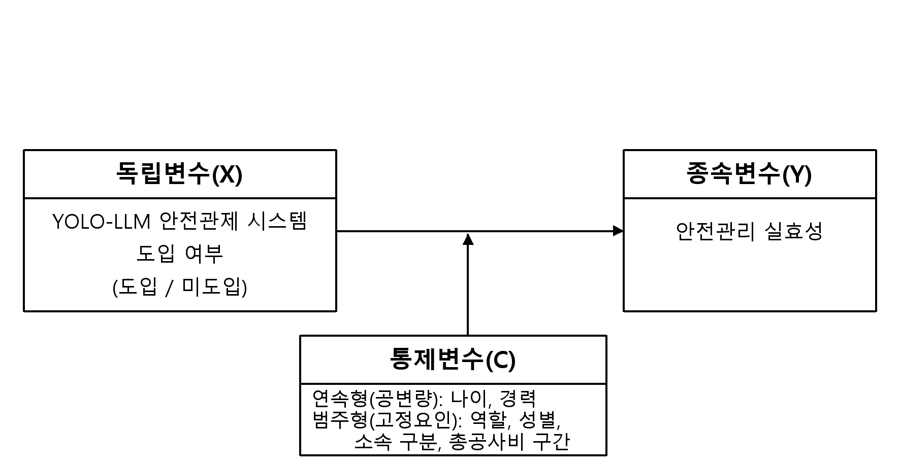
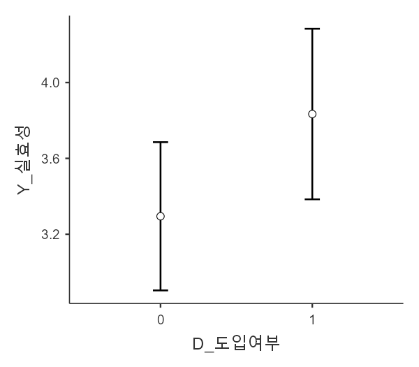

# 제4장 연구설계 및 실증분석

## 제1절 연구 모형 설계

본 장에서는 연구 모형·가설·측정도구·분석 절차를 설계하고 가설 검증 결과를 제시하였다. 설계의 목적은 도입·미도입 현장의 안전관리 실효성 차이를, 응답자·현장 특성이 서로 달라서 생기는 부분을 분석에서 감안한 뒤의 평균 차이(조정 평균 차이)로 추정하는 데 있다.

도입·미도입 현장의 비교는 시스템 설치 후 한 시점에 설문을 한 번 하고, 시스템을 운용하는 현장과 운용하지 않는 현장을 견주는 방식으로 하였다. 어느 현장에 시스템을 둘지 연구자가 무작위로 정하지는 않았으므로, 이 설계는 사후 설문 1회의 횡단적 준실험 설계에 해당한다. 도입 현장은 A공사 경기지역본부 산하 건설현장 가운데 시스템 설치와 응답일 현재 3개월 이상 정상 운용이 확인된 현장이고, 미도입 현장은 같은 관할에서 미설치·미운용이 확인된 현장이다. 독립변수는 현장 단위의 YOLO-LLM 안전관제 시스템 도입이며, 종속변수는 관리자가 지각한 현재 안전관리 업무의 실질적 수행 수준이다.

원인과 결과를 말하려면 세 가지 조건이 필요하다. 원인이 다르면 결과도 달라야 하고(공변성), 원인이 결과보다 먼저 있어야 하며(시간적 우선성), 다른 요인의 영향을 구분해 살펴야 한다(독립변수 통제). 본 연구에서 공변성은 응답자와 현장 특성의 차이를 분석에서 감안한 뒤 도입·미도입 현장별 평균을 비교하는 공분산분석(ANCOVA)으로 확인하였다. 시간적 우선성을 위해서는 시스템을 3개월 이상 운용한 뒤에 설문하여 시스템 운용이 설문 측정보다 앞서도록 하였다. 다만 도입 전에 점수를 재 두지 않았으므로, 두 집단의 차이가 도입 전부터 있었는지는 이 설계로 확인할 수 없다(제5장).

독립변수를 통제하기 위해 여섯 통제변수(C)를 분석에 넣어 그 차이를 감안하였고, 두 집단의 응답자·현장 구성이 얼마나 비슷한지를 분석 전에 먼저 확인하였다. 만 나이와 건설현장 경력은 연속형 통제변수(공변량)로, 소속 구분·성별·역할·총공사비 구간은 범주형 통제변수(고정요인)로 투입하였다.

이상의 설계를 토대로 연구변수를 구성하면 <표 4-1>과 같다.

<표 4-1> 연구변수의 구성

| 변수 구분 | 변수 및 하위요인 | 구성과 역할 |
|:---:|:---|:---|
| 독립변수(X) | YOLO-LLM 안전관제 시스템 도입 | 설치·3개월 이상 정상 운용 확인 도입=1, 미설치·미운용 확인 미도입=0 |
| 종속변수(Y) | 안전관리 실효성 | 관리자 개인이 지각한 현재 안전관리 업무 수준. 조기인지, 대응 신속성, 원격 파악, 순찰부담 경감, 위험 통제력의 5개 하위요인 |
| 통제변수(C) | 응답자·현장 특성 | 연속형 통제변수(공변량): 만 나이·건설현장 경력; 범주형 통제변수(고정요인): 소속 구분·성별·역할·총공사비 구간 |

연구 모형은 YOLO-LLM 안전관제시스템 도입 여부(X)에 따라 안전관리 실효성(Y)의 조정 평균, 즉 통제변수의 차이를 감안한 뒤의 평균이 다른지를 검토하도록 설정하였다.

<그림 4-1> 연구 모형

주 분석은 <그림 4-1>의 비교 모형으로 수행하며, 주 결론은 연구가설 (1-1)의 도입·미도입 현장 간 조정 평균 차이로 도출하였다. 모집 목표와 검정력은 제5절 제1항에서 다루었다.

## 제2절 연구 문제 및 연구가설

제1절의 연구 모형에 따라 연구 문제와 그에 대응하는 연구가설을 세웠다. 가설의 이론적 근거와 선행연구는 제2장 제4절에서 고찰하였다.

**연구 문제 1.** YOLO-LLM 안전관제 시스템 도입 현장과 미도입 현장의 관리자가 지각한 현재 안전관리 실효성은 여섯 통제변수(C)를 조정한 후에도 차이가 있는가.

**연구가설 (1-1).** YOLO-LLM 안전관제 시스템 도입 현장의 관리자가 지각한 안전관리 실효성은 여섯 통제변수(C)를 조정한 후에도 미도입 현장보다 높을 것이다.

연구가설 (1-1)은 안전관리 실효성 8문항 평균점수의 조정 평균 차이로 검정하였다. 조기인지·대응 신속성·원격 파악·순찰부담 경감·위험 통제력의 하위요인별 차이는 연구가설 (1-1)의 해석을 보완하는 분석으로 제시하였다.

이상의 연구가설을 종합하면 <표 4-2>와 같다.

<표 4-2> 연구가설 종합

| 가설 | 가설 내용 | 분석 관계 |
|:---:|:---|:---:|
| 연구가설 (1-1) | YOLO-LLM 안전관제 시스템 도입 현장의 관리자가 지각한 안전관리 실효성은 여섯 통제변수(C)를 조정한 후에도 미도입 현장보다 높을 것이다. | 현장 도입 여부 → Y |

## 제3절 변수의 조작적 정의 및 측정도구 구성

조작적 정의는 추상적인 개념을 관찰하고 측정할 수 있는 문항과 기준으로 바꾸는 절차이다. 본 연구의 변수는 제2장에서 고찰한 개념을 토대로 조작적으로 정의하였으며, 안전관리 실효성 하위요인의 정의는 제2장 제3절 제1∼5항을 따랐다. 아래에서는 독립변수, 종속변수, 참고 변수, 통제변수의 순서로 정의와 측정방법을 기술하였다.

독립변수인 YOLO-LLM 안전관제 시스템 도입(X)은 시스템 설치와 응답일 현재 3개월 이상 정상 운용이 확인된 현장을 1, 미설치·미운용이 확인된 현장을 0으로 구분하였으며, 응답자가 첫 질문에서 선택한 현장 구분을 사용하였다. 도입 요건을 응답일 현재 3개월 이상 정상 운용으로 둔 것은 B 문항 기준기간(응답일 직전 1개월) 전체가 안정된 운용 기간에 들게 하기 위해서다.

종속변수는 특정 시스템의 기능이나 만족도가 아니라 현장 일반의 업무 수준으로 정의하였다. 미도입 현장 관리자도 같은 기준으로 응답해야 도입·미도입 현장을 비교할 수 있기 때문이다. 도입·미도입 현장 관리자는 안전관리 실효성(Y) 문항에 설문 응답일 직전 1개월을 기준으로 응답하였다.

현장 운영 특성(A-7∼A-9)은 참고 변수로 두어 Y와 통제변수 어디에도 넣지 않았으며, 그 이유와 활용은 제5절 제2항에 기술하였다. A-7(담당자 부재 시 위험 인지 경로)과 A-8(순찰 간 위험 인지 시점)은 도입 현장에서는 시스템이 관리자의 위험 인지 경로가 되었는지를, 미도입 현장에서는 다른 알림 수단을 갖추었는지를 보는 운용 실태 확인 지표이다. A-9(인지 후 지시 전달 소요시간)는 위험을 안 뒤 지시 전달까지의 대응 과정을 보는 과정 지표이다.

통제변수 가운데 만 나이와 건설현장 경력은 구간으로 바꾸지 않고 연속값으로 투입하였다. 경력은 안전관리·공사감독·시공관리 등 건설현장 업무 경력을 합한 기간이다. 같은 기간에 여러 현장을 맡은 경력은 중복해서 더하지 않으며, A-4는 연 단위 정수(1년 미만은 0, 6개월 이상은 올림)로 수집하여 그대로 연속값으로 썼다. 소속 구분·성별·역할·총공사비 구간은 범주형 요인으로 지정하였다. 총공사비는 조사 대상으로 정한 현장 전체의 응답일 현재 최신 확정 금액(부가가치세와 관급자재비 포함)을 기준으로 나눈 조사용 네 구간이며, 법적 규모 분류가 아니다.

여섯 변수는 집단 간 응답자·현장 구성 차이를 조정하기 위해 선정하였다. 만 나이는 생애 단계와 기술 경험의 차이를, 건설현장 경력은 위험 상황에 대한 업무 경험의 차이를 고려한 변수이다. 건설안전 웨어러블 수용 연구에서도 연령과 업무 경력을 통제변수로 사용하였다(Chong et al., 2023, p. 7). 소속 구분은 발주·감독 측과 시공 측의 업무 관점 차이를, 역할은 위험 정보를 확인하고 지시·조치를 수행하는 책임 범위 차이를 고려하였다. 총공사비 구간은 현장 규모에 따른 관리 자원과 업무 범위의 차이를 고려한 변수이다. 성별은 응답자 구성 차이를 조정하기 위한 변수이다. 이 여섯 변수로 응답자·현장 구성을 조정하고, 현장 도입 여부에 따른 실효성 차이를 검정하였다.

소속과 역할의 구분은 본 연구의 발주·감독·시공 업무 구성을 반영한 연구자 선정이며, 해당 구분의 교란 효과를 검증한 직접 선행 근거는 확보하지 못했다[CITE_TODO: 소속·역할의 직접 선행 근거 보완]. 총공사비는 규모에 따른 자원 차이의 대리 지표로 선정하였다. 김용선(2022, pp.100–101)이 제시한 중·소규모 현장의 안전관리 구축비용과 감독인력 부족 문제를 참고하여 규모에 따른 자원 차이를 고려하였다. He et al.(2023, 제4.1–4.3절)은 중국 건설근로자 조사에서 성별에 따른 동료 안전인식 차이를 보고했지만 안전행동 차이는 유의하지 않았다. 이 결과는 응답자 구성을 검토하는 보조 근거로 활용하였다.

문항 전문은 부록(도입 현장용·미도입 현장용 설문지)에 수록하였다. 이상의 변수별 조작적 정의와 측정방법을 요약하면 <표 4-3>과 같다.

<표 4-3> 변수의 조작적 정의와 측정도구의 구성

<!-- hwpx-table-layout: {"caption":"<표 4-3>","merges":[[2,0,5,1],[7,0,2,1]]} -->

| 변수명 | 하위요인 | 조작적 정의 | 측정방법 |
|:---|:---|:---|:---|
| 독립변수: YOLO-LLM 안전관제 시스템 도입(X) | — | 시스템 설치와 응답일 현재 3개월 이상 정상 운용이 확인된 현장(도입=1)과 미설치·미운용이 확인된 현장(미도입=0)의 구분. 알림 경험은 별도 기록 | 본 연구에서 설치·운용 상태를 파악한 현장에 설문을 안내하고 응답자가 첫 질문에서 선택한 이분형 현장 구분 |
| 종속변수: 안전관리 실효성(Y) | 조기인지 | 현장 관리자가 자기 현장에서 위험 징후를 사고로 이어지기 전에 발견한다고 지각하는 수준 | 5점 리커트척도(B-1) |
| | 대응 신속성 | 위험 상황을 인지한 뒤 초동 대응을 빠르게 지시한다고 지각하는 수준 | 5점 리커트척도(B-2) |
| | 원격 파악 | 현장에 직접 가지 않고도 위험 상황을 파악하고 위험 정보와 조치 필요사항을 공유한다고 지각하는 수준 | 5점 리커트척도(B-3·B-4) |
| | 순찰부담 경감 | 제한된 인력으로 순찰·확인 업무를 효율적으로 수행하고 불필요한 확인보다 실제 위험 대응에 집중한다고 지각하는 수준 | 5점 리커트척도(B-5·B-6) |
| | 위험 통제력 | 시정·작업중지 등 통제 조치를 신속하게 시행하여 위험요인을 실질적으로 통제한다고 지각하는 수준 | 5점 리커트척도(B-7·B-8) |
| 통제변수(C): 응답자·현장 특성 | 연속형 통제변수(공변량) | 만 나이(세), 건설현장 경력(년) | 숫자 기입(A-3·A-4) |
| | 범주형 통제변수(고정요인) | 소속 구분, 성별, 역할, 총공사비 구간(4구간) | 명목척도(A-1·A-2·A-5·A-6) |

## 제4절 설문조사

### 제1항 설문조사의 개요 및 절차

본 설문조사는 도입 현장과 미도입 현장의 안전관리 실효성을 한 시점에 한 번, 같은 기준으로 재는 횡단 조사이다. 도입·미도입 현장 모두 B는 설문 응답일 직전 1개월의 현장 안전관리 실태·여건을 평가하도록 안내를 통일하였다. B의 안내에는 순찰과 순찰 사이나 안전관리 담당자가 현장에 없는 시간대에 생긴 위험 상황까지 평가에 넣도록 상황을 고정하는 문장을 두 양식에 똑같이 두었다. 한쪽 양식에만 시스템을 소개하면 응답을 유도할 수 있으므로 시스템 이름과 기능은 언급하지 않았다. A는 각 문항의 기준시점·기간을 따르고, C·D는 문항별 직접 경험을 기준으로 응답하였다.

측정도구는 표준화된 기존 척도를 그대로 쓰지 않고 본 연구에서 수정·개발한 척도로, 선행연구 고찰을 통한 초기 문항 구성과 국내 관계 법령·건설 실무 지표 대조의 두 단계로 개발하였다. 먼저 제2장의 이론적 배경과 제3절의 조작적 정의를 토대로 변수별 초기 문항 풀을 구성하였다. 이때 선행연구의 개념을 근거로 작성했던 구 설계 문항을 새 도입·미도입 현장 비교 맥락에 맞게 고치되 문항별 출처를 유지하였다. 안전관리 실효성 B-1∼B-8은 원래 시스템의 기능을 전제로 평가하던 8문항을, 시스템이 없는 현장의 관리자도 같은 기준으로 답할 수 있도록 '우리 현장에서는 …한다'처럼 현장의 안전관리 수준을 묻는 문항으로 고친 것이다. 현장 운영 특성 A-7∼A-9는 기존 문항을 옮기지 않고 지각이 아닌 사실을 묻는 문항으로 새로 작성하였다. 이어서 초기 문항을 산업안전보건법령의 산업안전보건관리비 기준과 스마트 안전장비 활용 가이드라인 등 국내 제도·실무 지표와 대조하여 현장 용어에 맞게 정비하였다(국토교통부·국토안전관리원, 2024). 문항별 출처는 <표 4-4>에 제시하였다.

개발한 문항은 지도교수와 건설안전 분야 박사 1인의 전문가 검토를 거쳐 표현과 현장 적합성을 점검한 뒤 2026-10-11 배포본으로 확정하였다. Y 채점 규칙과 결측·설계상 비해당·불성실 응답 기준은 제5절 제2항에 정한 규칙을 적용하였다.

### 제2항 설문지의 구성

본 설문지는 공통부와 도입 현장 전용부로 구성하였다. 공통부는 인구통계학적 특성과 현장 운영 특성을 묻는 A 9문항과 안전관리 실효성을 묻는 B 8문항이며, 도입 현장 전용부는 시스템 특성 인식을 묻는 C 8문항과 경보 피로도 완화 인식을 묻는 D 4문항이다. 미도입 현장 관리자는 공통부 17문항에, 도입 현장 관리자는 공통부와 전용부를 합한 29문항에 응답하였으며, 문항 전문은 부록에 수록하였다. 리커트 문항은 모두 1점 ‘전혀 그렇지 않다’부터 5점 ‘매우 그렇다’까지의 5점 척도로 측정하였다.

17·29문항은 측정 문항 수이며, 조사 관리용 현장 구분·현장명·성명 3개 입력 항목은 제외하였다. 현장 구분 선택은 전자 설문의 문항 이동과 분석용 현장 도입 여부에, 현장명·성명은 중복 제출 확인에 사용하였고, 세 항목 모두 점수나 통제변수로 투입하지 않았다. A-7∼A-9는 리커트 척도가 아닌 보기 선택형 사실 문항으로 주 분석에 투입하지 않았다. 전용부 C·D는 시스템 개발의 효과와 관련된 문항이므로 그 결과는 제3장 제4절 제5항에서 서술하였다. 설문지의 구성을 요약하면 <표 4-4>와 같다.

<표 4-4> 설문지의 최종 구성

<!-- hwpx-table-layout: {"caption":"<표 4-4>","merges":[[3,0,1,3],[4,0,2,1],[4,6,2,1],[6,0,1,3]],"aliases":[[1,0,"공통부 A"],[2,0,"공통부 B"],[3,0,"공통부 소계"],[4,0,"전용부 C"],[5,0,"전용부 D"],[6,0,"전용부 소계"],[7,0,"현행안 합계"]]} -->

| 구분 | 변수명 | 내용 | 응답 대상 | 문항수 | 문항번호 | 출처 |
|:---:|:---|:---|:---:|:---:|:---:|:---|
| 통제변수(C) | 인구통계학적 특성 및 현장 운영 특성 | 소속·성별·만 나이(세)·건설현장 경력(년)·역할·총공사비 구간, 위험 인지 경로·시점·지시 전달 소요시간(참고 변수) | 전체 | 9 | A-1∼A-9 | 연구자 작성(사실 문항). A-7∼A-9는 <표 2-2> 전달 기능과 제3장 제1절 제2항 적시성 요구사항(R5)의 상황을 바탕으로 하고 원격 파악·순찰 보완 연구인 김용선(2022); 이창남(2025) 참고 |
| 종속변수(Y) | 안전관리 실효성 | 조기인지·대응 신속성·원격 파악·순찰부담 경감·위험 통제력 | 전체 | 8 | B-1∼B-8 | 김민기·박성호(2026); 김용선(2022); 김태헌(2026); 김현수(2026); 이동건(2024); 이창남(2025); 황병복(2026); Chong et al.(2023); Cvach(2012); Wu et al.(2025) |
| 소계 | | | 전체 | 17 | | |
| 시스템특성 | 시스템 특성 인식 | 범용성·안정성·오탐 필터링·알림 전파 | 도입 현장 | 8 | C-1∼C-8 | 제3장 제4절 제5항(<표 3-10>) 참조 |
| | 경보 피로도 완화 인식 | 스트레스·둔감화·확인 부담 완화 | 도입 현장 | 4 | D-1∼D-4 | |
| 소계 | | | 도입 현장 | 12 | | |
| 합계 | 미도입 현장 17문항, 도입 현장 29문항 | | | 17 또는 29 | | |

## 제5절 자료 수집과 분석 절차

### 제1항 자료 수집 및 표본

조사대상은 A공사 경기지역본부 산하 건설현장에서 안전관리 업무를 맡은 현장 관리자이다. 응답자는 도입·미도입 현장 모두 시공사 측 현장소장(관리감독자)·안전관리자와 발주청 측 공사감독·감리원 가운데 담당 현장의 안전관리 업무를 맡은 관리자로 정하였다. 현장당 1명을 모집하되, 같은 사람이 두 번 응답하지 않도록 담당 현장 하나를 미리 지정하였다. 조사 범위에는 총공사비 120억 원 이상 현장도 포함하였으며 공사비 상한은 두지 않았다.

모집 목표는 도입 현장 30개소 이상과 미도입 현장 30개소 이상, 총 60개소 이상이며 현장당 1명씩 총 60명 이상이다. 현장은 같은 관할 범위에서 공사금액 규모와 주요 특성이 비슷한 곳을 먼저 확보하되, 무작위 배정을 전제하지는 않았다. 실제 조사에서는 설치·운용 상태를 파악하고 있던 현장 가운데 요건을 충족한 도입 현장 34개소와 미도입 현장 39개소에 현장당 1명씩 설문을 안내하였다. 사전 검정력 산정은 하지 않았다.

도입 현장의 후보 명부는 경기지역본부 안전관제 시스템의 카메라 등록 백업 자료와 식별값 없는 1대의 별도 현장 확인으로 파악한 등록 90개소·108대이며, 모집 목표나 분석 표본이 아닌 조사 후보의 범위다. 본 연구는 이 가운데 설치·운용 상태를 확인하여 응답일 현재 3개월 이상 정상 운용 요건을 충족한 현장을 도입 표본으로 정하였다. 정상 운용 기간은 시스템 설치일부터 셌으며, 3개월 미만이거나 중단·장애가 있는 현장은 도입 표본에 넣지 않되 미도입으로 재분류하지도 않았다.

정상 운용 판정에서 운용 중 1차 검출 가중치를 갱신한 것은 검출 대상 범주가 같은 가중치 교체이므로 운용 중단으로 보지 않았다. 정상 운용 중 알림이 없었던 현장도 도입(1)으로 코딩하였고, 카메라별 원격 알림 허용 설정은 정상 운용의 증거로 쓰지 않았다. 실제 알림 수신과 응답자의 확인 경험은 현장 운영 특성 문항(A-7·A-8)으로 확인하였으며, 현장 단위 알림 기록과는 연결하지 않았다.

3개월 요건은 조사 당시 정한 실무적 표본 선정 조건이다. 설치 후 2개월 안에 카메라 등록·임계값 조정·알림 수신자 설정과 초기 적응이 이루어진다고 가정하고, 이후 1개월을 응답 기준기간으로 확보하고자 하였다. 표본 선정에는 경과 기간과 함께 정상 운용 여부를 확인하였다.

비교 조건 가운데 다른 스마트 안전장비는 조사 대상 전 현장에 없음을 본 연구에서 확인하였고, 기존 CCTV 보유 여부·원격 열람·공종·안전관리 담당 인력은 현장 단위로 수집하지 않았다. 도입 현장의 운용 설정은 전 현장에 똑같이 적용하였으며 제3장에 기술한 구성을 따랐다. 

자료는 2026년 10월 12일부터 10월 23일까지 자기응답 설문으로 수집하였다. 응답자가 첫 질문에서 도입 현장 또는 미도입 현장을 고르면 각각 A∼D 29문항 또는 A∼B 17문항으로 넘어갔다. 응답자 이메일은 수집하지 않았으며, 중복 제출은 응답 내용의 동일성과 제출시각으로 점검하였다. 분석은 응답마다 내부 식별번호를 붙이고 성명과 현장명을 지운 통계분석용 사본으로 하였으며, 결측·이상값을 검토하였다. 성명과 현장명이 포함된 원응답·CSV 원자료와 코드·성명·현장명 대응표·현장 명부는 외부에 공개하지 않고 통계분석용 사본과 분리 보관하였다. 현장별 설치일·운용 기간, 정상 가동 세부 판정 기준과 미충족 현장 수, 추출 순서·규모 매칭 기준, 등록 현장과 분석 현장의 대응 기준, 자료 보관 기간과 연구윤리 심의 대상 여부 확인 결과는 따로 기록하지 않았다.

비교 대상 시스템을 개발하고 현장 관리에도 관여한 연구자와의 관계를 응답자가 의식하여 응답할 수 있다. 이를 줄이려고 안내문에 연구자의 역할, 자발적 참여와 중단 가능성, 개별 응답의 비공개를 밝혔다. 식별 원자료는 연구자가 열람·관리하고, 분석에는 성명과 현장명을 제거한 사본을 사용하였다.

이상의 자료 수집 절차를 요약하면 <표 4-5>와 같다.

<표 4-5> 자료 수집 개요

| 구분 | 내용 |
|:---:|:---|
| 조사대상 | A공사 경기지역본부 산하 조사대상 건설현장의 현장 관리자·안전관리자, 총공사비 120억 원 이상도 포함 |
| 비교 현장 | 모집 목표는 설치·3개월 이상 정상 운용 확인 도입 30현장과 미설치·미운용 확인 미도입 30현장(총 60현장), 실제 응답은 도입 34현장·미도입 39현장(총 73현장) |
| 정상 운용 확인 | 카메라 등록 백업 자료와 식별값 없는 1대의 별도 현장 확인으로 파악한 등록 90개소·108대(1대 77개소, 2대 8개소, 3대 5개소) 가운데 본 연구에서 설치·3개월 이상 정상 운용 요건 충족을 확인, 현장별 설치일·운용 기간은 별도 기록 없음 |
| 응답자 기준 | 도입·미도입 현장 동일 직무 범위의 안전관리 업무 담당자, 현장당 1명·담당 현장 사전 지정으로 개인 중복 응답 방지, 알림 경험은 A-7·A-8 응답으로 확인 |
| 조사 설계 | 사후 설문 1회의 횡단적 도입·미도입 현장 비교 준실험 설계 |
| 조사 시기·기준기간 | 2026년 10월 12일∼10월 23일 실시, 공통 B는 도입·미도입 현장 모두 설문 응답일 직전 1개월, 도입 현장은 응답일 현재 3개월 이상 정상 운용 확인 |
| 목표 표본·분석 단위 | 현장당 1명, 도입·미도입 현장별 응답 30건 이상, 총 60부 이상(사전 검정력 산정 없음). 실제 응답 73명(도입 34·미도입 39) 전원 분석. 분석 단위는 개인 응답자이며 한 현장 한 명의 자료로 도입·미도입 현장 비교 ANCOVA; 현장 ID는 중복 확인용 |

### 제2항 분석 절차

분석은 jamovi 2.7.41(The jamovi project, 2025)로 수행하였다. 분석에 앞서 자료를 정제하고 다음 규칙으로 채점하였다. 안전관리 실효성 점수(Y)는 8문항 점수를 같은 비중으로 평균한 값이다. 하위요인별 문항 수가 1·1·2·2·2개이므로 2문항 하위요인은 1문항 하위요인보다 전체 점수에서 두 배의 비중을 갖는다(12.5%·12.5%·25%·25%·25%). 따라서 이 평균점수는 통계적으로 하나의 개념(단일 잠재요인)임이 검증된 점수가 아니라, 다섯 하위요인을 합쳐 놓은 종합 점수(합성점수)이다. Y는 해당 척도의 전 문항에 응답한 경우에만 평균을 내며, 일부 문항에 답하지 않은 경우를 임의의 평균이나 0점으로 채우지 않았다. 분석마다 필요한 문항에 모두 답한 응답(완전사례)만 사용하되, 모든 문항에 같은 번호를 고른 응답(일렬응답)이라는 이유만으로 사례를 제외하지 않았다. 채점안은 연구가설 (1-1) 결과를 보기 전에 고정하였으며, 분석 절차는 다음과 같다.

첫째, 빈도분석으로 응답자와 현장의 인구통계학적 특성을 확인하였다. 도입·미도입 현장의 사전 특성은 연속형 변수는 독립표본 t검정과 Cohen's d로, 범주형 변수는 Fisher 정확검정과 Cramér's V로 비교하였고, 현장 운영 특성(A-7∼A-9)도 Fisher 정확검정으로 비교하였다.

둘째, 측정도구의 타당도는 반복 주축요인추출(PAF)에 의한 탐색적 요인분석으로 확인하였으며, 요인 수는 고유값 1 이상 기준과 스크리 도표로 정하였다.

셋째, 신뢰도는 Cronbach's α로 확인하였다. 단일 문항 영역에는 α를 산출하지 않았고, 2문항 영역은 문항 간 상관으로 보고하였다.

넷째, 기술통계 분석으로 주요 변수의 평균·표준편차·왜도·첨도를 산출하였다.

다섯째, Pearson 상관분석으로 주요 변수 간 관계를 확인하였다.

여섯째, 가설 검정에는 공분산분석을 사용하였다. 쉽게 말해, 두 집단 응답자의 나이·경력·소속·성별·역할·총공사비 구간이 같다고 가정했을 때의 평균 점수를 구해 도입·미도입 현장을 비교하는 방법이다. 분석의 세부 설정은 다음과 같다. 공분산분석의 가정은 선형성, 회귀기울기 동질성(나이·경력이 점수에 미치는 영향이 두 집단에서 같은지), 잔차의 정규성·등분산성, 영향점(결과에 유난히 크게 영향을 주는 응답, Cook's D 4/n 기준), 관측의 독립성을 점검하였으며, 영향점은 삭제하지 않고 보고하였다. 연구가설 (1-1)은 현장 도입 여부(도입=1, 미도입=0)에 만 나이·건설현장 경력을 공변량으로, 소속·성별·역할·총공사비 구간을 고정요인으로 함께 투입한 공분산분석으로 검정하였다. 범주형 통제변수는 기준범주 대비(Treatment) 더미변수로 표현하였고, 기준범주는 시공사·남성·공사감독·20억 원 미만이다. 총공사비 구간 코드는 등간 연속값이나 실제 공사비로 다루지 않았다. 통제변수는 이론적 근거로 미리 정하고 유의확률에 따라 넣거나 빼지 않았다. 현장 도입 여부의 F·p·부분 η²는 Type III 제곱합으로 산출하였다. 조정 평균은 범주형 통제변수의 각 범주에 같은 비중을 둔 추정 주변 평균으로 산출하였다. 도입−미도입 조정 차이는 비표준화 계수 B로 나타냈으며, 이 값은 1∼5점 척도에서 몇 점 차이인지를 그대로 뜻한다. B의 신뢰구간과 회귀 진단은 같은 모형의 Linear Regression 출력으로 확인하였다.

도입−미도입 차이가 양수이고 양측 p<.05이면 연구가설 (1-1)을 지지하는 것으로 판단하였다. Cohen's d와 부분 η²는 차이의 크기를 보여 주는 참고값으로만 제시하고, 크기의 등급을 매기는 기준은 적용하지 않았으며 가설 판정의 근거로 쓰지 않았다. 다섯 하위요인에는 같은 모형을 적용하고 Holm 보정을 하였으며, 시스템 알림이 실제로 관리자의 위험 인지 수단이 된 도입 현장만으로 다시 추정하는 추가 분석(민감도 분석)을 미리 정해 두었다. 결과를 해석할 때는 '지시 전달 소요시간(A-9)에 집단 차이가 있는가'(Fisher 정확검정 p<.05)와 '연구가설 (1-1)의 실효성에 차이가 있는가'를 나란히 놓고, 실효성 점수의 차이를 다른 이유로도 설명할 수 있는지 따져 보는 순서를 미리 정하였다. 이 비교는 가설이 지지되었는지 여부를 바꾸지 않는다.

운용 실태 확인은 결과를 보기 전에 정한 다음 규칙을 따랐다. 본 시스템은 PC용 데스크톱 뷰어와 모바일 메신저 알림으로 위험 정보를 전달하므로, 도입 현장 응답자가 A-7에서 ③ 또는 ④(CCTV 화면 직접 확인 또는 자동 알림)를 고르고 A-8에서 ③(발생 직후 알림)을 골랐으면 시스템 알림이 실제로 그 관리자의 위험 인지 수단이 된 것(시스템 경로 작동)으로 보았다. A-7이 ①·②이거나 A-8이 ③이 아니면 시스템이 그 관리자의 위험 인지 경로가 되지 못한 현장으로 기록하였다. A-7에서 ⑤(기타)를 고른 응답은 자동 알림을 명시하지 않았으므로 시스템 경로가 작동하지 않은 것으로 분류하였다. 이 기록은 정상 운용 확인 결과와 함께 읽으며, 해당 현장을 미도입으로 재분류하지 않았다.

현장 운영 특성(A-7∼A-9)을 통제변수로 투입하지 않은 이유는 다음과 같다. 위험을 어떤 경로로 언제 알게 되고 지시가 얼마나 빨리 전달되는지는, 시스템 도입이 안전관리 실효성과 관련되는 바로 그 통로(기제)일 수 있다. 이를 통제변수로 넣으면 알아보려는 도입·미도입 현장 간 차이의 일부까지 지워 버리는 과잉통제가 된다. 대신 이 문항은 리커트 점수만으로는 가려내기 어려운 응답의 치우침을 점검하는 데 썼다. Podsakoff et al.(2003, pp. 887–888)은 한 사람에게 모든 것을 물을 때 생기는 응답의 치우침을 줄이려면 질문 형식 등을 달리하라고 권하였다. 이를 참고하여 사실을 보기 선택으로 묻는 A-7∼A-9를 리커트 지각 척도와 구분하였다. 다만 두 문항군은 같은 응답자가 같은 시점에 스스로 답한 자료이므로, 질문 형식을 달리하였다고 해서 한 사람의 답에서 생기는 치우침(공통방법편향)이 모두 사라졌다고 볼 수는 없다.

A-7·A-8이 보는 자동 알림과 발생 직후 알림은 시스템 기능 그 자체이므로 두 문항의 도입·미도입 현장 간 차이는 설계상 거의 정해져 있다. 그래서 두 문항은 안전관리 실효성의 근거로도, 연구가설 (1-1) 결과와 나란히 놓고 보는 비교에도 쓰지 않았다. 이 비교에는 위험을 안 뒤의 대응 과정을 나타내는 과정 지표 A-9만 사용하였다.

## 제6절 조사 대상 특성과 기초통계 분석

본 절부터는 제1∼5절에서 정한 설계, 즉 시스템 설치 후 한 시점에 한 번 조사하여 도입·미도입 현장을 비교하는 설계에 따라 결과를 제시하였다. 연구가설 (1-1)은 미리 정한 여섯 통제변수(C)의 차이를 분석에서 감안한 뒤, 관리자 개인이 지각한 안전관리 실효성이 도입·미도입 현장 사이에 다른지로 검정하였다. 현장 도입 여부와 기준기간, 여섯 통제변수(C)의 투입 방식은 제5절 제2항의 규칙을 따르며, 현장당 1명의 응답을 공분산분석(ANCOVA)으로 분석하였다.

실제 유효 표본은 73명(도입 34명·미도입 39명)으로 모집 목표인 집단별 30개소 이상을 충족하였다.

---

### 제1항 인구통계학적 빈도분석

인구통계학적 빈도분석은 응답자와 현장의 구성을 파악하고, 공분산분석에 통제변수로 투입할 소속·성별·역할·총공사비 구간의 분포를 확인하기 위해 실시하였다. 범주형 통제변수의 어느 범주에 한 집단의 응답자가 거의 없으면(예컨대 한 집단에 여성 응답자가 없으면), 그 범주를 두 집단 사이에 비교하는 부분은 실제 자료가 아니라 통계 모형의 가정에 기대게 된다. 응답 범위는 발주청의 공사감독·감리원과 시공사의 현장소장(관리감독자)·안전관리자 가운데 담당 현장의 안전관리 업무를 맡은 관리자로 한정하였다(제5절 제1항). 종속변수인 안전관리 실효성은 위험 징후의 발견, 초동 대응 지시, 순찰·확인, 시정·작업중지 같은 현장 안전관리 업무에 대한 지각이므로, 이 업무를 직접 맡은 관리자만 같은 기준으로 응답할 수 있다고 보았다. 도입·미도입 현장 모두 같은 직무 범위를 적용하여 응답자 직무 구성의 차이가 집단 비교에 섞이는 것도 줄이고자 하였다.

자료 정제와 채점, 불성실 응답 판정은 제5절 제2항의 규칙을 따랐다. 부분 무응답은 대체하지 않고 분석별 완전사례를 사용하는 규칙이었으나, 유효 표본 73명의 문항 결측은 0건이었다. B 전 문항, 도입 현장의 C·D 전 문항과 여섯 통제변수(C)에 결측이 없으므로 Y는 73명 전원에게서 산출하였고, 연구가설 (1-1)의 완전사례도 73명이며 결측 민감도 분석은 하지 않았다. 리커트 전 문항에 같은 값을 적은 일렬응답은 자동 제외하지 않는다는 규칙에 따라 포함하였다. 현장당 1명이므로 개인 수와 현장 수는 같다.

알림 수신·확인 경험과 중단·장애 이력은 별도로 기록하지 않았다. 역할은 ‘기타’ 응답을 응답자에게 재확인하여 세 범주로 재분류하였고, 비율의 분모는 도입 34명·미도입 39명이다. 범주별 분포의 도입·미도입 현장 간 차이는 Fisher 정확검정으로 확인하고, 그 크기는 Cramér's V로 나타냈다. Cramér's V는 현장 도입 여부와 범주형 변수의 교차표에서 두 변수가 관련된 정도, 즉 두 집단의 구성이 얼마나 다른지를 0(같음)에서 1(완전히 다름) 사이의 값으로 나타내는 효과크기이며 부호가 없다. 이 값은 집단 간 응답자·현장 구성의 분포 차이를 기술하는 진단값으로 제시하였다.

소속은 도입 현장에서 시공사와 발주청이 각각 50.0%였고, 미도입 현장에서는 시공사가 69.2%였다(V=0.196, Fisher p=.150). 성별은 도입 현장 응답자가 전원 남성이었고 여성 6명은 모두 미도입 현장 응답자여서, 네 범주형 특성 가운데 유일하게 유의한 분포 차이를 보였다(V=0.279, p=.027). 역할 분포의 차이는 작았다(V=0.120, p=.631). 총공사비 구간은 도입 현장에서 50억 원 이상∼120억 원 미만이 47.1%로 가장 많았고, 미도입 현장에서는 120억 원 이상이 41.0%로 가장 많았다(V=0.254, p=.201). 도입 현장의 여성 응답자가 0명이고 총공사비 20억 원 미만 응답자가 3명뿐이므로, 이 희소범주가 관련된 비교는 제7절의 결과 해석에서 주의하였다. 조사 대상의 인구통계학적 특성은 <표 4-6>과 같다.

<표 4-6> 조사 대상의 인구통계학적 특성(도입·미도입 현장별)

<!-- hwpx-table-layout: {"caption":"<표 4-6>","merges":[[1,0,2,1],[3,0,2,1],[5,0,3,1],[8,0,4,1],[12,0,1,2]]} -->

| 구분 | 항목 | 도입 n(%) | 미도입 n(%) | 전체 n(%) |
|:---:|:---|---:|---:|---:|
| 소속 구분 | 시공사 | 17 (50.0) | 27 (69.2) | 44 (60.3) |
|  | 발주청(공사감독·감리원 포함) | 17 (50.0) | 12 (30.8) | 29 (39.7) |
| 성별 | 남성 | 34 (100.0) | 33 (84.6) | 67 (91.8) |
|  | 여성 | 0 (0.0) | 6 (15.4) | 6 (8.2) |
| 역할 | 공사감독 | 16 (47.1) | 15 (38.5) | 31 (42.5) |
|  | 안전관리자 | 7 (20.6) | 12 (30.8) | 19 (26.0) |
|  | 현장소장(관리감독자) | 11 (32.4) | 12 (30.8) | 23 (31.5) |
| 총공사비 구간 | 20억 원 미만 | 3 (8.8) | 5 (12.8) | 8 (11.0) |
|  | 20억 원 이상∼50억 원 미만 | 6 (17.6) | 9 (23.1) | 15 (20.5) |
|  | 50억 원 이상∼120억 원 미만 | 16 (47.1) | 9 (23.1) | 25 (34.2) |
|  | 120억 원 이상 | 9 (26.5) | 16 (41.0) | 25 (34.2) |
| 합계 |  | 34 (100.0) | 39 (100.0) | 73 (100.0) |

만 나이와 건설현장 경력은 제7절의 공분산분석에 공변량으로 투입하는 변수이므로, 조정에 앞서 두 집단에서 이 변수의 분포가 얼마나 다른지 확인할 필요가 있었다. 본 연구는 현장을 무작위로 배정하지 않은 횡단 비교이므로 도입 현장과 미도입 현장의 관리자 연령·경력 구성이 체계적으로 다를 수 있다. 공분산분석은 두 집단의 나이·경력을 같은 값에 맞춘 조정 평균으로 비교하는 방법인데, 두 집단의 나이·경력 평균이 크게 다르거나 분포 범위가 겹치지 않으면 조정 평균이 실제 자료가 없는 구간을 통계적으로 추정한 값(외삽)이 되어 모형 가정에 더 의존하게 된다. 따라서 이 비교는 가설 검정이 아니라 공분산분석의 조정이 자료의 범위 안에서 이루어지는지를 보는 사전 진단이다.

두 변수는 구간으로 나누지 않고 연속값 그대로 사용하였으므로 빈도 대신 평균과 표준편차를 제시하였다. 두 변수 모두 구간 코드나 구간 중간값으로 대체하지 않았으며 결측은 0건이다.

집단 차이는 도입·미도입 현장 응답자의 평균을 독립표본 t검정으로 비교하고 그 크기를 Cohen's d로 나타냈다. 독립표본 t검정은 서로 다른 두 집단의 평균이 같은지를 검정하는 방법이고, Cohen's d는 두 평균의 차이가 점수의 흩어진 정도(합동 표준편차)에 비해 얼마나 큰지를 나타내는 효과크기로 절댓값을 보고하였다. 판단은 유의확률만으로 하지 않고 d의 크기와 두 집단 관측범위의 겹침을 함께 보았다. 표본이 작으면 실제 차이가 있어도 비유의로 나올 수 있으므로, 비유의한 결과를 두 집단이 동질하다는 증거로 쓰지 않았다. t값의 부호는 도입−미도입 기준이다.

만 나이의 평균은 도입 현장 46.4세, 미도입 현장 46.9세이며, 차이는 −0.5세로 유의하지 않았고 효과크기도 0에 가까웠다(t(71)=−0.20, p=.842, d=0.047). 건설현장 경력은 도입 현장 14.2년, 미도입 현장 17.5년으로 미도입 현장이 3.3년 길었고, 유의하지 않았으나 효과크기는 만 나이보다 컸다(t(71)=−1.21, p=.229, d=0.285). 전체 평균은 만 나이 46.6세, 경력 16.0년이다. 두 집단 관측범위의 교집합인 공통 관측범위는 만 나이 30∼66세, 경력 1∼37년이고 범위 밖 응답자는 미도입 현장의 나이 4명과 경력 1명뿐이므로, 공분산분석의 조정은 대부분 자료가 있는 구간 안에서 이루어진다. 나이·경력은 이 비교 결과와 관계없이 제5절 제2항에서 미리 정한 대로 공변량으로 투입하였다. 만 나이와 건설현장 경력의 기술통계와 집단 비교 결과는 <표 4-7>과 같다.

<표 4-7> 만 나이와 건설현장 경력의 기술통계 및 집단 비교

<!-- hwpx-table-layout: {"caption":"<표 4-7>","merges":[[1,0,2,1],[1,5,2,1],[1,6,2,1],[3,0,2,1],[3,5,2,1],[3,6,2,1]]} -->

| 변수 | 현장 도입 여부 | N | Mean | SD | t(71) | p |
|:---|:---:|---:|---:|---:|---:|---:|
| 만 나이(세) | 도입 | 34 | 46.4 | 11.1 | −0.20 | .842 |
|  | 미도입 | 39 | 46.9 | 12.0 |  |  |
| 건설현장 경력(년) | 도입 | 34 | 14.2 | 10.8 | −1.21 | .229 |
|  | 미도입 | 39 | 17.5 | 12.4 |  |  |

현장 운영 특성(A-7∼A-9)의 분포는 제3장 제4절 제6항의 <표 3-12>에 제시하였다.

### 제2항 타당도 분석

타당도 분석은 측정도구가 재려는 개념을 제대로 재는지 확인하는 절차이다. 본 연구의 안전관리 실효성 척도는 표준화된 기존 척도가 아니라 본 연구에서 수정·개발한 척도이므로(제4절 제1항), B 8문항이 하나의 구성개념으로 묶이는지 확인할 필요가 있었다. 측정도구는 전문가 검토로 내용의 적합성을 점검하였으며(제4절 제1항), 본 항에서는 탐색적 요인분석으로 요인 구조를 확인하였다. Y는 B 8문항의 동일 가중 평균인 합성점수이므로(제5절 제2항), 이 점수가 단일차원인지, 타당한지, 도입·미도입 현장 간 비교가 가능한지는 α만으로 판단하지 않았다.

요인분석은 유효 73명 전체를 대상으로 하였다. 요인 추출에는 주축요인추출(PAF)을 적용하고, 요인 수는 고유값 1 이상 기준과 스크리 도표로 정하였다(Costello & Osborne, 2005). 표본이 요인분석에 적합한지는 KMO(Kaiser–Meyer–Olkin) 표본 적절성 측도로, 문항 간 상관행렬이 요인을 추출할 만한 구조인지는 Bartlett 구형성 검정으로 확인하였다. 도입 현장 전용부 C·D는 제3장 제4절 제5항에 기술통계로만 보고하였으므로 요인분석 대상에서 제외하였다.

KMO 값은 0.911로 요인분석에 적합한 수준이었고, Bartlett 구형성 검정도 유의하였다(χ²(28)=456, p<.001). 고유값이 1을 넘은 요인은 첫 요인(5.33) 하나뿐이어서 1요인이 추출되었고, 회전은 적용되지 않았다. 즉 8문항은 하나의 묶음으로 모였다. 이 요인의 설명분산, 즉 문항 응답이 사람마다 다른 정도 가운데 이 요인으로 설명되는 비율은 66.6%였다. 여덟 문항의 요인적재값, 즉 각 문항이 이 요인과 관련된 정도는 0.727∼0.888이어서 제거한 문항은 없었다. 다만 1요인 추출이 8문항이 한 가지 개념만 잰다는 것(단일차원성)을 보장하는 충분조건은 아니다. 문항별 요인적재값은 <표 4-8>과 같다.

<표 4-8> 안전관리 실효성 문항의 탐색적 요인분석 결과

<!-- hwpx-table-layout: {"caption":"<표 4-8>","merges":[[3,1,2,1],[5,1,2,1],[7,1,2,1],[9,0,1,4]]} -->

| 문항 | 하위요인 | 요인적재값 | 고유분산 |
|:---:|:---|---:|---:|
| B-1 | 조기인지 | 0.793 | 0.371 |
| B-2 | 대응 신속성 | 0.773 | 0.402 |
| B-3 | 원격 파악 | 0.807 | 0.348 |
| B-4 |  | 0.842 | 0.291 |
| B-5 | 순찰부담 경감 | 0.727 | 0.471 |
| B-6 |  | 0.810 | 0.344 |
| B-7 | 위험 통제력 | 0.888 | 0.212 |
| B-8 |  | 0.875 | 0.234 |
| 고유값(SS Loadings) 5.33, 설명분산 66.6%, KMO = 0.911, Bartlett χ²(28) = 456 (p < .001) |  |  |  |

### 제3항 신뢰도 분석

신뢰도 분석은 같은 개념을 재는 문항들이 얼마나 일관된 응답을 내는지 확인하는 절차이다. 본 연구에서는 Cronbach's α로 문항 간 내적 일관성을 확인하였으며, α 0.70 이상을 내적 일관성의 수용 기준으로 적용하였다(Tavakol & Dennick, 2011, p. 54). 다만 이 기준의 충족만으로 척도의 타당성이나 단일차원성을 확정하지 않았다. 단일 문항 영역인 조기인지와 대응 신속성에는 α를 산출하지 않았고, 2문항 영역인 원격 파악·순찰부담 경감·위험 통제력은 α 대신 문항 간 Pearson 상관계수(r)로 보고하였다. α와 문항 간 상관은 전체와 도입·미도입 현장별로 각각 산출하였다.

안전관리 실효성 8문항의 α는 전체 0.937, 도입 현장 0.906, 미도입 현장 0.937이었다. 문항 제거 시 α는 0.924∼0.934로 전체 α를 넘는 문항이 없었고, 수정 문항–총점 상관은 0.707(B-5)∼0.857(B-7)이었다. 2문항 영역의 문항 간 상관은 원격 파악 0.721, 순찰부담 경감 0.631, 위험 통제력 0.741로 모두 유의하였다(p<.001). 현장별 문항 간 상관은 도입 현장에서 원격 파악 0.501(p=.003), 순찰부담 경감 0.507(p=.002), 위험 통제력 0.709(p<.001)였고, 미도입 현장에서는 같은 순서로 0.783·0.647·0.704(모두 p<.001)였다. 모두 유의하였으나, 원격 파악과 순찰부담 경감은 도입 현장에서 낮았다. 도입 현장에서는 이 두 영역의 두 문항이 서로 다른 측면을 짚었을 가능성이 있으며, 이 점은 제8절의 하위요인 해석에서 함께 고려하였다. 높은 α가 단일차원성을 뜻하지는 않는다. 신뢰도 분석 결과는 <표 4-9>와 같다.

<표 4-9> 측정도구의 신뢰도 분석 결과

| 측정변수 | 문항 번호 | 문항 수 | Cronbach's α | 문항 간 r |
|:---|:---:|---:|---:|---:|
| 안전관리 실효성(전체) | B-1∼B-8 | 8 | 0.937 | — |
| 조기인지 | B-1 | 1 | — | — |
| 대응 신속성 | B-2 | 1 | — | — |
| 원격 파악 | B-3·B-4 | 2 | — | 0.721 |
| 순찰부담 경감 | B-5·B-6 | 2 | — | 0.631 |
| 위험 통제력 | B-7·B-8 | 2 | — | 0.741 |

### 제4항 기술통계 분석

기술통계 분석은 타당도와 신뢰도를 확인한 문항으로 산출한 점수의 분포를 집단별로 확인하기 위해 실시하였다. 안전관리 실효성은 8문항 평균으로, 하위요인은 해당 영역 전 문항 응답의 평균으로 산출하였으며 채점 규칙은 제5절 제2항을 따랐다. 결측이 없으므로 각 변수의 n은 제7절의 가설 검정 표본과 같다. 분포는 평균·표준편차와 함께 왜도·첨도로 확인하였다. 왜도는 분포가 좌우로 치우친 정도를, 첨도는 분포의 봉우리와 꼬리가 정규분포와 다른 정도를 나타낸다.

안전관리 실효성의 원평균은 도입 현장 4.11점, 미도입 현장 3.48점이었다. 다섯 하위요인 모두 도입 현장의 원평균이 높았으며, 그 차이는 원격 파악에서 가장 컸고(0.80점) 대응 신속성에서 가장 작았다(0.37점). 표준편차는 모든 변수에서 미도입 현장이 더 커서 미도입 현장 사이의 편차가 더 큰 것으로 보였다. 왜도의 절댓값은 최대 0.756, 첨도는 최대 1.252로 극단적인 비대칭이나 꼬리는 없었으므로, 원점수를 변환하지 않고 그대로 썼다. 원평균 차이는 통제변수를 조정하지 않은 값이므로 도입·미도입 현장 비교의 판정은 제7절의 조정 결과로 하였다. 주요 변수의 기술통계는 <표 4-10>과 같다.

<표 4-10> 주요 변수의 기술통계(도입·미도입 현장별)

<!-- hwpx-table-layout: {"caption":"<표 4-10>","merges":[[1,0,3,1],[4,0,3,1],[7,0,3,1],[10,0,3,1],[13,0,3,1],[16,0,3,1]]} -->

| 변수 | 현장 도입 여부 | N | Mean | SD | Skewness | Kurtosis |
|:---|:---:|---:|---:|---:|---:|---:|
| 안전관리 실효성 | 도입 | 34 | 4.11 | 0.606 | −0.251 | −0.322 |
|  | 미도입 | 39 | 3.48 | 0.812 | −0.146 | 0.349 |
|  | 전체 | 73 | 3.78 | 0.785 | −0.414 | 0.235 |
| 조기인지 | 도입 | 34 | 4.18 | 0.758 | −0.756 | 0.639 |
|  | 미도입 | 39 | 3.51 | 0.823 | −0.640 | 1.252 |
|  | 전체 | 73 | 3.82 | 0.855 | −0.603 | 0.651 |
| 대응 신속성 | 도입 | 34 | 4.24 | 0.699 | −0.360 | −0.834 |
|  | 미도입 | 39 | 3.87 | 0.833 | −0.326 | −0.375 |
|  | 전체 | 73 | 4.04 | 0.789 | −0.422 | −0.373 |
| 원격 파악 | 도입 | 34 | 4.12 | 0.708 | −0.308 | −0.690 |
|  | 미도입 | 39 | 3.32 | 0.997 | −0.314 | −0.335 |
|  | 전체 | 73 | 3.69 | 0.956 | −0.570 | 0.001 |
| 순찰부담 경감 | 도입 | 34 | 3.88 | 0.759 | −0.237 | −0.148 |
|  | 미도입 | 39 | 3.26 | 1.006 | −0.040 | −0.355 |
|  | 전체 | 73 | 3.55 | 0.947 | −0.318 | −0.213 |
| 위험 통제력 | 도입 | 34 | 4.25 | 0.631 | −0.289 | −0.649 |
|  | 미도입 | 39 | 3.67 | 0.814 | −0.342 | 0.385 |
|  | 전체 | 73 | 3.94 | 0.786 | −0.497 | 0.314 |

### 제5항 상관관계 분석

상관관계 분석은 주요 변수 사이에 나타나는 선형 관계의 방향과 크기를 확인하기 위해 실시하였다. 하위요인이 서로, 그리고 전체 점수와 어떻게 묶이는지는 하위요인별 공분산분석의 결과를 해석하는 데 참고가 된다. 공변량인 만 나이·건설현장 경력이 종속변수와 관련되는지는 공분산분석에 투입한 공변량의 역할을 해석하는 데 참고가 된다. 전체 점수는 하위요인 점수를 합쳐 만든 것이므로, 같은 문항이 전체 점수와 하위요인 점수에 함께 들어 있어 둘 사이의 상관은 그만큼 높게 나오는 부분–전체 관계가 포함된다. 범주형 통제변수는 Pearson 상관에 넣지 않았다.

상관분석은 전체 73명을 대상으로 Pearson 상관계수와 양측 검정을 사용하였다. 하위요인 사이의 상관은 0.566∼0.834로 모두 유의하였고(p<.001), 전체 점수와 하위요인의 상관은 0.799∼0.949였다. 만 나이·건설현장 경력과 안전관리 실효성 및 하위요인의 상관은 0.010∼0.226으로 모두 유의하지 않았으며, 가장 작은 p는 대응 신속성과 만 나이의 상관(p=.055)이었다. 만 나이와 건설현장 경력의 상관은 0.721로 유의하였으나(p<.001), 두 변수가 서로 겹치는 정보여서 분석이 불안정해지는 정도를 나타내는 공분산분석 모형의 분산팽창지수(VIF)는 최대 2.41이었다. 주요 변수 간 상관계수는 <표 4-11>과 같다.

<표 4-11> 주요 변수 간 상관관계

<!-- hwpx-table-layout: {"caption":"<표 4-11>","merges":[[9,0,1,9]]} -->

| 변수 | 1 | 2 | 3 | 4 | 5 | 6 | 7 | 8 |
|:---|---:|---:|---:|---:|---:|---:|---:|---:|
| 1. 안전관리 실효성 | 1 |  |  |  |  |  |  |  |
| 2. 조기인지 | 0.819\*\*\* | 1 |  |  |  |  |  |  |
| 3. 대응 신속성 | 0.799\*\*\* | 0.566\*\*\* | 1 |  |  |  |  |  |
| 4. 원격 파악 | 0.918\*\*\* | 0.790\*\*\* | 0.652\*\*\* | 1 |  |  |  |  |
| 5. 순찰부담 경감 | 0.900\*\*\* | 0.611\*\*\* | 0.685\*\*\* | 0.726\*\*\* | 1 |  |  |  |
| 6. 위험 통제력 | 0.949\*\*\* | 0.748\*\*\* | 0.765\*\*\* | 0.820\*\*\* | 0.834\*\*\* | 1 |  |  |
| 7. 만 나이 | 0.152 | 0.133 | 0.226 | 0.036 | 0.166 | 0.177 | 1 |  |
| 8. 건설현장 경력 | 0.073 | 0.173 | 0.094 | 0.010 | 0.043 | 0.087 | 0.721\*\*\* | 1 |
| \* p < .05, \*\* p < .01, \*\*\* p < .001 (N = 73) |  |  |  |  |  |  |  |  |

다음 제7절에서는 통제변수를 조정한 공분산분석으로 연구가설 (1-1)을 검정하였다.

---

## 제7절 가설 검증

### 제1항 연구가설 (1-1)에 대한 공분산분석(ANCOVA)

#### 1. 공분산분석의 적용 근거와 분석 방법

연구가설 (1-1)은 공분산분석(ANCOVA)으로 검정하였다. 현장을 무작위로 배정하지 않은 횡단 비교에서는 원평균 차이에 응답자·현장의 구성 차이가 함께 반영될 수 있으므로(제1절), 이 특성을 같은 조건에 맞춘 조정 평균으로 집단을 비교하였다. 본 자료에서도 성별과 총공사비 구간의 구성 차이가 확인되었다(<표 4-6>).

모형은 제5절 제2항에서 정한 대로 안전관리 실효성 8문항 평균을 종속변수로, 현장 도입 여부를 집단 변수로, 만 나이·건설현장 경력을 공변량으로, 소속·성별·역할·총공사비 구간을 범주형 통제변수로 투입하였다. 기준범주·제곱합·유의수준·판정 기준도 같은 항을 따랐으며, 분석 도구는 jamovi 2.7.41이다. 조정 평균은 만 나이·경력을 전체 분석 표본의 평균에 두고 범주형 통제변수의 각 수준에 같은 비중을 주어 산출하였다.

분석은 가정 점검, 조정 평균 차이 검정, 민감도·강건성 점검, 하위요인별 분석 순서로 진행하였다.

#### 2. 공분산분석 가정 점검

제5절 제2항에서 정한 절차에 따라 관측 독립성, 선형성, 회귀기울기 동질성, 잔차의 정규성·등분산성과 영향점을 점검하였다. 현장당 1명만 조사하여 현장 내 응답 중복을 막았으며, 만 나이·경력과 실효성의 산점도 및 잔차에서 뚜렷한 비선형 양상은 관찰되지 않았다. 나이·경력이 점수에 미치는 영향이 두 집단에서 다른지를 보는 집단과 만 나이·경력의 상호작용도 유의하지 않았다(각각 p=.226, .461).

전체 실효성 모형은 잔차 정규성(Shapiro–Wilk p=.128)과 등분산성(Levene p=.245)에서 뚜렷한 위반 신호가 없었다. 결과에 유난히 크게 영향을 주는 응답(영향점)을 가리는 Cook's D 기준(4/n=0.055)을 넘은 5건은 삭제하지 않고 주 분석에 포함하였으며, 이 사례를 제외해도 결과가 달라지지 않는지는 사후 점검(강건성 점검)으로 확인하였다. 여성 응답자 6명이 모두 미도입 현장에 있고 총공사비 20억 원 미만의 도입 응답자는 3명이므로, 해당 범주의 비교는 모형의 가정에 의존한다는 한계가 있다.

하위요인 중 위험 통제력은 잔차 정규성 검정에서 p=.036으로 나타나 해석에 주의가 필요하였다. 조기인지·대응 신속성은 단일 5점 문항이며, 대응 신속성의 도입 응답자 중 38.2%가 만점을 선택하여 천장효과 가능성도 있었다. 주 분석에는 사전에 정한 변수와 전체 사례를 사용하였다.

#### 3. 안전관리 실효성의 조정 평균 차이

조정 평균은 통제변수를 같은 조건에 맞춘 집단별 예측 평균이며, 연구가설 (1-1)은 이 조정 평균의 도입−미도입 차이로 판정하였다. 비표준화 계수 B는 1∼5점 척도에서 도입 현장이 미도입 현장보다 몇 점 높은지를 나타낸다. 이 값은 73명의 표본에서 구한 것이므로 실제 차이와 꼭 같지는 않다. 95% 신뢰구간(CI)은 실제 차이가 들어 있을 것으로 보는 범위로, 같은 조사를 100번 되풀이하면 그중 95번은 이 범위가 실제 차이를 담는다는 뜻이다. 범위가 좁을수록 추정이 정확하고, 범위 안에 0이 들어 있지 않으면 두 집단에 차이가 있다고 본다(양측 p<.05와 같은 판정). 이하 표에서는 CI로 줄여 적었다.

도입 현장의 조정 평균은 미도입 현장보다 0.54점 높았다. 통제변수를 조정하지 않은 원평균 차이(0.63점, <표 4-10>)보다 조정 차이가 작아졌으나, 차이의 방향은 같았다. 결과는 통제변수를 조정한 도입·미도입 현장 간 차이를 중심으로 제시하였다.

조정 평균과 집단 간 차이를 제시한 <표 4-12>의 CI는 실제 값이 들어 있을 것으로 보는 범위이다. 두 집단에 차이가 있는지는 셋째 줄의 도입−미도입 범위로 본다. 이 범위는 0.17∼0.91점으로 0을 지나지 않으므로, 도입 현장이 더 높다고 말할 수 있다. 다만 차이가 0.17점일 수도 있고 0.91점일 수도 있어, 차이가 있다고는 말할 수 있어도 얼마나 큰지는 잘라 말하기 어렵다. 범위가 이렇게 넓은 것은 응답자가 73명으로 적기 때문이다. 안전관리 실효성의 조정 평균과 집단 간 차이는 <표 4-12>와 같다.

<표 4-12> 안전관리 실효성의 조정 평균과 집단 간 차이

| 현장 도입 여부 | n(명·개소) | 조정 평균·차이 | SE | 95% CI |
|:---|---:|---:|---:|:---|
| 도입 | 34 | 3.83 | 0.225 | [3.38, 4.28] |
| 미도입 | 39 | 3.29 | 0.196 | [2.90, 3.69] |
| 도입−미도입(B) | 해당 없음 | 0.54 | 0.185 | [0.17, 0.91] |

두 집단의 조정 평균과 CI를 jamovi가 출력한 추정 주변 평균 그림으로 보면 <그림 4-2>와 같다. 가로축의 0은 미도입 현장, 1은 도입 현장이고, 세로축은 안전관리 실효성 점수이다. 점은 조정 평균, 위아래 선은 CI이다. 도입 현장의 점이 더 높고, 두 선이 3.38∼3.69점에서 일부 겹친다. 집단별 범위가 겹친다고 해서 두 집단이 같다고 보지는 않으며, 차이의 판단은 앞서 본 도입−미도입 범위로 한다.

<그림 4-2> 안전관리 실효성의 조정 평균과 95% 신뢰구간

집단 차이의 검정은 Type III 제곱합에 따른 F검정으로 하고, 차이의 크기는 부분 η²로 나타냈다. 부분 η²는 모형에서 집단 항의 제곱합을 집단 항과 오차 제곱합의 합으로 나눈 값이다. 쉽게 말해 통제변수로 설명되는 부분을 뺀 나머지 점수 변동 가운데 도입 여부로 설명되는 비율이며, 다른 변수를 조정한 집단 차이의 크기를 나타낸다. 표에는 jamovi 출력의 통제변수 항도 함께 제시하였다.

한편, 주 분석과 별도로 미리 정해 둔 추가 분석(민감도 분석)으로, 시스템 알림이 실제로 관리자의 위험 인지 수단이 된 도입 현장과 미도입 현장만 비교한 결과(n=54), 조정 차이는 0.78점으로 같은 방향이었다(95% CI [0.30, 1.25], p=.002). 이 분석의 도입 사례는 15명으로, 전체 표본에 대한 주 분석을 보완하는 결과로 제시하였다. 또한 결과가 특정 응답에 흔들리지 않는지 보는 사후 점검(강건성 점검)으로, 결과에 유난히 크게 영향을 준 응답(영향점)과 응답자가 거의 없는 범주(희소범주)를 각각 제외하고 다시 분석하였다. 이때의 조정 차이는 0.44∼0.53점으로 유의하였다(p=.006∼.015).

통제변수를 조정한 집단 차이는 유의하여 연구가설 (1-1)은 지지되었다. 이 결과는 같은 시점에 조사한 관리자의 지각 점수에서 나타난 조정된 집단 차이이다. 도입·미도입 현장 간 차이 검정과 효과크기는 <표 4-13>과 같다.

<표 4-13> 안전관리 실효성의 도입·미도입 현장 간 차이 검정과 효과크기

| 검정 항 | F | 분자 df | 분모 df | p | 부분 η² |
|:---|---:|---:|---:|---:|---:|
| 현장 도입 여부(도입=1·미도입=0) | 8.54 | 1 | 62 | .005 | 0.121 |
| 소속 구분 | 0.12 | 1 | 62 | .731 | 0.002 |
| 성별 | 2.27 | 1 | 62 | .137 | 0.035 |
| 역할 | 0.25 | 2 | 62 | .782 | 0.008 |
| 총공사비 구간 | 1.12 | 3 | 62 | .349 | 0.051 |
| 만 나이 | 0.04 | 1 | 62 | .850 | 0.001 |
| 건설현장 경력 | 0.05 | 1 | 62 | .820 | 0.001 |

#### 4. 하위요인별 공분산분석

안전관리 실효성의 어느 영역에서 집단 차이가 나타나는지 확인하기 위해 다섯 하위요인에 같은 모형을 적용하였다. 조기인지=B-1, 대응 신속성=B-2, 원격 파악=(B-3+B-4)/2, 순찰부담 경감=(B-5+B-6)/2, 위험 통제력=(B-7+B-8)/2로 채점하였다. 표본(도입 34명·미도입 39명)과 통제변수가 전체 점수 모형과 같으므로 F의 자유도는 모두 (1, 62)이고, 조정 평균의 기준도 <표 4-12>와 같다.

다섯 검정에는 Holm 보정을 적용하였다. Holm 보정은 여러 검정을 수행할 때 실제로 차이가 없는데도 우연히 유의한 차이가 있다고 판단할 가능성을 줄이기 위해 p값을 조정하는 방법이다. 보정은 다섯 하위요인의 집단 차이 검정을 하나의 검정군으로 묶어 적용하였고, 연구가설 (1-1)의 검정은 이 검정군에 넣지 않았다. 차이의 95% 신뢰구간은 개별 비교의 비보정 구간이며, 유의 여부의 판정은 Holm 보정 p를 기준으로 하였다.

Holm 보정 후 조기인지·원격 파악·위험 통제력에서 도입 현장이 유의하게 높았다. 순찰부담 경감은 보정 전에는 유의했으나(p=.031) 보정 후에는 유의하지 않았고, 대응 신속성도 유의한 차이를 확인하지 못하였다. 위험 통제력 모형의 잔차 정규성 문제와, 조기인지·대응 신속성은 문항이 하나뿐이어서 점수가 1∼5의 다섯 값으로만 나온다는 점을 고려하여 검정 결과를 해석할 필요가 있다. 하위요인별 공분산분석 결과는 <표 4-14>와 같다.

<표 4-14> 하위요인별 공분산분석 결과(조정 차이·Holm 보정 포함)

| 하위요인 | 도입 조정 평균 | 미도입 조정 평균 | 차이 B | 차이 95% CI | F | Holm 보정 p | 부분 η² | 판정 |
|:---|---:|---:|---:|:---|---:|---:|---:|:---:|
| 조기인지 | 3.94 | 3.32 | 0.62 | [0.24, 1.01] | 10.50 | .010 | 0.145 | 유의 |
| 대응 신속성 | 3.82 | 3.69 | 0.13 | [−0.25, 0.51] | 0.46 | .502 | 0.007 | 비유의 |
| 원격 파악 | 3.85 | 3.13 | 0.72 | [0.25, 1.19] | 9.36 | .012 | 0.131 | 유의 |
| 순찰부담 경감 | 3.65 | 3.13 | 0.52 | [0.05, 0.99] | 4.86 | .062 | 0.073 | 비유의 |
| 위험 통제력 | 3.95 | 3.41 | 0.54 | [0.18, 0.91] | 8.74 | .012 | 0.124 | 유의 |

### 제2항 가설 검증 결과 종합

제1항의 결과를 제5절 제2항에서 정한 판정 기준(도입−미도입 조정 차이가 양수이고 양측 p<.05)에 따라 종합하였다. 통제변수를 조정한 뒤에도 도입 현장의 지각 실효성은 미도입 현장보다 높았다. 하위요인에서는 조기인지·원격 파악·위험 통제력의 차이가 Holm 보정 후에도 유의하였다. 필요한 응답자 수를 미리 계산하지 않고(사전 검정력 산정 없음) 모집한 표본이라는 점을 고려하여 추정치의 신뢰구간과 함께 결과를 해석하였다.

과정 지표인 지시 전달 소요시간(A-9)에서는 유의한 집단 차이를 확인하지 못하였다(Fisher 정확검정 p=.663). 제5절 제2항에서 정한 대로 두 결과를 나란히 놓으면, 지시 전달 시간에서는 유의한 차이를 확인하지 못한 반면 지각 실효성[연구가설 (1-1)]에서는 차이를 확인한 경우에 해당한다. 이 비교는 가설 판정 자체를 바꾸지 않으며, 지각 점수 차이를 해석할 때 주의할 사항으로 운용 실태와 함께 제8절에서 논의하였다. 연구가설 검증 결과를 종합하면 <표 4-15>와 같다.

<표 4-15> 연구가설 검증 결과 종합

| 가설 | 검정 내용 | 핵심 추정·95% CI | 검정통계량·p | 검정결과 |
|:---|:---|:---|:---|:---|
| 연구가설 (1-1) | 통제변수 조정 후 도입 현장의 안전관리 실효성이 미도입 현장보다 높은가 | 조정 차이 B=0.54, [0.17, 0.91] | F(1, 62)=8.54, p=.005 | 지지 |

다음 제8절에서는 이 결과가 선행연구 및 과정 지표와 어떤 관계에 있는지 논의하였다.

---

## 제8절 분석결과 및 논의

이 절에서는 제3장에서 다룬 시스템 경보의 정확도와 관리자가 지각한 안전관리 실효성을 구분해 논의하였다. 담당자가 자리를 비웠을 때 위험을 어떤 경로로 인지하는지(A-7)와 순찰과 순찰 사이에 위험을 언제 인지하는지(A-8)를 물은 문항은 운용 실태를 보여주는 자료로, 관리자가 위험을 인지한 뒤 작업자에게 지시를 전달하기까지 걸린 시간(A-9)은 과정 지표로 함께 살펴보았다.

연구가설 (1-1)("도입 현장 관리자가 지각한 안전관리 실효성은 여섯 통제변수(C)를 조정한 뒤에도 미도입 현장보다 높을 것이다")은 지지되었지만, 차이의 크기는 이 표본에서 통계적으로 '차이 있음'이라고 말할 수 있는 최소 크기(검출 가능 최소 효과)에 가까웠다. 여섯 통제변수(C)를 조정한 뒤 도입 현장의 안전관리 실효성은 미도입 현장보다 0.54점 높았고(95% CI [0.17, 0.91]), 이 표본에서 검출할 수 있는 최소 효과는 0.52점이었다. 차이의 방향은 스마트 건설기술 활용이 안전성과와 관련이 있다고 보고한 황병복(2026), 중소규모 적용 현장의 사고예방 가능성을 보고한 류정·박인선(2025)의 결과와 같다. 다만 두 연구는 대상과 변수(안전성과·재해율)가 달라서 본 연구의 개인 지각 점수와 바로 견주기는 어렵다. 이동건(2024)과 Chong et al.(2023)은 기술 수용의도를 다룬 연구이므로 업무 성과의 근거로 끌어오지 않았다.

연구가설 (1-1)의 차이를 해석할 때는 탐지·검증·알림으로 이어지는 시스템의 전달 경로가 일부 도입 현장에서만 설계 의도대로, 즉 관리자가 실제로 자동 알림으로 위험을 아는 수단으로 운용되었다는 점을 함께 보아야 한다. 도입 응답자 34명 가운데 담당자 부재 시 자동 알림으로 위험을 발생 직후 인지한다고 답한 사람은 15명(약 44%)이었고, 나머지는 전화·보고나 순찰에 기대고 있었다. 이 15곳의 실효성 평균은 4.26점(SD 0.55)으로 나머지 19곳의 4.00점(SD 0.64)보다 높았다. 도입·미도입 현장 간 차이가 시스템 경로의 운용과 같은 방향으로 나타난 것이다. 시스템 알림이 위험 인지 수단이 되지 못한 19곳도 미도입 현장의 원평균(3.48점)보다 높았다. 이는 도입 집단 안의 운용 차이와 함께 관찰된 지각 점수의 차이이며, 시스템 도입 자체가 영향을 준 것인지, 연구자가 개발한 시스템을 쓰는 현장이라 응답자가 좋게 답한 것(호의 응답)인지는 가려낼 수 없다. 제7절 제2항에서 지시 전달 시간에는 도입·미도입 현장 간 유의한 차이를 확인하지 못하였고 실효성[연구가설 (1-1)]에는 차이를 확인한 것은, 시스템이 작업자에게 직접 지시를 전달하는 수단을 두지 않은 설계 범위와 함께 해석할 수 있다. 따라서 지각 실효성의 집단 차이와, 지시 전달 시간에서 유의한 차이를 확인하지 못한 결과를 함께 고려하였다.

하위요인 가운데 조기인지·원격 파악·위험 통제력의 차이는 Holm 보정 후에도 유의하였다. 차이는 각각 0.62점·0.72점·0.54점이었고, 대응 신속성(0.13점)과 순찰부담 경감(0.52점)의 차이는 유의하지 않았다. 원격 파악의 차이는 원격 모니터링이 관리자의 원격 위험 인지를 돕는다고 본 이창남(2025)과 방향이 같다. 다만 원격 파악의 두 문항은 도입 현장에서 상관이 0.50으로 미도입 현장(0.78)보다 낮아 서로 다른 측면을 반영했을 수 있으므로, 이 영역의 차이는 측정 일관성과 함께 해석해야 한다. 김현수(2026)가 보고한 사건 검토 시간 단축은 조기인지와 이어지는 결과이지만, 본 연구에서 대응 신속성의 차이는 작았다. 그 이유로는 문항이 하나뿐이었다는 점, 지시 전달 시간(A-9)의 분포가 도입·미도입 현장에서 비슷했다는 점, 그리고 미도입 평균(3.87점)과 도입 현장의 5점 응답 비율(13명, 38.2%)이 모두 높아 점수가 더 올라갈 여지가 적었을 가능성(천장효과)을 들 수 있다. 이 결과는 <표 2-2>에서 시스템 기능, 관리자의 업무, 실효성 하위요인을 서로 대응시킨 연결에 비추어 검토할 수 있다. 다만 그 연결은 해석의 틀일 뿐이며, 실효성 문항(B문항)이 시스템 기능 자체를 측정하였다는 뜻은 아니다. 또한 관리자가 스스로 답한 점수만으로 시스템이 인력을 대체할 수 있다고 주장할 수도 없다.

다음 제5장에서는 이 논의를 바탕으로 연구 결과를 요약하고, 시사점과 한계, 향후 연구 방향을 제시하였다.
