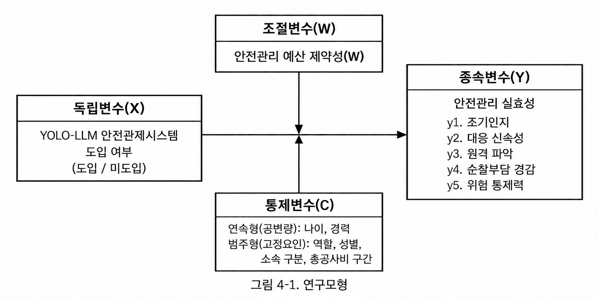

# 제4장 연구설계 및 실증분석

## 제1절 연구 모형 설계

본 장에서는 연구 모형·가설·측정도구·분석 절차를 설계하고, 그에 따른 가설 검증 결과를 제시하였다. 설계의 목적은 도입 현장과 미도입 현장의 안전관리 실효성 차이가 어느 정도인지를 응답자·현장 특성을 조정한 평균 차이로 추정하는 데 있다. 고가 서버와 VMS(Video Management System)에 의존하는 기존 스마트 안전관제 시스템은 안전관리 예산이 제한된 중소규모 현장에서 도입하기 어렵다(이준호, 2024). 본 연구는 일반 사무용 PC와 기존 현장 카메라(ONVIF)로 운용할 수 있는 저비용 시스템을 그 대안으로 제시하였다.

도입·미도입 현장의 비교에는 사후 설문 1회를 이용하는 횡단적 준실험 설계를 적용하였다. 도입 현장은 A공사 경기지역본부 산하 조사대상 건설현장 가운데 시스템 설치와 응답일 현재 3개월 이상 정상 운용이 확인된 현장으로 구성하고, 미도입 현장은 같은 관할 범위에서 미설치·미운용이 확인된 현장으로 구성하였다. 독립변수는 현장 단위의 YOLO-LLM 안전관제 시스템 도입이며, 종속변수는 관리자가 지각한 현재 안전관리 업무의 실질적 수행 수준이다.

시스템 개발은 안전관리 자원이 부족한 중소규모 현장을 지향하지만, 조사 표본에는 총공사비 120억 원 이상 현장도 들어 있다. 따라서 개발 대상과 조사 표본의 범위는 구분하며, 조사에 포함된 현장을 모두 중소규모라고 부르지 않았다. 현장마다 한 명이 응답하므로 그 응답은 해당 관리자의 지각이며, 현장 전체의 객관적 안전관리 실효성을 그대로 대표하지는 않았다.

가설의 방향은 기술수용 연구와 안전관리 업무 지원 기제를 연결하여 설정하였다. 기술수용모델(Davis, 1989)과 스마트 안전기술의 수용·채택 의도 연구(이동건, 2024; Chong et al., 2023)는 기술을 받아들이는 조건을 설명할 뿐 실제 안전 성과를 직접 입증하지 않았다. 그래서 본 연구는 저비용 인프라의 도입 가능성(이준호, 2024)과 위험정보 전달·대응 지원 기제에 기대어 관리자가 지각한 안전관리 실효성의 도입·미도입 현장 간 차이를 검토하였다. 그 근거는 제2장 제5절에서 고찰하였다.

인과관계의 세 조건인 공변성, 시간적 우선성, 독립변수 통제는 각각 어디까지 충족하는지 나누어 밝힌다(Shadish, Cook, & Campbell, 2002). 공변성은 응답자와 현장 특성을 조정한 뒤 도입·미도입 현장별 평균을 비교하는 공분산분석(ANCOVA)으로 확인하였다. 시간적 우선성을 위해서는 시스템 운용이 사후 측정보다 앞서도록 하였다. 다만 도입 전 안전관리 실효성을 측정하지 않았으므로, 현재 수준이 도입 후에 형성된 것인지까지는 확인할 수 없다.

독립변수를 통제하기 위해 여섯 통제변수(C)를 조정하고 사전 특성의 분포·균형을 진단하였다. 만 나이와 건설현장 경력은 연속형 통제변수(공변량)로, 소속 구분·성별·역할·총공사비 구간은 범주형 통제변수(고정요인)로 투입하였다. 두 범주를 통칭해 통제변수라 한다. 현장을 무작위로 배정하지 않았고 측정하지 않은 교란요인도 있으므로, 그 영향은 조정 뒤에도 남을 수 있다. 따라서 결과는 관리자가 지각한 안전관리 실효성의 조정된 도입·미도입 현장 간 차이로 읽으며 인과 효과로 단정하지 않았다.

비교 조건의 범위도 미리 한정하였다. 미도입 현장에는 CCTV를 운용하는 현장과 운용하지 않는 현장이 섞여 있다. 따라서 주 비교는 본 시스템을 운용하는 현장과 통상적인 방식으로 안전관리를 하는 현장의 관리자가 현재 업무 수준을 얼마나 다르게 지각하는지를 보았다. 이 차이는 기존 영상 인프라의 기여와 LLM 후단 검증·모바일 알림 같은 추가 기능의 기여를 갈라낸 인과 효과가 아니다.

이상의 설계를 토대로 연구변수를 구성하면 <표 4-1>과 같다.

<표 4-1> 연구변수의 구성

| 변수 구분 | 변수 및 하위요인 | 구성과 역할 |
|:---:|:---|:---|
| 독립변수(X) | YOLO-LLM 안전관제 시스템 도입 | 설치·3개월 이상 정상 운용 확인 도입=1, 미설치·미운용 확인 미도입=0 |
| 종속변수(Y) | 안전관리 실효성 | 관리자 개인이 지각한 현재 안전관리 업무 수준. 조기인지, 대응 신속성, 원격 파악, 순찰부담 경감, 위험 통제력의 5개 하위요인 |
| 통제변수(C) | 응답자·현장 특성 | 연속형 통제변수(공변량): 만 나이·건설현장 경력; 범주형 통제변수(고정요인): 소속 구분·성별·역할·총공사비 구간 |
| 조절변수(W) | 안전관리 예산 제약성 | 현장 도입 여부×예산 제약성 상호작용의 방향과 효과크기를 검토하는 공통 응답 변수 |
| 참고 변수 | 현장 운영 특성(도입·미도입 현장 공통), 시스템 특성 인식(A1∼A4)·경보 피로도 완화 인식(도입 현장) | 주 분석에 투입하지 않는 응답 변수. 현장 운영 특성은 위험 인지 경로·시점·지시 전달 소요시간의 도입·미도입 현장별 교차표를 보고하고 A-7·A-8 운용 실태 확인(민감도 분석 부분표본), A-9 <표 4-6> 해석에 쓰며, 시스템 특성 인식·경보 피로도 완화 인식은 도입 현장의 기술통계만 보고 |

연구 모형은 YOLO-LLM 안전관제시스템 도입 여부(X)에 따른 안전관리 실효성(Y)의 조정 평균 차이와 안전관리 예산 제약성(W)의 조절 관계를 검토하도록 설정하였다. 통제변수(C)는 연속형 공변량인 나이·경력과 범주형 고정요인인 역할·성별·소속 구분·총공사비 구간으로 구성하고, 이들 변수를 조정하여 도입·미도입 현장 간 차이를 비교하였다.

주: 화살표는 모형의 분석 관계이며 인과관계 입증을 뜻하지 않았다.

<그림 4-1> 연구 모형

주 분석은 <그림 4-1>의 비교 모형으로 수행하며, 주 결론은 H1의 도입·미도입 현장 간 조정 평균 차이로 도출하였다. 모집 목표와 검정력은 제5절 제1항에서 다루었다.

## 제2절 연구 문제 및 연구 가설

제1절의 연구 모형에 따라 연구 문제 두 개와 그에 대응하는 연구 가설을 세웠다. 각 가설의 이론적 근거와 선행연구는 제2장 제5절 제1항(H1)·제2항(H2)에서 고찰하였다.

**연구 문제 1.** YOLO-LLM 안전관제 시스템 도입 현장과 미도입 현장의 관리자가 지각한 현재 안전관리 실효성은 여섯 통제변수(C)를 조정한 후에도 차이가 있는가.

**연구 가설 1(H1).** YOLO-LLM 안전관제 시스템 도입 현장의 관리자가 지각한 안전관리 실효성은 여섯 통제변수(C)를 조정한 후에도 미도입 현장보다 높을 것이다.

H1은 안전관리 실효성 8문항 평균점수의 조정 평균 차이로 검정하였다. 조기인지·대응 신속성·원격 파악·순찰부담 경감·위험 통제력의 하위요인별 차이는 H1의 해석을 보완하는 분석으로 제시하였다.

**연구 문제 2.** 도입·미도입 현장 간 안전관리 실효성 차이는 응답자가 조사 시점에 지각한 안전관리 예산 제약성 수준에 따라 달라지는가.

**연구 가설 2(H2).** 도입·미도입 현장 간 안전관리 실효성 차이는 조사 시점에 안전관리 예산 제약성을 크게 지각하는 응답자일수록 더 클 것이다.

H2는 H1과 같은 통제변수에 W와 현장 도입 여부의 상호작용항을 더한 일반선형모형으로 검정하였다.

이상의 연구 가설을 종합하면 <표 4-2>와 같다.

<표 4-2> 연구 가설 종합

| 가설 | 가설 내용 | 분석 관계 |
|:---:|:---|:---:|
| H1 | YOLO-LLM 안전관제 시스템 도입 현장의 관리자가 지각한 안전관리 실효성은 여섯 통제변수(C)를 조정한 후에도 미도입 현장보다 높을 것이다. | 현장 도입 여부 → Y |
| H2 | 도입·미도입 현장 간 안전관리 실효성 차이는 조사 시점에 안전관리 예산 제약성을 크게 지각하는 응답자일수록 더 클 것이다. | 현장 도입 여부 × W → Y |

## 제3절 변수의 조작적 정의 및 측정도구 구성

### 제1항 변수의 조작적 정의

본 연구의 변수는 제2장에서 고찰한 개념을 토대로 조작적으로 정의하였으며, 변수별 하위요인과 측정방법은 <표 4-3>과 같다.

<표 4-3> 변수의 조작적 정의와 측정도구의 구성

| 변수명 | 하위요인 | 조작적 정의 | 측정방법 |
|:---|:---|:---|:---|
| 독립변수: YOLO-LLM 안전관제 시스템 도입(X) | — | 시스템 설치와 응답일 현재 3개월 이상 정상 운용이 확인된 현장(도입=1)과 미설치·미운용이 확인된 현장(미도입=0)의 구분. 알림 경험은 별도 기록 | 연구자가 설치·운용 상태를 아는 현장에 설문을 안내하고 응답자가 첫 질문에서 선택한 이분형 현장 구분 |
| 종속변수: 안전관리 실효성(Y) | 조기인지 | 현장 관리자가 자기 현장에서 위험 징후를 사고로 이어지기 전에 발견한다고 지각하는 수준 | 5점 리커트척도(B-1) |
| | 대응 신속성 | 위험 상황을 인지한 뒤 초동 대응을 빠르게 지시한다고 지각하는 수준 | 5점 리커트척도(B-2) |
| | 원격 파악 | 현장에 직접 가지 않고도 위험 상황을 파악하고 위험 정보와 조치 필요사항을 공유한다고 지각하는 수준 | 5점 리커트척도(B-3·B-4) |
| | 순찰부담 경감 | 제한된 인력으로 순찰·확인 업무를 효율적으로 수행하고 불필요한 확인보다 실제 위험 대응에 집중한다고 지각하는 수준 | 5점 리커트척도(B-5·B-6) |
| | 위험 통제력 | 시정·작업중지 등 통제 조치를 신속하게 시행하여 위험요인을 실질적으로 통제한다고 지각하는 수준 | 5점 리커트척도(B-7·B-8) |
| 조절변수: 안전관리 예산 제약성(W) | — | 조사 시점에 고가 스마트 안전장비나 관제 시스템을 도입하기에 안전관리 예산과 산업안전보건관리비·본사·발주청 지원이 부족하다고 지각하는 정도 | 5점 리커트척도(C-1∼C-4) |
| 참고 변수: 시스템 특성 인식(도입 현장) | 인프라 범용성(A1) | 일반 사무용 PC와 기존 카메라로 구동되어 별도 장비 투자 부담이 적다고 경험한 정도 | 5점 리커트척도(D-1·D-2) |
| | 탐지·제어 안정성(A2) | 알림이 몰리거나 통신 상태가 좋지 않아도 안정적으로 작동한다고 경험한 정도 | 5점 리커트척도(D-3·D-4) |
| | 오탐 필터링(A3) | 배경이나 정상 작업을 위험으로 잘못 알리는 일이 드물다고 경험한 정도 | 5점 리커트척도(D-5·D-6) |
| | 알림 전파 즉각성(A4) | 위험 요약과 이미지가 모바일 메신저로 신속하게 전달되고 이를 통해 현장 상황을 파악한다고 경험한 정도 | 5점 리커트척도(D-7·D-8) |
| 참고 변수: 경보 피로도 완화 인식(도입 현장) | — | 오탐 필터링으로 잦은 경보 확인에 따른 스트레스·둔감화와 불필요한 확인 부담이 줄었다고 회고적으로 지각하는 정도 | 5점 리커트척도(E-1∼E-4) |
| 참고 변수: 현장 운영 특성 | — | 담당자 부재 시 위험 인지 경로, 순찰 간 위험 인지 시점, 인지 후 지시 전달 소요시간 | 보기 선택(A-7·A-8: 운용 실태 확인, A-9: 과정 지표), 응답일 직전 1개월 |
| 통제변수(C): 응답자·현장 특성 | 연속형 통제변수(공변량) | 만 나이(세), 건설현장 경력(년) | 숫자 기입(A-3·A-4) |
| | 범주형 통제변수(고정요인) | 소속 구분, 성별, 역할, 총공사비 구간(4구간) | 명목척도(A-1·A-2·A-5·A-6) |

주: 안전관리 실효성 하위요인의 정의는 제2장 제3절 제1∼5항을 따랐다. 문항별 근거는 별도의 근거 대조표로 관리하며 문항 전문은 부록(도입 현장용·미도입 현장용 설문지)에 수록하였다.

종속변수는 특정 시스템의 기능이나 만족도가 아니라 현장 일반의 업무 수준으로 정의하였다. 미도입 현장 관리자도 같은 기준으로 응답해야 도입·미도입 현장을 비교할 수 있기 때문이다.

YOLO-LLM 안전관제 시스템 도입(X)은 정상 운용 중 알림이 없었던 현장도 1로 코딩하였다. 실제 알림 수신과 응답자의 확인 경험은 설문의 현장 운영 특성 문항(A-7·A-8)으로 확인하였고, 현장 단위 알림 기록과는 연결하지 않았다. 정상 운용 기간은 시스템 설치일부터 셌다. 운용 중 1차 검출 가중치를 갱신한 것은 검출 대상 범주가 같은 가중치 교체이므로 운용 중단으로 보지 않았다. 연구자는 현장의 설치·운용 상태를 확인하여 3개월 이상 정상 운용 요건을 충족한 현장을 도입 표본으로 정하였다. 정상 운용 기간이 3개월 미만이거나 중단·장애가 있는 현장은 도입 표본에 넣지 않되, 미도입으로 재분류하지도 않았다.

도입 요건을 응답일 현재 3개월 이상 정상 운용으로 둔 것은 B·C 문항 기준기간(응답일 직전 1개월) 전체가 안정된 운용 기간에 들게 하기 위해서다. 설치 직후에는 카메라 등록·임계값 조정·알림 수신자 설정 같은 초기 설정과 적응 과정이 이어지기 때문이다. 운용 안정화에 필요한 기간을 보고한 문헌은 확인하지 못했다[CITE_TODO: 스마트 안전장비·영상관제 도입 후 운용 안정화 기간 근거]. 이 요건은 설치 후 2개월 안에 초기 설정과 적응이 끝난다는 가정에 기댄다.

안전관리 실효성(Y)과 안전관리 예산 제약성(W)은 도입·미도입 현장 모두 설문 응답일 직전 1개월을 기준으로 응답하였다. W는 점수가 높을수록 예산 제약을 크게 지각한다는 뜻이다. 다만 W는 조사 시점의 개인 지각이므로 현장의 객관적 예산이나 도입 전 조건과 같지 않고, 도입 경험이 사후 인식과 관련될 가능성도 남는다.

채점안은 안전관리 실효성 점수(Y)를 8문항의 동일 가중 평균으로 산출하였다. 하위요인별 문항 수가 1·1·2·2·2개이므로 2문항 하위요인은 1문항 하위요인보다 전체 점수에서 두 배의 비중을 갖는다(12.5%·12.5%·25%·25%·25%). 따라서 이 평균점수는 단일 잠재요인으로 검증된 점수가 아니라 다섯 하위요인을 아우르는 합성점수이다. Y와 W는 기본 채점 규칙에 따라 해당 척도의 전 문항에 응답한 경우에만 평균을 내며, 부분 무응답을 임의 평균이나 0점으로 채우지 않았다. 단일 문항 하위요인에는 α를 산출하지 않으며, 채점안은 H1 결과를 보기 전에 고정하였다.

시스템 특성 인식(D영역)과 경보 피로도 완화 인식(E영역)은 도입 현장 관리자만 응답할 수 있으므로 가설 검정에 투입하지 않고 도입 현장의 기술통계만 보고하는 참고 변수로 두었다. E는 같은 현장에서 도입 전 자동 알림과 현재 본 시스템의 알림을 비교한 회고적 인식이고 비교 기간도 따로 정하지 않으므로, 실제 사전·사후 변화량이나 인과 효과를 측정한 값이 아니다.

현장 운영 특성(A-7∼A-9)은 Y·W에 넣지 않고 통제변수로도 투입하지 않았다. 위험 인지 경로·시점·소요시간은 도입이 안전관리 실효성과 관련되는 기제일 수 있다. 이를 통제하면 추정하려는 도입·미도입 현장 간 차이의 일부를 지우는 과잉통제가 된다. 대신 이 문항은 지각 점수만으로는 가려내기 어려운 응답 편향을 점검하는 데 썼다. 미도입 현장 관리자는 비교할 기준이 없어 자기 현장의 위험 파악과 조치 수준을 높게 평가할 수 있고, 도입 현장 관리자는 연구자와의 관계를 의식해 후하게 응답할 수 있다(제5절 제1항). 두 편향은 도입·미도입 현장 간 차이에 반대 방향으로 작용하지만, 그렇다고 서로 상쇄된다고 가정할 수는 없다. 그래서 응답 형식을 달리하여 측정 방법을 분리하는 절차적 처방(Podsakoff et al., 2003)[UNVERIFIED: Podsakoff et al.(2003)의 측정 방법 분리 처방의 원문 쪽수·표현 대조 필요]을 참고하여, 평가가 아닌 사실을 보기 선택으로 묻는 문항을 리커트 지각 척도와 따로 두었다.

세 문항은 역할이 다르다. A-7(담당자 부재 시 위험 인지 경로)과 A-8(순찰 간 위험 인지 시점)은 도입 현장에서는 시스템이 관리자의 위험 인지 경로가 되었는지를, 미도입 현장에서는 다른 알림 수단을 갖추었는지를 보여 주는 운용 실태 확인 지표이다. 자동 알림과 발생 직후 알림은 시스템 기능 그 자체이므로 두 문항의 도입·미도입 현장 간 차이는 설계상 거의 정해져 있다. 그래서 이 두 문항은 안전관리 실효성의 근거로도, H1 결과를 판별하는 조합에도 쓰지 않았다. A-9(인지 후 지시 전달 소요시간)만 위험을 안 뒤의 대응 과정을 나타내는 과정 지표로 두어 H1 결과와 짝지어 해석하였다(제5절 제2항).

운용 실태 확인은 결과를 보기 전에 정한 다음 규칙을 따랐다. 본 시스템은 PC용 데스크톱 뷰어와 모바일 메신저 알림으로 위험 정보를 전달하므로, 도입 현장 응답자가 A-7에서 ③ 또는 ④(CCTV 화면 직접 확인 또는 자동 알림)를 고르고 A-8에서 ③(발생 직후 알림)을 골랐으면 시스템 경로가 작동한 것으로 보았다. A-7이 ①·②이거나 A-8이 ③이 아니면 시스템이 그 관리자의 위험 인지 경로가 되지 못한 현장으로 기록하였다. A-7에서 ⑤(기타)를 고른 응답은 자동 알림을 명시하지 않았으므로 시스템 경로가 작동하지 않은 것으로 분류하였다. 이 기록은 정상 운용 확인 결과와 함께 읽으며, 해당 현장을 미도입으로 재분류하지 않았다.

통제변수 가운데 만 나이와 건설현장 경력은 구간으로 바꾸지 않고 연속값으로 투입하였다. 경력은 안전관리·공사감독·시공관리 등 건설현장 업무 경력을 합한 기간이다. 같은 기간에 여러 현장을 맡은 경력은 중복해서 더하지 않으며, A-4는 연 단위 정수(1년 미만은 0, 6개월 이상은 올림)로 수집하여 그대로 연속값으로 썼다. 소속 구분·성별·역할·총공사비 구간은 범주형 요인으로 지정하고 기준범주 대비(Treatment) 더미변수로 표현하였다. 총공사비는 조사 대상으로 정한 현장 전체의 응답일 현재 최신 확정 금액(부가가치세와 관급자재비 포함)을 기준으로 나눈 조사용 네 구간이다. 법적 규모 분류가 아니므로 구간 코드를 등간 연속값이나 실제 공사비로 다루지 않았다.

이 변수들을 투입하는 까닭은 업무·책임 범위, 위험 판단과 업무 경험, 자원·관리 여건에서 도입·미도입 현장의 구성이 다를 수 있기 때문이며, 성별 자체에 안전관리 능력 차이가 있다고 가정하지는 않았다. 이는 연구자의 선정 논리이며, 각 변수가 현장 도입 여부와 Y 양쪽에 관련된다는 선행 근거는 보완이 필요하다[CITE_TODO: 여섯 통제변수별 교란 조정의 이론적 근거 보완]. 도입 후 값이 바뀌었을 가능성은 잔여 교란 또는 과잉조정의 한계로 보고하며, 통제변수 계수는 H1의 실질적 성과로 해석하지 않았다.

### 제2항 측정도구의 구성 및 설문 문항 도출 출처

측정도구는 연구자가 수정·개발한 척도이다. 표준화된 기존 척도를 그대로 쓰지 않고, 선행연구의 개념을 근거로 연구자가 작성했던 구 설계 문항을 새 비교 설계에 맞게 수정하였다. 안전관리 실효성 B-1∼B-8은 구 설계의 시스템 귀속형 안전관리 실효성 8문항을 도입·미도입 현장 관리자가 같은 기준으로 응답할 수 있는 현장 일반형으로 고친 문항이다. 예산 제약성 C-1∼C-4는 구 예산 제약성 4문항의 표현을 다듬은 문항이다. 시스템 특성 인식 D-1∼D-8은 구 시스템 특성 16문항에서 하위특성별 대표 2문항을 골랐고, 경보 피로도 완화 E-1∼E-4는 구 경보 피로도 4문항을 도입 현장 전용부로 옮겨 표현을 수정하였다. 현장 운영 특성 A-7∼A-9는 기존 문항을 옮기지 않고 연구자가 새로 작성한 사실 문항이다.

안전관리 실효성 문항은 다섯 하위요인에 관한 연구에 근거한다(김민기·박성호, 2026; 김용선, 2022; 김태헌, 2026; 김현수, 2026; 이동건, 2024; 이창남, 2025; 황병복, 2026; Chong et al., 2023; Cvach, 2012; Wu et al., 2025). 예산 제약성 문항은 중소현장의 산업안전보건관리비와 기술 비용 제약을 다룬 논의에 바탕을 둔다(김용선, 2022; 윤영석, 2025; 이준호, 2024; 조도빈, 2026; Zhou et al., 2023). 시스템 특성 인식 문항은 네 기술 특성에 관한 연구와 가이드라인에서 끌어왔으며(국토교통부·국토안전관리원, 2024; 김민기·박성호, 2026; 김용선, 2022; 김태헌, 2026; 김현수, 2026; 류수영, 2023; 이동건, 2024; 이준호, 2024; 이창남, 2025; Chong et al., 2023; Cvach, 2012; Kim et al., 2025; Wu et al., 2025), 경보 피로도 완화 인식 문항은 알람 피로 이론과 하이브리드 관제 연구에 근거한다(김현수, 2026; Cvach, 2012). 현장 운영 특성 문항은 <표 2-2>의 전달 기능과 제3장 제1절 제2항의 적시성 요구사항(R5)에서 묻는 상황을 정하고, 담당자 부재 시 원격 파악과 순찰 보완을 다룬 연구를 참고하였다(김용선, 2022; 이창남, 2025).

리커트 문항은 모두 1점 ‘전혀 그렇지 않다’부터 5점 ‘매우 그렇다’까지의 5점 척도로 측정하였다.

## 제4절 설문조사 설계 및 척도 검증

### 제1항 설문조사의 개요 및 절차

본 설문조사는 도입 현장과 미도입 현장의 안전관리 실효성을 같은 기준으로 재는 횡단 조사이다. 도입·미도입 현장 모두 B·C는 설문 응답일 직전 1개월의 현장 안전관리 실태·여건을 평가하도록 안내를 통일하였다. B의 안내에는 순찰과 순찰 사이나 안전관리 담당자가 현장에 없는 시간대에 생긴 위험 상황까지 평가에 넣도록 상황을 고정하는 문장을 두 양식에 똑같이 두었다. 한쪽 양식에만 시스템을 소개하면 응답을 유도할 수 있으므로 시스템 이름과 기능은 언급하지 않았다. A는 각 문항의 기준시점·기간을 따르고, D·E는 문항별 직접 경험을 기준으로 응답하였다.

측정도구는 4단계 절차로 설계하였다. 도입·미도입 현장에 같이 쓰는 일반형 안전관리 실효성 문항의 내용타당도와 도입·미도입 현장 간 해석 가능성을 조사 전에 확보하려는 절차이며, 이 가운데 1단계 선행연구 고찰 및 초기 문항 풀 구성과 2단계 국내 관계 법령 및 건설 실무 지표 대조를 실시하였다. 먼저 제2장의 이론적 배경과 제3절의 조작적 정의를 토대로 변수별 초기 문항 풀을 구성하였다. 기존 문항은 새 도입·미도입 현장 비교 맥락에 맞게 고치되 문항별 출처를 유지하였다. 도입·미도입 현장 공통의 현장 운영 특성 A-7∼A-9는 지각이 아닌 사실을 묻는 문항으로 문항 풀에 함께 넣었다. 이어서 초기 문항을 산업안전보건법령의 산업안전보건관리비 기준과 스마트 안전장비 활용 가이드라인 등 국내 제도·실무 지표와 대조하여 현장 용어에 맞게 정비하였다(국토교통부·국토안전관리원, 2024).

3단계 전문가 필수성 평정과 4단계 인지면접·예비조사는 실시하지 않았다. 계획한 절차는 도입·미도입 현장 실무를 대표하는 전문가가 리커트 24문항과 사실 문항 3개(A-7∼A-9)를 ‘필수적’, ‘유용하나 필수적이지 않음’, ‘불필요’로 평정하고 문항별 내용타당도 비율(CVR)을 채택 기준과 비교하는 것이었다(Lawshe, 1975). 문항은 지도교수 검토를 거쳐 CVR에 따른 채택·삭제 없이 그대로 사용하였다. 4단계는 도입·미도입 현장별 인지면접으로 공통부와 A-7∼A-9의 보기, Part B의 평가 상황을 도입·미도입 현장 관리자가 같은 뜻으로 해석하는지 확인하고, 응답자 약 30명의 예비조사로 천장·바닥효과, 문항 변별력, Cronbach's α를 점검하는 계획이었다. 문항 표현은 조사 전 표현 점검(2026-09-30)으로 다듬었고 최종 문항은 2026-10-14 배포본으로 고정하였다. Y·W 채점 규칙과 결측·설계상 비해당·불성실 응답 기준은 제3절 제1항과 제5절 제2항에 정한 규칙을 적용하였다. α만으로 단일차원성이나 타당도·측정동일성을 확보했다고 말하지 않으며, 3·4단계를 거치지 않아 생긴 내용타당도의 한계는 제5장에 적었다.

### 제2항 본 설문지의 최종 구성

본 설문지는 공통부 21문항과 도입 현장 전용부 12문항으로 구성하며, 문항 전문은 부록에 수록하였다. 미도입 현장 관리자는 공통부 21문항에 응답하고, 도입 현장 관리자는 최종 구성에 따라 공통부와 전용부를 합한 33문항에 응답하였다. D·E 모두 비해당 선택지 없이 1∼5점 응답만 받으며 문항별 유효 응답 수·일반 무응답 수를 보고하였다.

<표 4-4> 설문지의 최종 구성

| 구분 | 변수명 | 내용 | 응답 대상 | 문항수 | 문항번호 |
|:---:|:---|:---|:---:|:---:|:---:|
| 공통부 A | 인구통계학적 특성 및 현장 운영 특성 | 소속·성별·만 나이(세)·건설현장 경력(년)·역할·총공사비 구간, 위험 인지 경로·시점·지시 전달 소요시간(참고 변수) | 전체 | 9 | A-1∼A-9 |
| 공통부 B | 안전관리 실효성 | 조기인지·대응 신속성·원격 파악·순찰부담 경감·위험 통제력 | 전체 | 8 | B-1∼B-8 |
| 공통부 C | 안전관리 예산 제약성 | 예산 부족과 제도적·조직적 지원 제약 | 전체 | 4 | C-1∼C-4 |
| **공통부 소계** | | | **전체** | **21** | |
| 전용부 D | 시스템 특성 인식 | 범용성·안정성·오탐 필터링·알림 전파 | 도입 현장 | 8 | D-1∼D-8 |
| 전용부 E | 경보 피로도 완화 인식 | 스트레스·둔감화·확인 부담 완화(참고용 기술 척도) | 도입 현장 | 4 | E-1∼E-4 |
| **전용부 소계** | | | **도입 현장** | **12** | |
| **현행안 합계** | 미도입 현장 21문항, 도입 현장 33문항 | | | **21 또는 33** | |

주: 21·33문항은 측정 문항 수이며, 조사 관리용 현장 구분·현장명·성명 3개 입력 항목은 제외하였다. A-7∼A-9는 리커트 척도가 아닌 보기 선택형 사실 문항으로 주 분석에 투입하지 않았다. 현장 구분 선택은 전자 설문의 문항 이동과 분석용 현장 도입 여부에, 현장명·성명은 중복 제출 확인에 사용하며 세 항목 모두 점수나 통제변수로 투입하지 않았다. D-6은 LLM이 입력받는 원본 프레임의 작업 상황을 범위로 하며 영상의 시간적 전후 관계를 뜻하지 않았다. D-7은 지각된 알림 신속성을 묻는 문항이며 실제 지연 시간의 측정치가 아니다.

## 제5절 자료 수집과 분석방법

### 제1항 데이터 수집 표본 설계

조사대상은 A공사 경기지역본부 산하 건설현장에서 안전관리 업무를 맡은 현장 관리자이다. 응답자는 도입·미도입 현장 모두 시공사 측 현장소장(관리감독자)·안전관리자와 발주청 측 공사감독·감리원 가운데 담당 현장의 안전관리 예산·지원 여건을 판단할 수 있는 사람으로 정하였다. 현장당 1명을 모집하되, 같은 사람이 두 번 응답하지 않도록 담당 현장 하나를 미리 지정하였다. 결과의 적용 범위는 실제 모집된 현장의 규모 분포와 공통 관측범위로 한정하였다.

모집 목표는 도입 현장 30개소 이상과 미도입 현장 30개소 이상, 총 60개소 이상이며 현장당 1명씩 총 60명 이상이다. 현장은 같은 관할 범위에서 공사금액 규모와 주요 특성이 비슷한 곳을 먼저 확보하되, 무작위 배정을 전제하지는 않았다. 실제 조사에서는 연구자가 설치·운용 상태를 아는 현장 가운데 요건을 충족한 도입 현장 34개소와 미도입 현장 39개소에 현장당 1명씩 설문을 안내하였다. 사전 검정력 산정은 하지 않았고, 실제 표본에서 검출할 수 있는 최소 효과는 제7절에 보고하였다.

도입 현장의 후보 명부는 경기지역본부 안전관제 시스템의 카메라 등록 백업 자료로 파악한 등록 90개소·108대이다. 이 수는 모집 목표나 분석 표본이 아니라 조사 후보의 범위다. 비교 조건 가운데 다른 스마트 안전장비는 조사 대상 전 현장에 없음을 연구자가 확인하였고, 기존 CCTV 보유 여부·원격 열람·공종·안전관리 담당 인력은 현장 단위로 수집하지 않았다. 도입 현장의 운용 설정은 전 현장에 똑같이 적용하였으며 제3장에 기술한 구성을 따랐다. 따라서 인프라·운용 조건에 따른 추가 분석은 하지 않았다.

자료는 2026년 10월 12일부터 10월 23일까지 자기응답 설문으로 수집하였다. 연구자가 설치·운용 상태를 아는 현장의 응답자에게 설문을 안내하였고, 첫 질문에서 도입 현장 또는 미도입 현장을 고르면 각각 A∼E 33문항 또는 A∼C 21문항으로 넘어갔다. 응답자가 자기 현장의 상태를 직접 고르므로 이 선택을 분석용 현장 도입 여부로 썼다. 응답자 이메일은 수집하지 않았으며, 중복 제출은 응답 내용의 동일성과 제출시각으로 점검하였다. 연구자는 응답마다 내부 식별번호를 붙이고 성명과 현장명을 지운 통계분석용 사본으로 분석하며, 결측·이상값을 검토하였다. 현장별 설치일·운용 기간, 정상 가동 세부 판정 기준과 미충족 현장 수, 추출 순서·규모 매칭 기준, 등록 현장과 분석 현장의 대응 기준, 자료 보관 기간과 연구윤리 심의 대상 여부 확인 결과는 따로 기록하지 않았다.

연구자는 비교 대상 시스템을 개발하였고 현장 관리에도 관여하므로, 응답자가 연구자와의 관계를 의식하여 응답할 수 있다. 이를 줄이려고 안내문에 연구자의 역할, 자발적 참여와 중단 가능성, 개별 응답의 비공개를 밝혔다. 다만 연구자가 식별 원자료를 열람할 수 있으므로 완전한 익명성을 보장한다고는 쓰지 않았다. 표본 설계의 세부 내용은 <표 4-5>와 같다.

<표 4-5> 자료 수집 개요

| 구분 | 내용 |
|:---:|:---|
| 조사대상 | A공사 경기지역본부 산하 조사대상 건설현장의 현장 관리자·안전관리자, 총공사비 120억 원 이상도 포함 |
| 비교 현장 | 모집 목표는 설치·3개월 이상 정상 운용 확인 도입 30현장과 미설치·미운용 확인 미도입 30현장(총 60현장), 실제 응답은 도입 34현장·미도입 39현장(총 73현장) |
| 선정 기준 | 동일 관할의 주요 특성 유사 현장 우선 확보, 구체적 추출 순서·매칭 기준은 별도 기록 없음 |
| 도입 후보 명부 | 카메라 등록 백업 자료와 식별값 없는 1대의 별도 현장 확인으로 파악한 등록 90개소·108대(1대 77개소, 2대 8개소, 3대 5개소), 모집 목표가 아닌 후보 범위이며 3개월 이상 정상 운용 확인 후 도입 표본 선정, 등록 현장과 분석 현장 단위의 대응 기준은 별도 기록 없음. 카메라별 원격 알림 허용 설정은 정상 운용의 증거로 쓰지 않음 |
| 정상 운용 확인 | 연구자가 설치·3개월 이상 정상 운용 요건 충족을 확인, 현장별 설치일·운용 기간은 별도 기록 없음 |
| 응답자 기준 | 도입·미도입 현장 동일 직무 범위 및 담당 현장의 안전관리 예산·지원 여건 파악, 모집 전 예산 파악·참여 기준 충족 확인 결과는 별도 기록 없음, 현장당 1명·담당 현장 사전 지정으로 개인 중복 응답 방지, 알림 경험은 A-7·A-8 응답으로 확인 |
| 비교 조건 기록 | 다른 스마트 안전장비는 전 현장 없음(연구자 확인); 기존 CCTV 보유 여부·원격 열람·공종·안전관리 담당 인력은 현장 단위 미수집; 도입 현장의 운용 설정은 전 현장 동일(제3장 구성). 이 조건으로 모집 제외나 통제변수 추가를 하지 않음 |
| 조사 설계 | 사후 설문 1회의 횡단적 도입·미도입 현장 비교 준실험 설계 |
| 조사 방식 | 자기응답 설문, 연구자가 설치·운용 상태를 아는 현장에 안내 후 첫 질문의 ‘YOLO-LLM 안전관제 시스템 도입 현장’·‘YOLO-LLM 안전관제 시스템 미도입 현장’ 선택으로 분기하여 직접 제출, 선택한 현장 구분을 분석용 현장 도입 여부로 사용 |
| 자료 관리 | 성명과 현장명이 포함된 원응답·CSV 원자료와 코드·성명·현장명 대응표·현장 명부는 연구자 본인만 열람, 통계분석용 사본과 분리 보관 |
| 조사 시기·기준기간 | 2026년 10월 12일∼10월 23일 실시, 공통 B·C는 도입·미도입 현장 모두 설문 응답일 직전 1개월, 도입 현장은 응답일 현재 3개월 이상 정상 운용 확인 |
| 목표 표본 | 현장당 1명, 도입·미도입 현장별 응답 30건 이상, 총 60부 이상(사전 검정력 산정 없음). 실제 응답 73명(도입 34·미도입 39) 전원 분석 |
| 분석 단위 | 개인 응답자, 한 현장 한 명의 자료로 도입·미도입 현장 비교 ANCOVA; 현장 ID는 중복 확인용 |

### 제2항 분석 절차

분석은 본 조사, 자료 정제·채점, 기술통계와 측정도구 점검, 사전 특성 분포·균형 진단, 공분산분석 가정 점검, 가설 검정 순으로 진행하였다. 주 분석은 jamovi 2.7.41(The jamovi project, 2025)로 수행하였다. jamovi는 R 4.5를 기반으로 하며, 신뢰도와 탐색적 요인분석은 psych 패키지로, 회귀 진단은 car 패키지로 산출하였다. 모형은 최소제곱(OLS)으로 적합하며, 현장 도입 여부 검정의 F·p와 부분 η²는 ANCOVA 모듈의 Type III 제곱합 분산분석표로 산출하고 조정 평균은 추정 주변 평균(estimated marginal means)으로 계산하였다. 계수 신뢰구간·잔차·공선성·영향점은 같은 사례·변수·모형식의 Linear Regression 출력으로 확인하였다. 분석 도구를 jamovi로 정했으므로 조정 평균의 가중 방식과 사전 특성 균형 지표도 이 도구가 산출하는 방식을 따랐다.

**1. 자료 정제, 주요 변수 기술통계와 측정도구 점검.** Y와 W는 제3절 제1항의 채점 규칙에 따라 산출하며, H1은 Y·현장 도입 여부·여섯 통제변수(C)가 완전한 사례를, H2는 추가로 W가 완전한 사례를 사용하였다. 일반 무응답과 미도입 현장 D·E의 설계상 비해당은 구분하였다. 설계상 비해당이나 일렬응답만을 이유로 자동 제외하지 않으며, 문항·변수별 결측률과 도입·미도입 현장별 제외 사유를 보고하였다. 응답 소요시간은 수집하지 않았으므로 불성실 응답 판정에 쓰지 않았다. 결측 민감도 분석의 필요성과 방법은 그 가정·근거를 기록하여 결정한다. 주요 변수 기술통계로 Y·하위요인·W의 도입·미도입 현장별 평균·표준편차·왜도·첨도와 참고 척도(D·E)의 문항별 응답 상태·평균을 제시하였다. Y·W의 Cronbach's α는 전체 및 도입·미도입 현장별 내적 일관성 정보로 사용하고, 2문항 하위요인에는 문항 간 상관을 함께 제시하였다. 척도 구조는 Y 8문항과 W 4문항에 각각 탐색적 요인분석을 적용하여 확인하였다. 추출은 반복 주축요인추출(PAF), 요인 수는 상관행렬 고유값이 1보다 큰 요인 수와 스크리 도표로 정하며, 1요인이 나오면 회전은 하지 않았다.

**2. 사전 특성 진단과 가정 점검.** 만 나이와 건설현장 경력은 도입·미도입 현장별 평균·표준편차와 효과크기 Cohen's d(독립표본 t검정)로, 범주형 특성은 빈도·비율과 효과크기 Cramér's V로 기술하고 공통 관측범위를 확인하였다. 범주형 통제변수의 기준범주는 소속=시공사, 성별=남성, 역할=공사감독, 총공사비=20억 원 미만으로 두며, 기준범주가 관측되지 않으면 대체 기준과 사유를 분석 전에 기록한다. A-5에서 ‘기타’를 고른 응답은 응답자에게 다시 확인하여 공사감독·안전관리자·현장소장(관리감독자) 세 범주로 재분류하였으며(제6절 제1항), 범주형 통제변수 ‘역할’은 이 3수준으로 투입하였다. 비유의한 검정을 동질성 확보의 증거로 사용하지 않았다. 현장 운영 특성 A-7∼A-9는 통제변수가 아니므로 도입·미도입 현장별 빈도·비율 교차표로 제6절 제1항의 표본 특성과 함께 기술하고, 도입·미도입 현장 간 분포 차이는 Fisher 정확검정으로 확인하되, 도입·미도입 현장 간 차이가 설계상 예상되는 A-7·A-8의 p는 참고값으로만 보고하고 A-9에는 아래 5의 판정 기준(p<.05)을 적용하였다. 2×2를 넘는 교차표(A-7 5개 보기, A-8·A-9 4개 보기)의 Fisher 정확검정은 주변합을 고정한 모든 표를 열거하는 방식(Fisher–Freeman–Halton)으로 산출하였다. 도입 현장의 A-7·A-8 응답은 제3절 제1항의 운용 실태 확인 규칙에 따라 따로 집계하였다.

가정 점검 항목은 두 연속형 통제변수와 Y의 선형 관계, X×나이·X×경력에 대한 회귀기울기 동질성, 잔차 정규성과 등분산성, 영향점, 공선성과 희소범주에 따른 식별성, 현장·담당자 중복 방지에 근거한 관측의 독립성이다. 현장당 응답자가 1명이므로 현장 군집(다수준) 구조는 모형에 반영하지 않았다. 단일 검정의 비유의만으로 가정 충족을 선언하지 않으며, 유의확률을 보고 통제변수를 선택·삭제하거나 범주를 통합하지 않았다. 영향점은 Cook's D(4/n 기준)·레버리지·외적 스튜던트화 잔차로 보고하되 삭제하지 않으며, 가정 위반이나 영향점이 확인되면 잔차 진단 결과를 보고하고 제5장 한계에 기술한다. 설계행렬의 순위 결함으로 식별되지 않는 분석은 추론하지 않고 그 이유를 서술하였다.

**3. H1의 공분산분석과 하위요인별 분석.** H1은 응답자 i에 대해 다음의 일반선형모형으로 검정하였다.

Y_i = β₀ + β_X X_i + β_A Age_i + β_E Exp_i + Σ γ_k Z_ki + ε_i

X_i는 도입=1·미도입=0, Age_i는 만 나이(세), Exp_i는 건설현장 경력(년), Z_ki는 소속·성별·역할·총공사비 구간의 더미, ε_i는 개인 잔차이다. Age·Exp는 연속형 통제변수(공변량), Z_k는 범주형 통제변수(고정요인)이며, 이를 통칭해 통제변수 C라 한다. β_X는 다른 통제변수의 조건이 같을 때의 도입−미도입 현장 차이를 나타낸다. 유의수준은 α=.05의 양측 검정이며, 차이가 양수이고 p<.05일 때 H1을 지지하는 결과로 판단하였다. 보고 지표는 현장 도입 여부 항의 F·자유도·p·부분 η², 도입·미도입 현장별 조정 평균, 도입−미도입 차이와 그 95% 신뢰구간이다. 부분 η²는 다른 통제변수를 모형에 둔 채 현장 도입 여부 항이 설명하는 변동의 비율이다. 조정 평균은 도입·미도입 현장에 같은 연속형 통제변수 값을 넣고 범주형 통제변수의 각 수준에 같은 비중을 주는 동일 가중(equal cell weights)으로 구한 예측 평균이다. 비유의 결과를 차이가 없다는 증거로 단정하지 않았다. 사전 지정 민감도 분석에서는 제3절 제1항의 운용 실태 확인 규칙에서 시스템 경로가 작동하지 않은 도입 현장을 뺀 부분표본으로 H1을 다시 추정하여 참고로 보고하였다. 주 결과는 전체 표본이다. 이 제외 기준은 같은 응답자의 보고에 근거하므로 부분표본 결과에도 선택 편향이 남을 수 있다.

하위요인별 분석은 다섯 하위요인 점수에 H1과 같은 모형을 각각 적용하고, 다섯 하위요인별 현장 도입 여부 효과의 p값을 하나의 검정군으로 묶어 Holm 보정을 적용하였다.

**4. H2의 상호작용 분석.** H2는 H2 완전사례 전체의 평균으로 W를 평균중심화한 W_c와 X×W_c를 H1 모형에 더한 일반선형모형으로 검정하고, 상호작용 계수의 부호·SE·95% 신뢰구간과 F·p를 보고하였다. 평균 및 평균±1표준편차에서의 조건부 도입·미도입 현장 간 차이는 도입·미도입 현장의 공통 관측범위 안에 있는 수준에만 제시하며, 이 결과를 객관적 예산 효과나 인과적 조절효과로 해석하지 않았다.

**5. 결과 해석 순서(사전 지정).** H1 결과는 과정 지표인 지시 전달 소요시간(A-9)의 도입·미도입 현장 간 차이와 짝지어 해석하며, 조합별 해석 순서는 결과를 확인하기 전에 <표 4-6>과 같이 정하였다. 지각 점수의 도입·미도입 현장 간 차이만으로는, 비교할 기준이 없는 미도입 현장 관리자가 자기 평가를 높이는 경우와 도입 현장 관리자가 호의적으로 응답하는 경우를 구별할 수 없기 때문이다. A-9의 ‘차이 있음’은 도입 현장의 응답이 짧은 소요시간 구간 쪽으로 미도입 현장보다 많이 분포하는 경우를 뜻한다. 판정 기준은 Fisher 정확검정 p<.05로 하고, 보기별 비율 차이는 방향을 확인하는 보조 근거로 사용하였다. H1의 ‘차이 있음’은 3의 지지 판정 기준(차이가 양수이고 p<.05)을 충족한 경우이며, 조합 판정은 해석 순서를 정할 뿐 H1의 판정 자체를 바꾸지 않았다. 도입·미도입 현장 간 차이가 역방향(미도입 현장의 소요시간 구간이 더 짧거나 조정 평균이 더 높음)으로 유의하면 ‘역방향 차이’로 따로 보고하고, 미도입 현장의 대체 알림 수단과 측정 편향 가능성을 먼저 논의하였다.

<표 4-6> H1 결과와 과정 지표의 조합별 해석 순서

| 지시 전달 소요시간(A-9) 도입·미도입 현장 간 차이 | H1(Y 조정 평균) 도입·미도입 현장 간 차이 | 해석 순서 |
|:---:|:---:|:---|
| 있음 | 있음 | 대응 과정(지시 전달 소요시간)과 결과(지각 실효성)가 일치. 횡단 설계의 한계 안에서 H1 지지로 보고 |
| 있음 | 없음 | 지시 전달 과정은 다르나 지각 실효성 차이 미확인. ① 미도입 현장의 참조 기준 부재로 자평 상향 ② 도입 현장의 평가 기준 엄격화 ③ 지시가 빨리 전달되어도 현장 조치·통제로 이어지지 않아 체감 차이가 실제로 없음 ④ 검정력 부족 — 이 순서로 논의. 판별 단서: 하위요인 패턴(원격 파악·순찰부담 경감만 차이 → ①), D·E 분포(알림 즉각성·피로 완화는 높은데 B가 안 높음 → ②·③), 효과크기 신뢰구간 폭(→ ④) |
| 없음 | 있음 | 지시 전달 과정의 차이 없이 지각 실효성만 차이. 도입 현장의 호의 응답(연구자 관계) 가능성을 먼저 점검. 운용 실태(정상 운용 확인과 A-7·A-8)와 D 응답 대조 후 H1을 조건부로 해석 |
| 없음 | 없음 | 지시 전달 과정과 지각 실효성 모두 차이 미확인. A-7·A-8의 운용 실태 확인에서 시스템이 인지 경로로 작동하지 않은 도입 현장이 많으면 정상 운용·3개월 요건을 재검토하고, ‘실효성 차이 미확인’으로 결론 |

주: A-7·A-8의 도입·미도입 현장 간 차이는 설계상 예상되므로 이 표의 조합 판정에 쓰지 않았다. 해석 순서는 대안 설명을 논의하는 순서이며, 각 설명은 하위요인·D·E 분포와 운용 기록으로 확인한 범위에서만 채택하였다. 어느 조합도 횡단 설계의 한계를 넘어 도입의 인과 효과를 입증하지 않았다. 역방향 유의 차이는 ‘없음’이 아니라 ‘역방향 차이’로 따로 서술하였다(제5절 제2항).

이 설계에 따라 제6절에서는 표본 특성, 측정도구 점검, 기술통계와 사전 특성 균형을 제시하고, 제7절에서 가설 검증 결과를 <표 4-6>의 순서로 해석하였다.

## 제6절 조사 대상 특성과 측정도구 검증

본 절부터는 제1∼5절의 사후 횡단 비교 설계에 따라 결과를 제시하였다. H1은 사전에 지정한 여섯 통제변수(C)를 조정한 개인 지각 안전관리 실효성의 도입·미도입 현장 간 차이로 검정하였다. 현장 도입 여부와 기준기간, 여섯 통제변수(C)의 투입 방식은 제5절 제2항의 규칙을 따르며, 현장당 1명의 응답을 공분산분석(ANCOVA)으로 분석하였다. H2는 같은 통제변수를 사용하는 일반선형모형으로 검정하며, 응답자가 조사 시점에 지각한 예산 제약성에 따라 도입·미도입 현장 간 차이가 달라지는지를 상호작용의 방향과 신뢰구간으로 판단하였다.

실제 유효 표본은 73명(도입 34명·미도입 39명)이다. 모집 목표(도입·미도입 각 30개소 이상, 사전 검정력 산정 없음)는 충족했으나 도입·미도입 현장의 수는 같지 않으며, 실제 계수 수는 H1 모형 11개·H2 모형 13개이다. 이 표본의 표준오차로 역산한 검출 가능 최소 효과는 H1 도입·미도입 현장 간 차이 0.52점, H2 상호작용 0.56이며, 산출 근거는 제7절에 보고하였다.

---

### 제1항 조사 대상자의 인구통계학적 특성 및 현장 운영 특성

도입 표본의 선정은 제5절 제1항의 등록 현장 90개소에서 출발하였다. 연구자는 설치·운용 상태를 아는 현장 가운데 응답일 현재 3개월 이상 정상 운용 요건을 충족한 도입 현장 34개소와 미설치·미운용 현장 39개소를 조사 명부로 정하고, 현장당 1명에게 설문을 안내하였다. 조사 범위는 기관 산하 조사대상 건설현장이며, 총공사비 120억 원 이상 현장도 포함하였다. 시스템 개발이 중소규모 현장을 지향한다는 점과 조사 표본의 범위는 구분하며, 이 등록 규모도 아래의 실제 조사·분석 표본과 구분하였다.

설문은 2026년 10월 12일부터 10월 23일까지 받았다. 연구자가 설치·운용 상태를 아는 현장에 설문을 안내하였다. 자료 정제와 채점은 제3절 제1항과 제5절 제2항의 규칙을 따랐다. 부분 무응답은 대체하지 않고 분석별 완전사례를 사용하며, 현장당 1명이므로 개인 수와 현장 수는 같다.

불성실 응답 판정은 제5절 제2항의 규칙을 따랐다. 유효 표본 73명의 문항 결측은 0건이다. B·C 전 문항, 도입 현장의 D·E 전 문항과 여섯 통제변수(C)에 결측이 없으므로 Y·W는 73명 전원에게서 산출하였고, H1·H2 완전사례도 73명이다. 리커트 전 문항에 같은 값을 적은 일렬응답은 자동 제외하지 않았다는 규칙에 따라 포함하였다. 결측이 없으므로 결측 민감도 분석은 하지 않았다.

<표 4-7> 조사 대상의 범주형 인구통계학적 특성(도입·미도입 현장별)

| 구분 | 항목 | 도입 빈도(명) | 도입 비율(%) | 미도입 빈도(명) | 미도입 비율(%) | 전체 빈도(명) | 전체 비율(%) |
|:---:|:---|---:|---:|---:|---:|---:|---:|
| 소속 구분 | 시공사 | 17 | 50.0 | 27 | 69.2 | 44 | 60.3 |
|  | 발주청(공사감독·감리원 포함) | 17 | 50.0 | 12 | 30.8 | 29 | 39.7 |
| 성별 | 남성 | 34 | 100.0 | 33 | 84.6 | 67 | 91.8 |
|  | 여성 | 0 | 0.0 | 6 | 15.4 | 6 | 8.2 |
| 역할 | 공사감독 | 16 | 47.1 | 15 | 38.5 | 31 | 42.5 |
|  | 안전관리자 | 7 | 20.6 | 12 | 30.8 | 19 | 26.0 |
|  | 현장소장(관리감독자) | 11 | 32.4 | 12 | 30.8 | 23 | 31.5 |
| 총공사비 구간 | 20억 원 미만 | 3 | 8.8 | 5 | 12.8 | 8 | 11.0 |
|  | 20억 원 이상∼50억 원 미만 | 6 | 17.6 | 9 | 23.1 | 15 | 20.5 |
|  | 50억 원 이상∼120억 원 미만 | 16 | 47.1 | 9 | 23.1 | 25 | 34.2 |
|  | 120억 원 이상 | 9 | 26.5 | 16 | 41.0 | 25 | 34.2 |
| **합계** |  | **34** | **100.0** | **39** | **100.0** | **73** | **100.0** |

주: 도입 분류는 설치 및 응답일 현재 3개월 이상 정상 운용 요건에 근거하며, 알림 수신·확인 경험과 중단·장애 이력은 별도로 기록하지 않았다. 역할은 ‘기타’ 응답을 응답자에게 재확인하여 세 범주로 재분류한 값이다.

<표 4-8> 조사 대상의 만 나이와 건설현장 경력 기술통계(도입·미도입 현장별)

| 연속 특성 | 단위 | 현장 도입 여부 | n | 평균(M) | 표준편차(SD) | 중위값 | 최솟값 | 최댓값 |
|:---|:---:|:---:|---:|---:|---:|---:|---:|---:|
| 만 나이 | 세 | 도입 | 34 | 46.4 | 11.1 | 47.0 | 30 | 66 |
|  | 세 | 미도입 | 39 | 46.9 | 12.0 | 48 | 24 | 67 |
|  | 세 | 전체 | 73 | 46.6 | 11.5 | 48 | 24 | 67 |
| 건설현장 경력 | 년 | 도입 | 34 | 14.2 | 10.8 | 10.5 | 1 | 37 |
|  | 년 | 미도입 | 39 | 17.5 | 12.4 | 15 | 1 | 45 |
|  | 년 | 전체 | 73 | 16.0 | 11.7 | 13 | 1 | 45 |

주: 경력은 연 단위 정수로 수집하며(1년 미만은 0, 6개월 이상은 올림) 그대로 연속값으로 사용하였다. 만 나이와 경력은 분석에서도 연속값으로 사용하며, 구간 코드나 구간 중간값으로 대체하지 않았다. 두 변수 모두 결측은 0건이다.

<표 4-9> 현장 운영 특성(A-7∼A-9)의 분포(도입·미도입 현장별)

| 문항 | 보기 | 도입 n(%) | 미도입 n(%) | 전체 n(%) |
|:---|:---|---:|---:|---:|
| A-7 담당자 부재 시 위험 인지 경로 | ① 알게 될 방법이 없다 | 0 (0.0) | 2 (5.1) | 2 (2.7) |
|  | ② 작업자나 반장의 전화·보고 | 10 (29.4) | 27 (69.2) | 37 (50.7) |
|  | ③ 사무실 등에서 CCTV 화면을 직접 본다 | 7 (20.6) | 7 (17.9) | 14 (19.2) |
|  | ④ 자동 알림(문자·메신저·앱)을 받는다 | 17 (50.0) | 0 (0.0) | 17 (23.3) |
|  | ⑤ 기타 | 0 (0.0) | 3 (7.7) | 3 (4.1) |
| A-8 순찰 간 위험 인지 시점 | ① 다음 순찰 때 | 6 (17.6) | 5 (12.8) | 11 (15.1) |
|  | ② 누군가 알려줄 때 | 10 (29.4) | 29 (74.4) | 39 (53.4) |
|  | ③ 발생 직후 알림으로 | 15 (44.1) | 2 (5.1) | 17 (23.3) |
|  | ④ 모르고 지나가는 경우가 많다 | 3 (8.8) | 3 (7.7) | 6 (8.2) |
| A-9 인지 후 지시 전달 소요시간 | ① 즉시∼5분 | 11 (32.4) | 15 (38.5) | 26 (35.6) |
|  | ② 5분 초과∼30분 | 18 (52.9) | 15 (38.5) | 33 (45.2) |
|  | ③ 30분 초과∼1시간 | 4 (11.8) | 7 (17.9) | 11 (15.1) |
|  | ④ 1시간 초과 또는 다음 순찰 때 | 1 (2.9) | 2 (5.1) | 3 (4.1) |

주: A-7∼A-9는 응답일 직전 1개월의 실제 상황을 묻는 사실 문항이며 Y·W·통제변수에 투입하지 않았다. A-7·A-8은 운용 실태 확인 지표로, 도입·미도입 현장 간 차이가 설계상 예상되므로 실효성의 근거나 <표 4-6>의 조합 판정에 쓰지 않았다. A-9는 지시 전달 과정을 나타내는 과정 지표로 제7절 제5항의 조합 판정에 사용하였다. 비율은 문항별 유효 응답을 분모로 하며, 도입·미도입 현장 간 분포 차이에 대한 Fisher 정확검정의 p는 A-7·A-8에서는 참고값으로만 제시하였다(A-7 p<.001, A-8 p<.001, A-9 p=.663). p는 2×k 교차표의 주변합을 고정한 모든 표를 열거하여 정확하게 계산하였다. 도입 현장에서 A-7이 ③ 또는 ④이고 A-8이 ③이면 시스템 경로가 작동한 것으로 보고, A-7이 ①·②·⑤이거나 A-8이 ③이 아닌 응답은 시스템이 인지 경로가 되지 못한 현장으로 따로 집계하였다(19건). 시스템 경로가 작동한 도입 응답은 15건이며, A-7 ⑤(기타)를 고른 도입 응답은 없다(제3절 제1항). 이 집계는 정상 운용 확인 결과와 함께 읽으며 미도입으로 재분류하지 않았다.

도입 현장 응답자는 전원 남성이며, 시공사와 발주청 소속이 절반씩이고 총공사비 50억∼120억 원 구간이 가장 많다. 미도입 현장 응답자는 시공사 소속이 약 70%이고 여성 6명이 모두 미도입 현장 응답자이며, 총공사비 120억 원 이상 구간이 가장 많다. 만 나이는 도입·미도입 현장 모두 평균 46세 안팎으로 비슷하지만, 경력은 미도입 현장 응답자가 평균 약 3년 길다. 도입·미도입 현장의 구성상 차이는 제4항의 사전 특성 분포·균형 진단과 함께 판단하였다. 현장 운영 특성에서 도입 현장은 담당자 부재 시 자동 알림으로 위험을 아는 비율(50.0%)과 위험을 ‘발생 직후 알림으로’ 아는 비율(44.1%)이 높고, 미도입 현장은 작업자·반장의 전화·보고(69.2%)와 ‘누군가 알려줄 때’(74.4%)에 몰렸다. 반면 지시 전달 소요시간(A-9)은 도입·미도입 현장의 분포가 비슷하여(Fisher 정확검정 p=.663), ‘30분 이내’ 응답이 도입 85.3%, 미도입 76.9%였다. 미도입 응답 가운데 2건은 위험을 ‘발생 직후 알림으로’ 안다고 답하였다. 이 응답이 다른 알림 수단을 뜻하는지, 문항을 다르게 해석한 것인지는 확정하지 않았다.

---

### 제2항 측정도구의 신뢰도 및 타당도 검증

Y는 현재 안전관리 업무의 실질적 수행 수준에 대한 개인 지각이며 B 8문항의 동일 가중 평균을 사용하였다. 다섯 영역의 문항 수는 1·1·2·2·2개로, 영역 가중치는 12.5%·12.5%·25%·25%·25%이다. 이 합성점수가 단일차원인지, 타당한지, 도입·미도입 현장 간 비교가 가능한지는 α만으로 판단하지 않았다.

측정도구의 내용타당도를 확인하는 전문가 필수성 평정(CVR)과 도입·미도입 현장 인지면접·예비조사는 실시하지 않았다(제4절 제1항). 따라서 본 항에서는 내적 일관성(Cronbach's α), 문항 간 상관과 탐색적 요인분석으로 측정 근거를 점검하였다. 내용타당도와 도입·미도입 현장의 문항 해석 동일성은 확인하지 못한 한계로 남겼다(제5장). 도입·미도입 현장의 통계적 측정동일성도 검증하지 않았다. α를 높이려고 사후에 문항을 삭제하여 가설 결과를 바꾸는 일은 하지 않았다.

<표 4-10> 측정도구의 내적 일관성 검증 결과(전체 및 도입·미도입 현장별)

| 측정변수 | 문항 수 | 분석 개인 수(전체/도입/미도입) | Cronbach's α(전체/도입/미도입) | 문항 간 관련성·점검 결과 |
|:---|---:|:---|:---|:---|
| 안전관리 실효성 전체 | 8 | 73/34/39 | 0.937/0.906/0.937 | 문항 제거 시 α 0.924∼0.934(모든 문항에서 전체 α 미만, 제거 문항 없음); 수정 문항–총점 r 0.71∼0.86(최저 B-5 0.707, 최고 B-7 0.857) |
| 조기인지 | 1 | 73/34/39 | 해당 없음(단일 문항) | 단일 문항 — 5점 응답 분포를 <표 4-11> 영역별 분포에서 점검 |
| 대응 신속성 | 1 | 73/34/39 | 해당 없음(단일 문항) | 단일 문항 — 5점 응답 분포를 <표 4-11> 영역별 분포에서 점검 |
| 원격 파악 | 2 | 73/34/39 | 해당 없음(2문항, 문항 간 상관으로 보고) | 문항 간 r(전체) 0.721(p<.001); 도입·미도입 현장별 r 도입 0.501(p=.003)·미도입 0.783(p<.001) |
| 순찰부담 경감 | 2 | 73/34/39 | 해당 없음(2문항, 문항 간 상관으로 보고) | 문항 간 r(전체) 0.631(p<.001); 도입·미도입 현장별 r 도입 0.507(p=.002)·미도입 0.647(p<.001) |
| 위험 통제력 | 2 | 73/34/39 | 해당 없음(2문항, 문항 간 상관으로 보고) | 문항 간 r(전체) 0.741(p<.001); 도입·미도입 현장별 r 도입 0.709·미도입 0.704(모두 p<.001) |
| 안전관리 예산 제약성 | 4 | 73/34/39 | 0.926/0.885/0.957 | 문항 제거 시 α 0.880∼0.927(C-4 제거 시 0.927로 전체와 사실상 동일, 제거 문항 없음); 수정 문항–총점 r 0.76∼0.90(최저 C-4 0.756, 최고 C-2 0.897) |

주: 단일 문항 두 영역에는 α를 산출하지 않았다. 2문항 세 영역은 α 대신 전체 표본의 문항 간 상관(Pearson r)을 보고하고 8문항 전체의 내적 일관성과 구분하였다. D·E는 도입 현장의 참고용 기술통계로만 보고하였다.

<표 4-11> 측정도구의 탐색적 요인분석 결과

| 분석 대상 | KMO | Bartlett χ² | df | p | 추출 요인 수 | 요인적재값 범위 | 누적 설명분산(%) | 제거 문항 |
|:---|---:|---:|---:|---:|---:|:---:|---:|:---:|
| 안전관리 실효성 문항 | 0.911 | 456 | 28 | <.001 | 1 | 0.727∼0.888 | 66.6 | 없음 |
| 안전관리 예산 제약성 문항 | 0.836 | 240 | 6 | <.001 | 1 | 0.784∼0.955 | 76.5 | 없음 |

주: 탐색적 요인분석은 표본 적절성(KMO), 구형성 검정(Bartlett), 추출 요인 수, 적재 양상, 설명분산과 문항 제거 여부를 보고하였다. 안전관리 예산 제약성은 분석 척도로 검토하고, 경보 피로도 완화 인식은 기술통계만 보고하므로 요인분석 대상에서 제외하였다. 유효 73명 전체를 대상으로 jamovi의 주축요인추출을 적용하고 고유값 1 이상 기준과 스크리 도표로 요인 수를 정하였으며(Costello & Osborne, 2005), Y·W 모두 첫 요인의 고유값만 1을 넘어(Y 5.33, W 3.06) 1요인이 추출되었고 회전은 적용되지 않았다. 첫 요인의 설명분산은 Y 66.6%, W 76.5%이다. 문항별 적재값은 B-1 0.793, B-2 0.773, B-3 0.807, B-4 0.842, B-5 0.727, B-6 0.810, B-7 0.888, B-8 0.875, C-1 0.922, C-2 0.955, C-3 0.826, C-4 0.784이며, 적재값 범위는 그 최솟값과 최댓값이다.

Y 8문항과 W 4문항은 전체와 도입·미도입 현장 모두에서 높은 내적 일관성을 보였다(Y α 0.906∼0.937, W α 0.885∼0.957). 2문항 영역의 문항 간 상관은 원격 파악 0.721, 순찰부담 경감 0.631, 위험 통제력 0.741로 모두 유의하였다(p<.001). 문항 제거 시 α는 Y 0.924∼0.934, W 0.880∼0.927로, 어느 문항을 빼도 전체 α를 의미 있게 넘지 않았으므로 뺄 문항은 없었다. 도입·미도입 현장별 문항 간 상관은 모두 유의하였다. 다만 원격 파악과 순찰부담 경감은 도입 현장에서 0.50 수준으로 미도입 현장(0.78·0.65)보다 낮았다. 도입 현장에서는 이 두 영역의 두 문항이 서로 다른 측면을 짚었을 가능성이 있다. 탐색적 요인분석에서도 Y와 W는 각각 1요인으로 묶였다(적재값 Y 0.727∼0.888, W 0.784∼0.955). 그러나 이는 α와 마찬가지로 단일차원성의 충분조건이 아니며 도입·미도입 현장의 측정동일성을 뜻하지도 않았다. 이 불확실성은 H1 해석에 반영하였다.

---

### 제3항 주요 변수의 기술통계

본 항은 도입·미도입 현장의 안전관리 실효성 분포와 상호작용·참고 변수의 분포를 확인하였다.

<표 4-12> 공통 척도와 E 완전응답 평균점수의 기술통계(도입·미도입 현장별)

| 변수 | 현장 도입 여부 | n | 평균(M) | 표준편차(SD) |
|:---|:---:|---:|---:|---:|
| 안전관리 실효성 전체 | 도입 | 34 | 4.11 | 0.61 |
|  | 미도입 | 39 | 3.48 | 0.81 |
|  | 전체 | 73 | 3.78 | 0.79 |
| 조기인지 | 도입 | 34 | 4.18 | 0.76 |
|  | 미도입 | 39 | 3.51 | 0.82 |
| 대응 신속성 | 도입 | 34 | 4.24 | 0.70 |
|  | 미도입 | 39 | 3.87 | 0.83 |
| 원격 파악 | 도입 | 34 | 4.12 | 0.71 |
|  | 미도입 | 39 | 3.32 | 1.00 |
| 순찰부담 경감 | 도입 | 34 | 3.88 | 0.76 |
|  | 미도입 | 39 | 3.26 | 1.01 |
| 위험 통제력 | 도입 | 34 | 4.25 | 0.63 |
|  | 미도입 | 39 | 3.67 | 0.81 |
| 안전관리 예산 제약성 | 도입 | 34 | 3.31 | 1.04 |
|  | 미도입 | 39 | 3.57 | 1.11 |
| 경보 피로도 완화 인식 | 도입 | 34 | 3.65 | 0.97 |

주: B·C의 n은 해당 척도 전 문항 응답자 수이며, 결측이 없어 <표 4-17>·<표 4-24>의 분석 표본과 같다. 왜도와 첨도는 모든 척도와 도입·미도입 현장별 분석에서 절댓값 1.25 이하였다. 하위요인은 해당 영역 전 문항 응답 기준이다. <표 4-13>의 D·E는 문항별 유효 응답자에서 인식의 평균·분산을 기술하며, 미도입 현장의 값을 산출하지 않으며 미도입 현장의 설계상 비해당을 0점으로 처리하지 않았다. 위 E 평균행은 E 전 문항에 유효 응답한 도입 응답자의 평균점수 분포이며 그 n을 별도로 기록하였다. E는 같은 현장에서 도입 전 자동 알림과 현 시스템 알림을 직접 확인한 전반적인 경험을 비교하는 회고적 응답이며, 비교 기간의 길이는 따로 정하지 않았다. D·E 모두 1∼5점 유효 응답을 대상으로 기술하였다. 이 통계로 모든 도입 현장의 성과나 도입 전후 변화량을 추정하지 않았다.

<표 4-13> 도입 현장 전용 D·E 문항별 응답 상태와 기술통계

| 문항 | 유효 응답 수 | 경험 부재 비해당 수 | 일반 무응답 수 | 평균(M) | 표준편차(SD) |
|:---|---:|---:|---:|---:|---:|
| D-1 | 34 | — | 0 | 3.71 | 1.00 |
| D-2 | 34 | — | 0 | 3.71 | 0.97 |
| D-3 | 34 | — | 0 | 3.94 | 0.69 |
| D-4 | 34 | — | 0 | 3.53 | 0.99 |
| D-5 | 34 | — | 0 | 3.56 | 0.96 |
| D-6 | 34 | — | 0 | 3.47 | 0.96 |
| D-7 | 34 | — | 0 | 4.12 | 0.77 |
| D-8 | 34 | — | 0 | 3.85 | 0.86 |
| A1 범용성(D-1·D-2) | 34 | — | 0 | 3.71 | 0.88 |
| A2 안정성(D-3·D-4) | 34 | — | 0 | 3.74 | 0.72 |
| A3 오탐 필터링(D-5·D-6) | 34 | — | 0 | 3.51 | 0.91 |
| A4 알림 전파(D-7·D-8) | 34 | — | 0 | 3.99 | 0.74 |
| A1∼A4 전체(D-1∼D-8) | 34 | — | 0 | 3.74 | 0.66 |
| E-1 | 34 | — | 0 | 3.53 | 1.28 |
| E-2 | 34 | — | 0 | 3.59 | 1.21 |
| E-3 | 34 | — | 0 | 3.91 | 0.97 |
| E-4 | 34 | — | 0 | 3.59 | 1.13 |

주: 각 행의 상태별 수 합계는 전용부 응답 대상 도입 개인 수 34명과 대조하였다. D·E에는 비해당 선택지가 없으므로 경험 부재 비해당 칸을 —로 표시하며, 이는 수집한 0건을 뜻하지 않았다. 일반 무응답은 평균·표준편차 분모에서 제외하며 미도입의 설계상 비해당은 이 표의 분모에 포함하지 않았다. A1∼A4 네 묶음은 제3장의 시스템 특성(A1 범용성·A2 안정성·A3 오탐 필터링·A4 알림 전파)에 대응하는 두 문항의 평균이다. D·E는 H1·H2에 투입하지 않았다.

안전관리 실효성의 원평균은 도입 현장 4.11점, 미도입 현장 3.48점이었다. 다섯 하위요인 가운데 도입·미도입 현장 간 원평균 차이는 원격 파악에서 가장 컸고(0.80점) 대응 신속성에서 가장 작았다(0.37점). 다섯 하위요인 모두 도입 현장의 원평균이 높았다. 표준편차는 모든 영역에서 미도입 현장이 더 커서 미도입 현장 사이의 편차가 더 큰 것으로 보였다. 왜도와 첨도는 모든 척도에서 절댓값 1.25 이하여서 극단적인 비대칭이나 꼬리는 없었고, 원점수를 변환하지 않고 그대로 썼다. 예산 제약성은 미도입 현장(3.57점)이 도입 현장(3.31점)보다 다소 높았다. 원평균 차이는 통제변수를 조정하지 않은 값이므로 도입·미도입 현장 비교의 판정은 제7절의 조정 결과로 하였다.

도입 현장의 경보 피로도 완화 인식은 평균 3.65점(표준편차 0.97)이었다. 시스템 특성 인식(D영역) 전체 평균은 3.74점이며, 네 특성 가운데 알림 전파(A4, 3.99점)가 가장 높고 오탐 필터링(A3, 3.51점)이 가장 낮았다. 문항별로도 D-7(위험 요약과 이미지의 신속한 메신저 전달, 4.12점)이 가장 높고 D-6(정상 작업을 위험으로 잘못 알리는 일이 드묾, 3.47점)이 가장 낮았다. 즉 도입 응답자는 알림의 전달 속도를 오탐 억제보다 더 높게 평가하였다. D·E 분포는 <표 4-6>의 판별 단서(②·③ 구분, '없음/있음' 조합의 D 응답 대조)로 제7절 제5항과 제5장 제1절에서 참조하였다.

### 제4항 도입·미도입 현장의 사전 특성 분포·균형 진단

본 항은 연속 특성 2개와 범주형 특성 4개의 도입·미도입 현장별 분포 및 공통 관측범위를 확인하였다.

<표 4-14> 연속형 통제변수의 분포와 균형 진단 결과(도입·미도입 현장별)

| 사전 특성 | 집계 단위 | 도입 n·M(SD)·범위 | 미도입 n·M(SD)·범위 | 평균 차이(도입−미도입) | 효과크기(연속 Cohen's d, 범주 Cramér's V) | 공통 관측범위 |
|:---|:---|:---|:---|:---|:---|:---|
| 만 나이(세) | 개인 | 34·46.4(11.1)·30∼66 | 39·46.9(12.0)·24∼67 | −0.5 | d=0.047(t(71)=0.20, p=.842) | 30∼66(범위 밖 도입 0·미도입 4명) |
| 건설현장 경력(년) | 개인 | 34·14.2(10.8)·1∼37 | 39·17.5(12.4)·1∼45 | −3.3 | d=0.285(t(71)=1.21, p=.229) | 1∼37(범위 밖 도입 0·미도입 1명) |

<표 4-15> 범주형 통제변수의 분포와 균형 진단 결과(도입·미도입 현장별)

| 사전 특성 | 집계 단위 | 도입 범주별 n(%) | 미도입 범주별 n(%) | 범주별 비율 차이(도입−미도입) | 효과크기(연속 Cohen's d, 범주 Cramér's V) | 공통 관측범위·희소범주 |
|:---|:---|:---|:---|:---|:---|:---|
| 소속 구분 | 개인 | 시공사 17(50.0); 발주청(공사감독·감리원 포함) 17(50.0) | 시공사 27(69.2); 발주청(공사감독·감리원 포함) 12(30.8) | 시공사 −19.2%p; 발주청(공사감독·감리원 포함) +19.2%p | V=0.196(Fisher p=.150) | 희소범주 없음 |
| 성별 | 개인 | 남성 34(100.0); 여성 0(0.0) | 남성 33(84.6); 여성 6(15.4) | 남성 +15.4%p; 여성 −15.4%p | V=0.279(Fisher p=.027) | 빈 칸: 도입 여성. n<5: 도입 여성 0 |
| 역할 | 개인 | 공사감독 16(47.1); 안전관리자 7(20.6); 현장소장(관리감독자) 11(32.4) | 공사감독 15(38.5); 안전관리자 12(30.8); 현장소장(관리감독자) 12(30.8) | 공사감독 +8.6%p; 안전관리자 −10.2%p; 현장소장(관리감독자) +1.6%p | V=0.120(Fisher p=.631) | 희소범주 없음 |
| 총공사비 구간 | 현장 | 20억 원 미만 3(8.8); 20억 원 이상∼50억 원 미만 6(17.6); 50억 원 이상∼120억 원 미만 16(47.1); 120억 원 이상 9(26.5) | 20억 원 미만 5(12.8); 20억 원 이상∼50억 원 미만 9(23.1); 50억 원 이상∼120억 원 미만 9(23.1); 120억 원 이상 16(41.0) | 20억 원 미만 −4.0%p; 20억 원 이상∼50억 원 미만 −5.4%p; 50억 원 이상∼120억 원 미만 +24.0%p; 120억 원 이상 −14.6%p | V=0.254(Fisher p=.201) | n<5: 도입 20억 원 미만 3 |

주: 모든 특성에 결측이 없으며 분모는 도입 34명·미도입 39명이다. 현장당 1명이므로 개인 수와 현장 수는 같지만 각 특성의 측정 단위는 구분하였다. 효과크기는 도입·미도입 현장 간 분포 차이를 기술하는 진단값이며 교란 제거의 증명이 아니다. 연속 특성은 독립표본 t검정의 Cohen's d(합동 표준편차 기준 절댓값)이며 방향은 평균 차이 열로 읽는다. 범주형 특성은 현장 도입 여부×범주 교차표의 Cramér's V이며 부호가 없고, 도입·미도입 현장 간 분포 차이는 Fisher 정확검정으로 확인하였다. 비유의한 검정을 동질성 확보의 증거로 쓰지 않았다. 공통 관측범위는 도입·미도입 현장 관측범위의 교집합이다.

도입·미도입 현장 간 분포 차이가 가장 큰 특성은 성별이다. 성별의 Cramér's V는 0.279로 네 범주형 특성 가운데 가장 크고 Fisher 정확검정에서도 유일하게 유의하였다(p=.027). 여성 6명이 모두 미도입 현장 응답자여서 도입 현장에는 여성 범주가 없다. 총공사비 구간은 V=0.254(p=.201)로, 도입 현장에 50억∼120억 원 현장이, 미도입 현장에 120억 원 이상 현장이 많다. 소속 구분(V=0.196, p=.150)은 미도입 현장의 시공사 비율이 높고, 역할(V=0.120, p=.631)은 분포 차이가 작다. 만 나이는 도입·미도입 현장이 거의 같고(d=0.047), 경력은 미도입 현장 응답자가 평균 3.3년 길다(d=0.285). 연속형 통제변수는 도입·미도입 현장의 관측범위가 대부분 겹치지만, 여성·20억 원 미만처럼 도입 관측이 없거나 5명 미만인 범주에서는 조정이 모형의 가산 가정에 따른 외삽이 된다. 따라서 이 범주에 속한 응답자의 도입·미도입 현장 비교는 해석을 제한하였다. 코딩·식별 점검 결과, 만 나이와 경력의 상관은 r=0.72이고 VIF 최대값은 2.41(소속 구분)이다. 설계행렬의 순위는 실제 계수 수 11과 같아 모든 계수를 추정할 수 있다. 나이와 경력은 함께 움직이는 경향이 있어 두 연속형 통제변수 각각의 계수가 흔들릴 수 있지만, 두 계수는 해석 대상이 아니므로 도입·미도입 현장 간 차이 추정에 미치는 영향은 제한적이다. 기준범주(소속=시공사, 성별=남성, 역할=공사감독, 총공사비=20억 원 미만)는 모두 관측되어 대체 기준을 두지 않았다.

비교 조건의 차이는 여섯 통제변수(C)와 별도로 현장 단위로 기술하였다. 미도입 현장에는 CCTV를 운용하지 않는 현장이 포함된다. 본 시스템 외의 다른 스마트 안전장비는 조사 대상 전 현장(도입·미도입 모두)에 없음을 연구자가 확인하였다. 따라서 도입·미도입 현장의 비교 조건 차이는 본 시스템의 운용 여부와 기존 일반 CCTV의 보유·운용 여부로 한정된다. 다만 기존 CCTV 보유 여부, 원격 열람, 공종과 안전관리 담당 인력은 현장 단위로 수집하지 않아 도입·미도입 현장별 분포를 제시하지 못하였다. 도입 현장의 운용 설정은 현장 간에 같았으나, 운용 기간 중에 모델·프롬프트 판본을 갱신하였다(제3장 제2절∼제4절). 현장별 설치일·운용 기간은 기록하지 않았다. 이 조건들은 주 모형에 넣지 않았다.

---

## 제7절 가설 검증

### 제1항 공분산분석 가정 점검

제5절 제2항에 정한 공분산분석의 가정(관측 독립성, 선형성, 회귀기울기 동질성, 잔차 정규성·등분산성, 영향점)을 점검하였다.

<표 4-16> 공분산분석 가정 점검 결과

| 점검 항목 | 진단 자료·방법 | 결과 | 추론에 대한 판단·후속 처리 |
|:---|:---|:---|:---|
| 관측의 독립성 | 현장당 1명 여부·현장 간 업무 공유 확인 | 현장당 1명에게만 설문을 안내하여 모집 단계에서 현장 중복을 막았다 | 독립 관측으로 분석하였다 |
| 선형성 | 만 나이·경력과 Y의 관계, 연속형 통제변수 대비 잔차 양상 | 산점도(선형 적합선·95% 신뢰대)에서 만 나이·경력 모두 곡률 없이 직선 주변에 분산하였고, 회귀 잔차–연속형 통제변수 산점도에도 체계적 양상이 없었다. 두 연속형 통제변수의 계수는 −0.002·0.003으로 작았다 | 선형 관계 가정의 위반 신호 없음. 제곱항 진단 모형은 실행하지 않았다 |
| 회귀기울기 동질성 | X×만 나이·X×경력의 진단 모형 | X×만 나이 F=1.50, p=.226, X×경력 F=0.55, p=.461 | 기울기 이질성의 뚜렷한 신호는 없으나, 비유의를 동질성 확보의 증거로 쓰지 않았다. 단일 조정 차이로 보고하였다 |
| 잔차 정규성 | 잔차 Q-Q 도표와 Shapiro–Wilk 검정 | H1 잔차 Shapiro–Wilk W=0.974, p=.128. 하위요인에서는 위험 통제력만 p=.036이다 | H1에는 위반 신호가 없다. 위험 통제력의 경계 수준 정규성 위반 신호와 단일 문항 영역(조기인지·대응 신속성)의 이산적 잔차 때문에 해당 영역의 p값은 근사값으로 읽는다 |
| 등분산성 | 현장 도입 여부·범주 조합별 잔차 분산의 Levene 검정 | H1 Levene F(26, 46)=1.26, p=.245. H2 모형 Levene p=.372 | H1·H2 모두 이분산 신호가 없다 |
| 영향점 | 응답자별 Cook's D | H1(n=73, 계수 11)에서 Cook's D 평균 0.017, 최대 0.139이며, 4/n(0.055) 초과 건수는 5건(6.8%; R002·R027·R030·R038·R056, 도입 1명·미도입 4명)이다. 레버리지·외적 스튜던트화 잔차는 jamovi 기본 출력에 없어 보고하지 않았다 | 제5절 제2항의 기준에 따라 사례를 삭제하지 않았다. H1 판정은 기준 초과 사례를 포함한 추정이다 |
| 공선성·식별성 | 만 나이–경력·소속–역할 중복, 희소범주, 설계행렬 순위·실제 계수 수 | 만 나이–경력 r=0.72. 여성 6명은 모두 미도입 현장 응답자이다. 설계행렬 순위 11로 계수 11개와 같고 VIF 최대값은 2.41(소속 구분)이다 | 설계행렬은 완전 순위여서 추정할 수 있다. 성별 더미는 미도입 현장 안에서만 식별되므로 여성 응답자에 대한 도입·미도입 현장 비교는 외삽에 의존한다 |
| 공통 관측범위 | 연속값의 겹침과 범주별 도입·미도입 현장 분포·외삽 위험 | 만 나이 공통범위 30∼66세, 경력 공통범위 1∼37년(범위 밖은 미도입 현장의 나이 4명·경력 1명뿐). 도입 현장 응답자 중에는 여성이 없고, 총공사비 20억 원 미만은 도입 3명이다 | 연속형 통제변수는 대부분 겹친다. 여성·20억 원 미만에서는 도입 관측이 없거나 적으므로 이 범주의 조정은 모형의 가산 가정에 의존한다 |
| 영역별 분포 | 단일 5점 문항의 범주 분포·천장/바닥효과 포함 | 대응 신속성(B-2)은 도입 현장에서 5점 응답이 13명(38.2%)이고 3점 미만이 없어 천장에 가깝다. 73명 기준 5점(만점) 응답은 조기인지 15명(20.5%), 대응 신속성 22명(30.1%), 원격 파악 13명(17.8%), 순찰부담 경감 10명(13.7%), 위험 통제력 16명(21.9%)이고, 1점(바닥)은 영역별 0∼1명이다 | 천장 비율이 높은 대응 신속성은 도입·미도입 현장 간 차이가 작게 추정될 수 있다(<표 4-22>) |
| H2 선형성·상호작용 | W와 Y 관계·W 공통 관측범위 | W–Y 상관은 미도입 r=−0.355(p=.026), 도입 r=0.100(p=.572)이다. W의 범위는 도입 1.50∼5.00·미도입 1.00∼5.00, 공통 관측범위 1.50∼5.00이며, W 평균 3.449, 평균±1SD 수준 2.371·4.527은 모두 공통범위 안이다 | 조건부 조정 평균은 <표 4-25>에 보고하였다 |

주: 각 진단은 H1·다섯 영역·H2별로 기록하였다. 회귀기울기 동질성 진단에서 X×만 나이와 X×경력을 점검하되 이를 H2의 X×W_c와 구분하였다. 가정 위반·영향점이 확인되면 제5절 제2항에 따라 사례나 변수를 삭제하지 않고 잔차 진단 결과를 보고하며, 그 내용을 제5장 한계에 기술한다. 진단에서 문제가 드러나더라도 유의수준을 임의로 바꾸거나 유의확률에 따라 통제변수를 삭제하지 않았다.

H1 모형은 회귀기울기 동질성, 잔차 정규성, 등분산성에서 뚜렷한 위반 신호가 없었고, 설계행렬이 완전 순위여서 추정에도 문제가 없었다. 선형성도 연속형 통제변수–Y 산점도와 잔차 산점도에서 위반 신호가 없었다. 추론을 제한하는 요인은 세 가지이다. 첫째, 성별 더미는 미도입 현장 안에서만 식별되고 일부 범주는 도입 관측이 적어 해당 범주의 조정은 외삽에 의존한다. 둘째, Cook's D 최대값(0.139)이 4/n 기준(0.055)을 넘어 소수 사례가 차이의 크기에 영향을 줄 수 있다. 셋째, 하위요인 가운데 위험 통제력은 잔차 정규성이 경계 수준(p=.036)이고, 단일 문항 영역은 종속변수가 5점 이산값이다. 관측의 독립성은 현장당 1명에게만 설문을 안내한 모집 방식에 근거한다. 이 점검 결과를 이유로 주 모형의 변수나 사례를 넣거나 빼지는 않았으며, 확인한 진단 결과는 제5장 한계에 적었다.

### 제2항 안전관리 실효성에 대한 공분산분석

본 항은 B 8문항 평균 Y를 종속변수로, 현장 도입 여부 X를 요인으로 하는 공분산분석을 적용하였다. 만 나이 Age와 건설현장 경력 Exp는 연속형 통제변수이며, 소속 구분·성별·역할·총공사비 구간의 더미변수 Z를 함께 투입하였다. 모형은 Y_i=β0+β_X X_i+β_A Age_i+β_E Exp_i+Σγ_k Z_ki+ε_i이다.

유의수준은 α=.05이며 양측 95% 신뢰구간을 보고하였다. 제곱합은 Type III를 사용하고, 만 나이·경력의 조정 평균 기준값은 해당 분석의 완전사례 전체 평균으로 정하였다. 분석은 jamovi 2.7.41(The jamovi project, 2025)의 ANCOVA와 Linear Regression 모듈로 수행하였다. 모형은 최소제곱(OLS)으로 적합하고, 범주형 통제변수는 기준범주 대비(Treatment) 더미로 코딩하였으며, 현장 도입 여부 검정의 F·p와 부분 η²는 Type III 제곱합의 분산분석표로 산출하였다. 계수와 조정 평균의 95% 신뢰구간은 잔차 자유도의 t분포에 따랐다. 조정 평균은 jamovi 추정 주변 평균의 동일 가중(equal cell weights) 값으로, 범주형 통제변수의 각 수준에 같은 비중을 준 예측 평균이다.

비표준화 B는 원래의 1∼5점 척도에서 본 도입−미도입 차이이고, 95% 신뢰구간은 그 추정이 얼마나 불확실한지를 보여 준다. 부분 η²는 모형 안에서 도입·미도입 현장 간 차이의 크기를 나타내는 효과크기로만 보고하며 인과효과로 읽지 않았다.

<표 4-17> 안전관리 실효성의 원평균과 조정 평균(H1 완전사례)

| 현장 도입 여부 | n(명·개소) | 원평균(M) | 원표준편차(SD) | 조정 평균·차이 | SE | 95% CI |
|:---|---:|---:|---:|---:|---:|:---|
| 도입 | 34 | 4.11 | 0.61 | 3.83 | 0.225 | [3.38, 4.28] |
| 미도입 | 39 | 3.48 | 0.81 | 3.29 | 0.196 | [2.90, 3.69] |
| 도입−미도입 | 해당 없음 | 0.63 | 해당 없음 | 0.54 | 0.185 | [0.17, 0.91] |

주: 원평균·원표준편차는 H1 완전사례(73명) 기준이며 <표 4-12>와 같다. 조정 평균은 만 나이·경력을 H1 완전사례 평균에 두고 범주형 통제변수의 각 수준에 같은 비중을 주는 동일 가중을 도입·미도입 현장에 똑같이 적용한 예측 평균이다. 동일 가중은 표본에 없는 구성(남녀 각 50% 등)을 기준으로 하므로 조정 평균의 수준이 원평균보다 낮게 나타났다. 차이 B·SE·CI와 <표 4-19>의 F·p·부분 η²는 가중 방식과 무관하게 같다.

조정 차이(0.54점)가 원평균 차이(0.63점)보다 작은 것은 여섯 통제변수(C)에서 도입·미도입 현장의 구성 차이를 조정한 결과이며, 개별 통제변수의 기여는 해석하지 않았다.

<표 4-18> 안전관리 실효성 공분산분석의 비표준화 계수

| 모형 항 | B | SE | 95% CI | t | df | p |
|:---|---:|---:|:---|---:|---:|---:|
| 절편 | 3.326 | 0.664 | [1.999, 4.652] | 5.01 | 62 | <.001 |
| 도입(1)−미도입(0) | 0.539 | 0.185 | [0.170, 0.908] | 2.92 | 62 | .005 |
| 만 나이(1세 증가) | −0.002 | 0.012 | [−0.025, 0.021] | −0.19 | 62 | .850 |
| 건설현장 경력(1년 증가) | 0.003 | 0.012 | [−0.021, 0.026] | 0.23 | 62 | .820 |
| 소속 구분: 발주청(공사감독·감리원 포함)(기준범주 시공사) | −0.139 | 0.403 | [−0.945, 0.667] | −0.34 | 62 | .731 |
| 성별: 여성(기준범주 남성) | −0.524 | 0.348 | [−1.221, 0.172] | −1.51 | 62 | .137 |
| 역할: 안전관리자(기준범주 공사감독) | 0.220 | 0.392 | [−0.564, 1.004] | 0.56 | 62 | .577 |
| 역할: 현장소장(관리감독자)(기준범주 공사감독) | 0.301 | 0.428 | [−0.556, 1.157] | 0.70 | 62 | .485 |
| 총공사비 구간: 20억 원 이상∼50억 원 미만(기준범주 20억 원 미만) | 0.357 | 0.319 | [−0.279, 0.994] | 1.12 | 62 | .266 |
| 총공사비 구간: 50억 원 이상∼120억 원 미만(기준범주 20억 원 미만) | 0.357 | 0.307 | [−0.255, 0.970] | 1.17 | 62 | .248 |
| 총공사비 구간: 120억 원 이상(기준범주 20억 원 미만) | 0.029 | 0.315 | [−0.601, 0.658] | 0.09 | 62 | .928 |

주: 각 더미를 별도 행으로 펼쳤으며, 행 이름의 괄호 안이 기준범주이다. 기준범주는 소속=시공사, 성별=남성, 역할=공사감독, 총공사비=20억 원 미만이며 모든 범주가 관측되어 변경하지 않았다. 모든 더미가 식별되었으나 성별 더미(여성)는 여성 6명이 모두 미도입 현장 응답자이므로 미도입 현장 안의 성별 차이로만 추정된다. 만 나이와 경력에는 범주형 기준범주을 두지 않았다. 통제변수 계수는 모형 명세 확인을 위한 보고값이며 실질적 성과로 해석하지 않았다.

<표 4-19> 안전관리 실효성의 도입·미도입 현장 간 차이 검정과 효과크기

| 검정 항 | F | 분자 df | 분모 df | p | 부분 η² |
|:---|---:|---:|---:|---:|---:|
| 현장 도입 여부(도입=1·미도입=0) | 8.54 | 1 | 62 | .005 | 0.121 |

<표 4-20> 안전관리 실효성 공분산분석의 분석 규모와 모형 식별 상태

| n(도입/미도입/전체) | 실제 계수 수 | 설계행렬 순위(rank) | 잔차 df | 가정 위반·추정 가능 여부 |
|:---|---:|---:|---:|:---|
| 34/39/73 | 11 | 11 | 62 | 완전 순위로 추정 가능. 주요 가정 위반 신호 없음(<표 4-16>). Cook's D 기준(0.055) 초과 5건, 성별 더미는 미도입 현장 안에서만 식별 |

주: 현장당 1명이므로 도입·미도입 현장별 분석 개인 수와 현장 수는 같다. 잔차 자유도는 실제 완전사례 수 n에서 설계행렬의 순위를 뺀 값이며, 결측·관측 범주·식별 상태를 반영한 분석 출력으로 보고하였다. 모집 목표만으로 계산한 예상 자유도를 관측 결과로 기입하지 않았다. 결측이 없어 H1 완전사례는 유효 73명 전원이며, 잔차 df는 73−11=62이다. 모형 전체의 R²는 0.318이다.

도입−미도입 차이는 0.54점(B=0.539), SE=0.185, 95% CI [0.17, 0.91], F(1, 62)=8.54, p=.005, 부분 η²=0.121이다. 차이가 양수이고 p<.05이므로 H1은 지지되었다. 즉 여섯 통제변수(C)를 조정한 뒤에도 도입 현장 관리자가 지각한 안전관리 실효성이 미도입 현장보다 높게 나타났다. 다만 신뢰구간의 하한이 0.17점으로 0에서 멀지 않다. 차이의 크기는 5점 척도에서 작은 값부터 0.91점 가까이까지 넓게 열려 있다. 이 횡단 비교로는 도입 전후의 변화나 인과 효과도 입증할 수 없다.

실제 표본의 표준오차로 역산한 검출 가능 최소 효과(80% 검정력, 양측 α=.05)는 (1.96+0.84)×SE=2.80×0.185=0.52점이다. 검출 가능 최소 효과(0.52점)가 관찰된 조정 차이(0.54점)보다 작아, 이 표본은 관찰된 크기의 차이를 겨우 검출할 수 있는 수준이었다.

제5절 제2항에서 미리 정한 민감도 분석은 운용 실태 확인에서 시스템 경로가 작동하지 않은 도입 응답자 19명을 빼고, 시스템 경로 충족 도입 응답자 15명·미도입 39명, 부분표본 n=54로 H1을 다시 추정하는 것이다. 이 부분표본에서 도입−미도입 조정 차이는 B=0.78, SE=0.23, 95% CI [0.30, 1.25], t(43)=3.31, p=.002로 전체 표본과 같은 양(+)의 방향이었고 크기는 더 컸다(모형 R²=0.364). 이 결과는 주 결과인 전체 표본의 판정을 대신하지 않으며 참고로만 보고하였다. 남은 도입 사례가 15명이어서 이 부분표본의 추정은 미도입 자료에 크게 기대며 불안정할 수 있다.

사전 지정 민감도 분석과 별도로, 영향점·응답 품질·희소범주가 H1 추정에 미치는 영향을 사후 점검으로 확인하였다.

<표 4-21> 안전관리 실효성 도입·미도입 현장 간 차이의 사후 강건성 점검 결과

| 점검 조건 | n | 조정 차이 B | SE | 95% CI | p |
|:---|---:|---:|---:|:---|---:|
| 기본 모형(원고 보고값) | 73 | 0.539 | 0.185 | [0.170, 0.908] | .005 |
| Cook's D 초과 사례 제외 | 68 | 0.49 | 0.17 | [0.15, 0.83] | .006 |
| 일렬응답 제외(3건) | 70 | 0.51 | 0.18 | [0.15, 0.88] | .006 |
| 여성 제외(남성만, 성별 더미 제외) | 67 | 0.53 | 0.18 | [0.16, 0.90] | .006 |
| 총공사비 20억 원 미만 제외 | 65 | 0.44 | 0.18 | [0.09, 0.80] | .015 |
| 통제변수 없는 단순 비교 | 73 | 0.63 | 0.17 | [0.29, 0.97] | <.001 |

주: 결과를 확인한 뒤 수행한 사후 점검이며 사례·변수 선택에 사용하지 않았다. 각 조건은 전체 표본에 필터를 적용해 H1 모형을 다시 적합한 결과이며, 여성 제외 조건은 성별이 단일 수준이 되므로 성별 더미를 뺀 모형이다. 통제변수 없는 단순 비교(독립표본 t검정, t(71)=3.71)의 Mann–Whitney U 검정은 U=354, p<.001이다. 일렬응답은 B-1∼B-8·C-1∼C-4 12문항에 모두 같은 값을 응답한 경우로 정의하며 73명 중 3건(R002·R030·R050)이다. Cook's D 초과 사례는 <표 4-16>의 4/n(0.055) 기준을 넘는 사례이다. 총공사비 20억 원 미만 제외처럼 기준범주가 빠진 부분 표본은 남은 최소 수준을 기준범주로 다시 적합하며, 현장 도입 여부 계수는 기준범주 선택과 무관하다.

사후 강건성 점검(<표 4-21>)에서 통제변수를 조정한 모든 점검 조건은 기본 모형과 같은 양(+)의 방향으로 0.44∼0.53점의 차이를 보였다(p=.006∼.015). 영향점 5건을 빼도 차이와 유의성은 거의 달라지지 않았다(0.49점, p=.006). 총공사비 20억 원 미만 현장을 뺐을 때 차이가 가장 작았으나(0.44점, p=.015) 유의수준을 넘지는 않았다. 통제변수 없는 단순 비교와 순위 기반 검정에서도 같은 방향으로 유의하였다. 시스템 경로 충족 부분표본(n=54)에서는 차이가 0.78점으로 더 컸다. 따라서 H1의 도입·미도입 현장 간 차이는 특정 사례나 희소범주에 의존하는 결과가 아니다.

### 제3항 안전관리 실효성 하위요인별 공분산분석

다섯 영역은 조기인지=B-1, 대응 신속성=B-2, 원격 파악=(B-3+B-4)/2, 순찰부담 경감=(B-5+B-6)/2, 위험 통제력=(B-7+B-8)/2로 채점하였다. 각 영역에는 H1과 같은 모형을 적용하였다.

<표 4-22> 하위요인별 공분산분석 결과(조정 차이·Holm 보정 포함)

| 하위요인 | n(도입/미도입) | 도입 조정 평균 | 미도입 조정 평균 | 차이 B | 차이 95% CI | F | 분자·분모 df | 비보정 p | Holm 보정 p | 부분 η² | 판정 |
|:---|:---|---:|---:|---:|:---|---:|:---|---:|---:|---:|:---:|
| 조기인지 | 34/39 | 3.94 | 3.32 | 0.62 | [0.24, 1.01] | 10.50 | 1, 62 | .002 | .010 | 0.145 | 유의 |
| 대응 신속성 | 34/39 | 3.82 | 3.69 | 0.13 | [−0.25, 0.51] | 0.46 | 1, 62 | .502 | .502 | 0.007 | 비유의 |
| 원격 파악 | 34/39 | 3.85 | 3.13 | 0.72 | [0.25, 1.19] | 9.36 | 1, 62 | .003 | .012 | 0.131 | 유의 |
| 순찰부담 경감 | 34/39 | 3.65 | 3.13 | 0.52 | [0.05, 0.99] | 4.86 | 1, 62 | .031 | .062 | 0.073 | 비유의 |
| 위험 통제력 | 34/39 | 3.95 | 3.41 | 0.54 | [0.18, 0.91] | 8.74 | 1, 62 | .004 | .012 | 0.124 | 유의 |

주: 다섯 영역의 도입·미도입 현장 간 차이에 대한 p 전체를 하나의 검정군으로 하여 Holm 보정을 적용하였다. 하나의 종속변수 안에서 도입·미도입 현장의 사후비교만 보정하는 것과 구분하며 H1·H2는 이 검정군에 넣지 않았다. 판정은 차이가 양수이고 Holm 보정 p<.05이면 ‘유의’로 표기하였다. 차이의 95% CI는 개별 비교의 비보정 구간이다. 다섯 영역 모두 완전 순위로 추정되어 검정군을 줄이지 않았다. 조정 평균은 <표 4-17>과 같은 연속형 통제변수 기준값과 동일 가중을 적용한 값이며, 차이 B·F·p·부분 η²는 가중 방식과 무관하다. 위험 통제력 모형의 잔차 정규성은 Shapiro–Wilk p=.036으로 경계 수준이다.

<표 4-23> 하위요인별 모형 식별 상태와 가정 점검 요약

| 하위요인 | 실제 계수 수 | 설계행렬 순위(rank) | 잔차 df | 가정 위반·추정 가능 여부 |
|:---|---:|---:|---:|:---|
| 조기인지 | 11 | 11 | 62 | 완전 순위로 추정 가능. Levene p=.709, Shapiro–Wilk p=.157. 단일 5점 문항이라 잔차가 이산적. |
| 대응 신속성 | 11 | 11 | 62 | 완전 순위로 추정 가능. Levene p=.731, Shapiro–Wilk p=.072. 단일 5점 문항이라 잔차가 이산적. |
| 원격 파악 | 11 | 11 | 62 | 완전 순위로 추정 가능. Levene p=.289, Shapiro–Wilk p=.496. |
| 순찰부담 경감 | 11 | 11 | 62 | 완전 순위로 추정 가능. Levene p=.304, Shapiro–Wilk p=.402. |
| 위험 통제력 | 11 | 11 | 62 | 완전 순위로 추정 가능. Levene p=.541, 잔차 정규성 Shapiro–Wilk p=.036으로 경계 수준. |

하위요인별로 보면, 다섯 영역 모두 도입 현장의 조정 평균이 미도입 현장보다 높게 나타났다. 차이는 원격 파악에서 0.72점(Holm 보정 p=.012, 부분 η²=0.131)으로 가장 컸고, 조기인지(0.62점, Holm 보정 p=.010, 부분 η²=0.145)와 위험 통제력(0.54점, Holm 보정 p=.012, 부분 η²=0.124)도 다섯 검정을 함께 고려한 뒤 유의하였다. 순찰부담 경감(0.52점)은 비보정 p=.031이었으나 Holm 보정 p=.062로 유의하지 않았고, 대응 신속성(0.13점, Holm 보정 p=.502)은 차이가 가장 작고 유의하지 않았다. 위험 통제력은 잔차 정규성이 경계 수준(p=.036)이어서 p값을 근사값으로 읽어야 한다. 영역별 추정치의 크기 순서만으로 영역 간 차이가 통계적으로 입증되었다고 보지 않았다.

### 제4항 현장 도입 여부와 안전관리 예산 제약성의 상호작용 분석

본 항은 응답자가 조사 시점에 지각한 예산 제약성 W에 따라 도입·미도입 현장의 차이가 달라지는지를 분석하였다. 분석에는 제2항의 공분산분석 모형에 W와 현장 도입 여부의 상호작용항을 더한 일반선형모형을 사용하였다.

W는 C 4문항의 평균이며, 점수가 높을수록 조사 시점에 예산 제약을 크게 지각함을 뜻한다. 이 W를 H2 완전사례 전체(73명)의 W 평균 3.449(SD 1.078)로 평균중심화하였다. 모형에는 H1과 같은 여섯 통제변수(C)와 현장 도입 여부 X에 W_c와 X×W_c를 투입하였다.

<표 4-24> 현장 도입 여부와 안전관리 예산 제약성의 상호작용 모형 계수와 신뢰구간

| 모형 항 | B | SE | 95% CI | t | df | p |
|:---|---:|---:|:---|---:|---:|---:|
| 현장 도입 여부 X(도입=1·미도입=0) | 0.501 | 0.184 | [0.134, 0.868] | 2.73 | 60 | .008 |
| 예산 제약성 W_c | −0.208 | 0.113 | [−0.435, 0.018] | −1.84 | 60 | .070 |
| X×W_c | 0.309 | 0.201 | [−0.094, 0.712] | 1.53 | 60 | .131 |

주: 현장 도입 여부 계수는 W가 중심화 평균일 때의 차이이다. W_c 계수는 미도입 현장의 W 기울기이고, 도입 현장의 W 기울기는 W_c와 X×W_c의 합이다. 절편과 통제변수 계수(SE)는 절편 3.159(0.668), 만 나이 0.005(0.012), 경력 −0.004(0.013), 소속 발주청 −0.136(0.400), 성별 여성 −0.428(0.348), 역할 안전관리자 0.078(0.414)·현장소장(관리감독자) 0.139(0.437), 총공사비 20∼50억 0.427(0.328)·50∼120억 0.446(0.333)·120억 이상 0.072(0.329)이며 모두 유의하지 않다. 상호작용 방향은 B와 CI로 판단하였다. 연속형 통제변수 기준값·범주형 통제변수 코딩·자유도 보고는 제5절 제2항 및 <표 4-18>·<표 4-20>의 규칙을 따랐다.

<표 4-25> 안전관리 예산 제약성 수준별 조건부 도입·미도입 현장 간 차이

| 예산 제약성 수준 | 실제 W값·공통범위 포함 여부 | 도입 조정 평균 | 미도입 조정 평균 | 조건부 차이 B | SE | 95% CI | t | df | p |
|:---|:---|---:|---:|---:|---:|:---|---:|:---|---:|
| 평균−1SD | W=2.371(W_c=−1.078), 공통범위 안 | 3.74 | 3.58 | 0.17 | 0.298 | [−0.43, 0.76] | 0.56 | 60 | .575 |
| 평균 | W=3.449(W_c=+0.00), 공통범위 안 | 3.85 | 3.35 | 0.50 | 0.184 | [0.13, 0.87] | 2.73 | 60 | .008 |
| 평균+1SD | W=4.527(W_c=+1.078), 공통범위 안 | 3.96 | 3.13 | 0.83 | 0.270 | [0.29, 1.37] | 3.09 | 60 | .003 |

주: W의 도입·미도입 현장별 범위는 도입 1.50∼5.00, 미도입 1.00∼5.00이고 공통 관측범위는 1.50∼5.00이며, H2 완전사례 전체의 W 평균은 3.449, SD는 1.078이다. 조정 평균은 jamovi 회귀분석의 추정 주변 평균에 X와 W_c를 함께 지정해 산출하였다(동일 가중; 95% CI는 평균−1SD에서 미도입 [3.08, 4.07]·도입 [3.18, 4.31], 평균에서 미도입 [2.96, 3.74]·도입 [3.40, 4.30], 평균+1SD에서 미도입 [2.70, 3.55]·도입 [3.43, 4.49]). 평균 수준의 차이 검정은 상호작용 모형의 X 계수와 같다. ±1SD 수준의 차이 B·SE·CI·t·p는 W_c를 해당 수준으로 재중심화한 변수(W_c+1.078, W_c−1.078)와 그 상호작용항을 투입한 같은 회귀의 현장 도입 여부 계수이며, 상호작용 계수(0.309)와 잔차 df(60)는 세 수준에서 같다. 평균−1SD의 B(0.168)는 반올림한 조정 평균의 차(0.16)와 소수 둘째 자리에서 다르다. 도입·미도입 조정 평균은 만 나이·경력을 H2 완전사례 평균에, 범주형 통제변수를 동일 가중에, W_c를 해당 수준값에 두고 현장 도입 여부만 바꾼 예측 평균이다. 공통범위를 벗어난 수준은 조건부 추정값을 채우지 않고 제외 사유를 적는다. W_c=w에서 도입−미도입 차이는 β_X+β_XW w이며, 도입·미도입 현장 평균에 동일한 연속형 통제변수 기준값과 범주형 통제변수 가중 방식을 적용하였다.

<표 4-26> 상호작용 검정과 H2의 분석 규모·모형 식별 상태

| X×W_c의 F | 분자·분모 df | p | n(도입/미도입/전체) | 실제 계수 수 | 설계행렬 순위(rank) | 잔차 df | 가정 위반·추정 가능 여부 |
|---:|:---|---:|:---|---:|---:|---:|:---|
| 2.35 | 1, 60 | .131 | 34/39/73 | 13 | 13 | 60 | 완전 순위로 추정 가능. 도입·미도입 현장별 잔차 Levene p=.372, 잔차 정규성 Shapiro–Wilk p=.726, Cook's D 기준(4/n=0.055) 초과 6건(R002·R018·R027·R030·R038·R056; H1 모형의 초과 5건에 미도입 R018이 더해짐), 삭제하지 않음 |

주: 분석 개인 수와 현장 수는 같으며 H2에 사용한 실제 완전사례에서 잔차 df=n−설계행렬 순위를 확인하였다. F는 부호를 나타내지 않으므로 상호작용의 방향은 <표 4-24>의 B로 해석하였다.

상호작용은 B=0.309, SE=0.201, 95% CI [−0.09, 0.71](F(1, 60)=2.35, p=.131, 부분 η²=0.038)이다. 추정 방향은 H2가 예상한 양(+)의 방향이지만, 신뢰구간이 0을 포함하므로 방향이 일치한다고 확신할 수 없다. 따라서 H2는 기각되었다. 같은 모형에서 W가 평균일 때의 도입·미도입 현장 간 차이는 유의하였고(p=.008), 도입·미도입 현장에 같은 비중을 둔 W의 주효과는 유의하지 않았다(p=.519). 미도입 현장에서의 W 기울기는 −0.208로 유의수준에 미치지 못하였다(p=.070). 예산 제약성 평균−1SD·평균·평균+1SD 수준에서의 조정 차이는 0.17·0.50·0.83점으로 예상 방향대로 커졌으나, 상호작용이 유의하지 않으므로 수준 간 차이를 주장하지 않았다. 실제 표본의 표준오차로 역산한 상호작용의 검출 가능 최소 효과는 (1.96+0.84)×0.201=0.56으로 관찰된 B(0.309)보다 크다. 즉 이 표본은 관찰된 크기의 상호작용을 검출하기에 부족하였다. 따라서 이 비유의 결과를 상호작용이 없다는 증거로 단정하지 않았다. W 수준별 조건부 도입·미도입 현장 간 차이는 <표 4-25>에 보고하되, 상호작용이 유의하지 않으므로 수준별 차이의 크기를 해석하지 않았다.

---

### 제5항 가설 검증 결과 종합

<표 4-27> 연구 가설 검증 결과 종합

| 가설 | 연구 가설 | 분석방법 | 핵심 추정·불확실성 | 검정통계량·자유도·p | 검정결과 |
|:---|:---|:---|:---|:---|:---|
| H1 | YOLO-LLM 안전관제 시스템 도입 현장의 관리자가 지각한 안전관리 실효성은 여섯 통제변수(C)를 조정한 후에도 미도입 현장보다 높을 것이다. | 공분산분석(ANCOVA) | 조정 차이 B=0.54, 95% CI [0.17, 0.91], 부분 η²=0.121(n=73) | F(1, 62)=8.54, p=.005 | 지지 |
| H2 | 도입·미도입 현장 간 안전관리 실효성 차이는 조사 시점에 안전관리 예산 제약성을 크게 지각하는 응답자일수록 더 클 것이다. | 상호작용 일반선형모형 | X×W_c B=0.309, 95% CI [−0.09, 0.71], 부분 η²=0.038(n=73) | F(1, 60)=2.35, p=.131 | 기각 |

주: 분석 개인 수와 현장 수, 실제 계수 수·설계행렬 순위·잔차 자유도와 가정 점검 결과는 각 모형 표에 보고하였다. 사전 검정력 산정은 하지 않았으며, 실제 표본의 검출 가능 최소 효과는 H1 0.52점·H2 0.56이다(제2·4항). H2는 정식 가설로 검정하되, 사전 검정력 산정 없이 검출 가능 최소 효과(0.56)로 이를 대신하므로 유의확률과 함께 상호작용 추정치와 95% 신뢰구간을 보고하고, 유의하지 않은 결과를 상호작용이 없다는 증거로 단정하지 않았다.

첫째, 여섯 통제변수(C)를 조정한 뒤에도 도입 현장의 안전관리 실효성은 미도입 현장보다 0.54점 높게 나타나 H1은 지지되었다(95% CI [0.17, 0.91]). 다만 신뢰구간 하한이 0에서 멀지 않아 차이의 크기는 불확실하다. 검출 가능 최소 효과(0.52점)도 관찰된 차이와 거의 같아, 이 표본은 관찰된 크기의 차이를 겨우 검출할 수 있는 수준이었다. 둘째, 다섯 영역 모두 차이의 부호는 양(+)이었고, Holm 보정 후에는 조기인지·원격 파악·위험 통제력에서만 차이가 유의하였다. 셋째, H2의 상호작용은 예상과 같은 양(+)의 방향이었으나 신뢰구간이 0을 포함하여 기각되었다.

H1 결과는 과정 지표인 지시 전달 소요시간(A-9)의 도입·미도입 현장 간 차이와 짝지어 <표 4-6>의 조합으로 판정하였다. A-9의 도입·미도입 현장 간 차이는 ‘없음’으로 판정하였다. 도입·미도입 현장의 보기별 분포가 비슷하고(Fisher 정확검정 p=.663), ‘즉시∼5분’은 미도입 현장(38.5%)이 도입 현장(32.4%)보다 많고 ‘5분 초과∼30분’은 도입 현장(52.9%)이 미도입 현장(38.5%)보다 많아서, 도입 현장이나 미도입 현장 어느 쪽의 응답도 일관되게 짧은 구간에 몰리지 않았다. 따라서 H1 판정과의 조합은 <표 4-6>의 ‘A-9 없음’ × ‘H1 있음’이며, 지시 전달 과정의 차이 없이 지각 실효성만 차이를 보인 경우에 해당한다. 이 조합에서는 도입 현장의 호의 응답 가능성을 먼저 점검하고 운용 실태와 D 응답을 대조한 뒤 H1을 조건부로 해석하였다. 판정 기준은 제5절 제2항의 Fisher 정확검정 p<.05이다. 조합 판정은 제5장 제1절의 해석 순서를 정할 뿐 H1의 채택·기각을 바꾸지 않았다. 본 자료에서는 A-9와 H1 모두 역방향 차이가 나타나지 않았다.

제5장에서는 이 결과가 선행연구 및 과정 지표와 어떤 관계에 있는지 논의하고, 연구의 결론과 시사점, 한계를 제시하였다.
