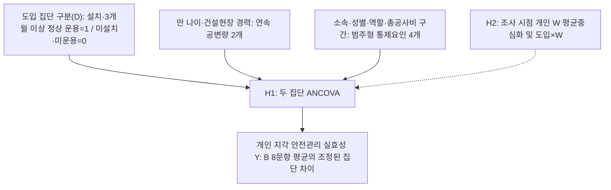

# 제4장 연구설계 및 실증분석

## 제1절 연구 모형 설계

본 연구의 목적은 중소규모 건설현장을 위한 YOLO-LLM 안전관제 시스템을 개발하고, 도입 현장과 미도입 현장의 안전관리 실효성 차이를 실증적으로 검증하는 데 있다. 고가 서버와 VMS(Video Management System)에 의존하는 기존 스마트 안전관제 시스템은 안전관리 예산이 제한된 중소규모 현장에서 도입하기 어렵다(이준호, 2024). 본 연구는 일반 사무용 PC와 기존 현장 카메라(ONVIF)로 운용할 수 있는 저비용 시스템을 그 대안으로 제시한다.

두 집단의 비교에는 사후 설문 1회를 이용하는 횡단적 준실험 설계를 적용한다. 도입 집단은 A공사 경기지역본부 산하 조사대상 건설현장 가운데 시스템 설치와 응답일 현재 3개월 이상 정상 운용이 확인된 현장으로 구성하고, 미도입 집단은 같은 관할 범위에서 미설치·미운용이 확인된 현장으로 구성한다. 독립변수는 현장 단위의 YOLO-LLM 안전관제 시스템 도입이며, 종속변수는 관리자가 지각한 현재 안전관리 업무의 실질적 수행 수준이다.

시스템 개발은 안전관리 자원이 부족한 중소규모 현장을 지향하지만, 조사 표본에는 총공사비 120억 원 이상 현장도 포함한다. 개발 대상과 조사 표본의 범위를 구분하며, 조사에 포함된 모든 현장을 중소규모라고 정의하지 않는다. 현장별 한 명의 응답은 해당 관리자의 지각을 나타내므로 현장 전체의 객관적 안전관리 실효성을 완전하게 대표하지 않는다.

가설의 방향은 기술수용 연구와 안전관리 업무 지원 기제를 연결하여 설정한다. 기술수용모델(Davis, 1989)과 스마트 안전기술의 수용·채택 의도 연구(이동건, 2024; Chong et al., 2023)는 기술을 받아들이는 조건을 설명할 뿐 실제 안전 성과를 직접 입증하지 않는다. 따라서 본 연구는 저비용 인프라의 도입 가능성(이준호, 2024)과 위험정보 전달·대응 지원 기제를 바탕으로 관리자가 지각한 안전관리 실효성의 집단 차이를 검토하며, 그 근거는 제2장 제5절에서 고찰하였다.

본 연구는 인과관계의 세 조건인 공변성, 시간적 우선성, 외생변수 통제를 각각 어디까지 충족하는지 구분하여 제시한다(Shadish, Cook, & Campbell, 2002). 공변성을 확인하기 위해서는 응답자와 현장 특성을 조정하여 집단 평균을 비교하는 공분산분석(ANCOVA)을 사용한다. 시간적 우선성에 대해서는 시스템 운용이 사후 측정보다 앞서도록 한다. 다만 도입 전 안전관리 실효성을 측정하지 않으므로, 현재 수준이 도입 후에 형성되었는지까지는 확인할 수 없다.

외생변수를 통제하기 위해 여섯 특성을 조정하고 사전 특성의 분포·균형을 진단한다. 만 나이와 건설현장 경력은 연속 공변량으로, 소속 구분·성별·역할·총공사비 구간은 범주형 통제요인으로 투입한다. 이하 가설 문장의 ‘공변량’은 연속 공변량과 범주형 통제요인을 통칭한다. 비무작위 선정에 따른 편향과 측정하지 않은 교란요인의 영향은 조정 후에도 남을 수 있으므로, 결과는 관리자가 지각한 안전관리 실효성의 조정된 집단 차이로 해석하며 인과 효과를 단정하지 않는다.

비교 조건의 범위도 미리 한정한다. 미도입 집단에는 CCTV를 운용하는 현장과 운용하지 않는 현장이 함께 포함된다. 따라서 주 비교에서는 본 시스템 운용 현장과 통상적인 방식으로 안전관리를 수행하는 현장의 관리자가 현재 업무 수준을 어떻게 다르게 지각하는지 살펴본다. 이 차이는 기존 영상 인프라의 기여와 LLM 후단 검증·모바일 알림 등 추가 기능의 기여를 분리한 인과 효과가 아니다.

이상의 설계를 토대로 연구변수를 구성하면 <표 4-1>과 같다.

<표 4-1> 연구변수의 구성

| 변수 구분 | 변수 및 하위요인 | 구성과 역할 |
|:---:|:---|:---|
| 독립변수 | YOLO-LLM 안전관제 시스템 도입 | 설치·3개월 이상 정상 운용 확인 도입=1, 미설치·미운용 확인 미도입=0 |
| 종속변수 | 안전관리 실효성 | 관리자 개인이 지각한 현재 안전관리 업무 수준. 조기인지, 대응 신속성, 원격 파악, 순찰부담 경감, 위험 통제력의 5개 하위요인 |
| 조정변수 | 응답자·현장 특성 | 연속 공변량: 만 나이·건설현장 경력; 범주형 통제요인: 소속 구분·성별·역할·총공사비 구간 |
| 상호작용 변수 W | 안전관리 예산 제약성 | 집단×예산 제약성 상호작용의 방향과 효과크기를 검토하는 공통 응답 변수 |
| 참고 변수 | 현장 운영 특성(두 집단 공통), 시스템 특성 인식·경보 피로도 완화 인식(도입 집단) | 주 분석에 투입하지 않는 응답 변수. 현장 운영 특성은 위험 인지 경로·시점·지시 전달 소요시간의 집단별 교차표를 보고하고 A-7·A-8 운용 실태 확인(민감도 분석 부분집단), A-9 <표 4-6> 해석에 쓰며, 시스템 특성 인식·경보 피로도 완화 인식은 도입 집단의 기술통계만 보고 |

연구 모형은 도입 집단 구분(D)에 따른 두 집단의 안전관리 실효성 조정 평균을 비교하는 단순 모형으로 설정하였다.

주: 화살표는 모형의 분석 관계이며 인과관계 입증을 뜻하지 않는다.

<그림 4-1> 연구 모형

주 분석은 <그림 4-1>의 비교 모형으로 수행하며, 주 결론은 H1의 집단 간 조정 평균 차이로 도출한다. 모집 목표와 검정력은 제5절 제1항에서 다룬다.

## 제2절 연구 문제 및 연구 가설

본 연구는 제1절의 연구 모형에 따라 두 개의 연구 문제와 이에 대응하는 연구 가설을 설정한다. 각 가설의 이론적 근거와 선행연구는 제2장 제5절 제1항(H1)·제2항(H2)에서 고찰하였다.

**연구 문제 1.** 두 집단(YOLO-LLM 안전관제 시스템 도입집단, 미도입집단)의 관리자가 지각한 현재 안전관리 실효성은 응답자·현장 특성(공변량)을 통제한 후에도 차이가 있는가.

**연구 가설 1(H1).** 두 집단(YOLO-LLM 안전관제 시스템 도입집단, 미도입집단) 중 도입집단의 관리자가 지각한 안전관리 실효성은 응답자·현장 특성(공변량)을 통제한 후에도 미도입집단보다 높을 것이다.

H1은 안전관리 실효성 8문항 평균점수의 조정 평균 차이로 검정한다. 조기인지·대응 신속성·원격 파악·순찰부담 경감·위험 통제력의 하위요인별 차이는 H1의 해석을 보완하는 분석으로 제시한다.

**연구 문제 2.** 두 집단 간 안전관리 실효성 차이는 응답자가 조사 시점에 지각한 안전관리 예산 제약성 수준에 따라 달라지는가.

**연구 가설 2(H2).** 두 집단 간 안전관리 실효성 차이는 조사 시점에 안전관리 예산 제약성을 크게 지각하는 응답자일수록 더 클 것이다.

H2는 H1과 같은 조정변수에 W와 집단의 상호작용항을 더한 일반선형모형으로 검정한다.

이상의 연구 가설을 종합하면 <표 4-2>와 같다.

<표 4-2> 연구 가설 종합

| 가설 | 가설 내용 | 분석 관계 |
|:---:|:---|:---:|
| H1 | 두 집단(YOLO-LLM 안전관제 시스템 도입집단, 미도입집단) 중 도입집단의 관리자가 지각한 안전관리 실효성은 응답자·현장 특성(공변량)을 통제한 후에도 미도입집단보다 높을 것이다. | 집단 → Y |
| H2 | 두 집단 간 안전관리 실효성 차이는 조사 시점에 안전관리 예산 제약성을 크게 지각하는 응답자일수록 더 클 것이다. | 집단 × W → Y |

## 제3절 변수의 조작적 정의 및 측정도구 구성

### 제1항 변수의 조작적 정의

본 연구의 변수는 제2장에서 고찰한 개념을 토대로 조작적으로 정의하였으며, 변수별 하위요인과 측정방법은 <표 4-3>과 같다.

<표 4-3> 변수의 조작적 정의와 측정도구의 구성

| 변수명 | 하위요인 | 조작적 정의 | 측정방법 |
|:---|:---|:---|:---|
| 독립변수: YOLO-LLM 안전관제 시스템 도입(D) | — | 시스템 설치와 응답일 현재 3개월 이상 정상 운용이 확인된 현장(도입=1)과 미설치·미운용이 확인된 현장(미도입=0)의 구분. 알림 경험은 별도 기록 | 연구자가 설치·운용 상태를 아는 현장에 설문을 안내하고 응답자가 첫 질문에서 선택한 이분형 현장 구분 |
| 종속변수: 안전관리 실효성(Y) | 조기인지 | 현장 관리자가 자기 현장에서 위험 징후를 사고로 이어지기 전에 발견한다고 지각하는 수준 | 5점 리커트척도(B-1) |
| | 대응 신속성 | 위험 상황을 인지한 뒤 초동 대응을 빠르게 지시한다고 지각하는 수준 | 5점 리커트척도(B-2) |
| | 원격 파악 | 현장에 직접 가지 않고도 위험 상황을 파악하고 위험 정보와 조치 필요사항을 공유한다고 지각하는 수준 | 5점 리커트척도(B-3·B-4) |
| | 순찰부담 경감 | 제한된 인력으로 순찰·확인 업무를 효율적으로 수행하고 불필요한 확인보다 실제 위험 대응에 집중한다고 지각하는 수준 | 5점 리커트척도(B-5·B-6) |
| | 위험 통제력 | 시정·작업중지 등 통제 조치를 신속하게 시행하여 위험요인을 실질적으로 통제한다고 지각하는 수준 | 5점 리커트척도(B-7·B-8) |
| 상호작용 변수: 안전관리 예산 제약성(W) | — | 조사 시점에 고가 스마트 안전장비나 관제 시스템을 도입하기에 안전관리 예산과 산업안전보건관리비·본사·발주청 지원이 부족하다고 지각하는 정도 | 5점 리커트척도(C-1∼C-4) |
| 참고 변수: 시스템 특성 인식(도입 집단) | 인프라 범용성 | 일반 사무용 PC와 기존 카메라로 구동되어 별도 장비 투자 부담이 적다고 경험한 정도 | 5점 리커트척도(D-1·D-2) |
| | 탐지·제어 안정성 | 알림이 몰리거나 통신 상태가 좋지 않아도 안정적으로 작동한다고 경험한 정도 | 5점 리커트척도(D-3·D-4) |
| | 오탐 필터링 | 배경이나 정상 작업을 위험으로 잘못 알리는 일이 드물다고 경험한 정도 | 5점 리커트척도(D-5·D-6) |
| | 알림 전파 즉각성 | 위험 요약과 이미지가 모바일 메신저로 신속하게 전달되고 이를 통해 현장 상황을 파악한다고 경험한 정도 | 5점 리커트척도(D-7·D-8) |
| 참고 변수: 경보 피로도 완화 인식(도입 집단) | — | 오탐 필터링으로 잦은 경보 확인에 따른 스트레스·둔감화와 불필요한 확인 부담이 줄었다고 회고적으로 지각하는 정도 | 5점 리커트척도(E-1∼E-4) |
| 참고 변수: 현장 운영 특성 | — | 담당자 부재 시 위험 인지 경로, 순찰 간 위험 인지 시점, 인지 후 지시 전달 소요시간 | 보기 선택(A-7·A-8: 운용 실태 확인, A-9: 과정 지표), 응답일 직전 1개월 |
| 조정변수: 응답자·현장 특성 | 연속 공변량 | 만 나이(세), 건설현장 경력(년) | 숫자 기입(A-3·A-4) |
| | 범주형 통제요인 | 소속 구분, 성별, 역할, 총공사비 구간(4구간) | 명목척도(A-1·A-2·A-5·A-6) |

주: 안전관리 실효성 하위요인의 정의는 제2장 제3절 제1∼5항을 따른다. 문항별 근거는 별도의 근거 대조표로 관리하며 문항 전문은 부록(도입 현장용·미도입 현장용 설문지)에 수록한다.

종속변수를 특정 시스템의 기능이나 만족도가 아닌 현장 일반의 업무 수준으로 정의한 것은, 미도입 현장 관리자도 같은 기준으로 응답하게 하여 두 집단을 비교하기 위해서이다.

YOLO-LLM 안전관제 시스템 도입(D)은 정상 운용 중 알림이 없었던 현장도 1로 코딩하며, 실제 알림 수신과 응답자의 확인 경험은 설문의 현장 운영 특성 문항(A-7·A-8)으로 확인하고 현장 단위 알림 기록과는 연결하지 않았다. 정상 운용 기간은 시스템 설치일부터 세며, 운용 중 1차 검출 가중치의 갱신은 검출 대상 범주가 같은 가중치 교체이므로 운용 중단으로 보지 않는다. 연구자는 현장의 설치·운용 상태를 확인하여 3개월 이상 정상 운용 요건을 충족한 현장을 도입 표본으로 정하였다. 정상 운용 기간이 3개월 미만이거나 중단·장애가 있는 현장은 미도입으로 재분류하지 않고 도입 표본에 넣지 않는다.

설치 직후에는 카메라 등록·임계값 조정·알림 수신자 설정 같은 초기 설정과 적응 과정이 이어지므로, 응답일 현재 3개월 이상 정상 운용을 도입 요건으로 두어 B·C 문항 기준기간(응답일 직전 1개월) 전체가 안정된 운용 기간에 들도록 하였다. 운용 안정화에 필요한 기간을 보고한 문헌은 확인하지 못했다[CITE_TODO: 스마트 안전장비·영상관제 도입 후 운용 안정화 기간 근거]. 이 요건은 설치 후 2개월 안에 초기 설정과 적응이 끝난다는 가정에 기댄다.

안전관리 실효성(Y)과 안전관리 예산 제약성(W)은 두 집단 모두 설문 응답일 직전 1개월을 기준으로 응답한다. W는 점수가 높을수록 예산 제약을 크게 지각한다는 뜻이다. 다만 W는 조사 시점의 개인 지각이므로 현장의 객관적 예산이나 도입 전 조건과 같지 않고, 도입 경험이 사후 인식과 관련될 가능성도 남는다.

현재 채점안은 안전관리 실효성 점수(Y)를 8문항의 동일 가중 평균으로 산출한다. 하위요인별 문항 수가 1·1·2·2·2개이므로 2문항 하위요인은 1문항 하위요인보다 전체 점수에서 두 배의 비중을 차지하며(12.5%·12.5%·25%·25%·25%), 이 평균점수는 단일 잠재요인으로 검증된 점수가 아니라 다섯 하위요인을 포괄하는 합성점수이다. Y와 W는 기본 채점 규칙에 따라 해당 척도 전 문항에 응답한 경우 평균을 산출하며, 부분 무응답을 임의 평균이나 0점으로 채우지 않는다. 단일 문항 하위요인에는 α를 산출하지 않으며, 채점안은 H1 결과를 보기 전에 고정한다.

시스템 특성 인식(D)과 경보 피로도 완화 인식(E)은 도입 집단만 응답할 수 있으므로 가설 검정에 투입하지 않고 도입 집단의 기술통계만 보고하는 참고 변수로 둔다. E는 같은 현장에서 도입 전 자동 알림과 현재 본 시스템의 알림을 비교한 회고적 인식이고 비교 기간도 따로 정하지 않으므로, 실제 사전·사후 변화량이나 인과 효과를 측정한 값이 아니다.

현장 운영 특성(A-7∼A-9)은 Y·W에 포함하지 않고 공변량이나 범주형 통제요인으로도 투입하지 않는다. 위험 인지 경로·시점·소요시간은 도입이 안전관리 실효성과 관련되는 기제일 수 있어, 이를 통제하면 추정하려는 집단 차이의 일부를 지우는 과잉통제가 되기 때문이다. 대신 이 문항은 지각 점수만으로는 판별하기 어려운 응답 편향을 점검하기 위해 둔다. 미도입 현장 관리자는 비교할 기준이 없어 자기 현장의 위험 파악과 조치 수준을 높게 평가할 수 있고, 도입 현장 관리자는 연구자와의 관계를 의식해 후하게 응답할 수 있다(제5절 제1항). 두 편향은 집단 차이에 반대 방향으로 작용하므로 서로 상쇄된다고 가정할 수 없다. 이에 응답 형식을 달리하여 측정 방법을 분리하는 절차적 처방(Podsakoff et al., 2003)[UNVERIFIED: Podsakoff et al.(2003)의 측정 방법 분리 처방의 원문 쪽수·표현 대조 필요]을 참고하여, 평가가 아닌 사실을 보기 선택으로 묻는 문항을 리커트 지각 척도와 따로 두었다.

세 문항은 역할이 다르다. A-7(담당자 부재 시 위험 인지 경로)과 A-8(순찰 간 위험 인지 시점)은 도입 현장에서는 시스템이 관리자의 위험 인지 경로가 되었는지를, 미도입 현장에서는 다른 알림 수단을 갖추었는지를 보여 주는 운용 실태 확인 지표이다. 자동 알림과 발생 직후 알림은 시스템 기능 자체이므로 두 문항의 집단 차이는 설계상 거의 보장되며, 안전관리 실효성의 근거나 H1 결과를 판별하는 조합에 쓰지 않는다. A-9(인지 후 지시 전달 소요시간)만 위험을 안 뒤의 대응 과정을 나타내는 과정 지표로 두어 H1 결과와 짝지어 해석한다(제5절 제2항).

운용 실태 확인은 결과를 보기 전에 정한 다음 규칙을 따른다. 본 시스템은 PC용 데스크톱 뷰어와 모바일 메신저 알림으로 위험 정보를 전달하므로, 도입 현장 응답자가 A-7에서 ③ 또는 ④(CCTV 화면 직접 확인 또는 자동 알림)를 고르고 A-8에서 ③(발생 직후 알림)을 골랐으면 시스템 경로가 작동한 것으로 본다. A-7이 ①·②이거나 A-8이 ③이 아니면 시스템이 그 관리자의 위험 인지 경로가 되지 못한 현장으로 기록한다. A-7에서 ⑤(기타)를 고른 응답은 자동 알림을 명시하지 않았으므로 시스템 경로가 작동하지 않은 것으로 분류한다. 이 기록은 정상 운용 확인 결과와 함께 읽으며, 해당 현장을 미도입으로 재분류하지 않는다.

조정변수 가운데 만 나이와 건설현장 경력은 구간으로 바꾸지 않고 연속값으로 투입한다. 경력은 안전관리·공사감독·시공관리 등 건설현장 업무 경력을 합한 기간이며, 같은 기간에 여러 현장을 담당한 경력은 중복하여 더하지 않으며, A-4는 연 단위 정수(1년 미만은 0, 6개월 이상은 올림)로 수집하여 그대로 연속값으로 사용한다. 소속 구분·성별·역할·총공사비 구간은 범주형 요인으로 지정하고 기준범주 대비(Treatment) 더미변수로 표현한다. 총공사비는 조사 대상으로 정한 현장 전체의 응답일 현재 최신 확정 금액(부가가치세와 관급자재비 포함)을 기준으로 한 조사용 네 구간이며, 법적 규모 분류가 아니므로 구간 코드를 등간 연속값이나 실제 공사비로 처리하지 않는다.

이 변수들은 업무·책임 범위, 위험 판단과 업무 경험, 자원·관리 여건에서 나타나는 구성 차이를 조정하기 위해 투입하며, 성별 자체의 안전관리 능력 차이는 가정하지 않는다. 이는 연구자의 선정 논리이며, 각 변수가 집단과 Y 양쪽에 관련된다는 선행 근거는 보완이 필요하다[CITE_TODO: 여섯 통제변수별 교란 조정의 이론적 근거 보완]. 도입 후 값이 바뀌었을 가능성은 잔여 교란 또는 과잉조정의 한계로 보고하며, 통제변수 계수는 H1의 실질적 성과로 해석하지 않는다.

### 제2항 측정도구의 구성 및 설문 문항 도출 출처

본 연구의 측정도구는 표준화된 기존 척도를 그대로 사용하지 않고, 선행연구의 개념을 근거로 연구자가 작성한 구 설계 문항을 새 비교 설계에 맞게 수정한 연구자 수정·개발 척도이다. 안전관리 실효성 B-1∼B-8은 구 설계의 시스템 귀속형 안전관리 실효성 8문항을 두 집단이 같은 기준으로 응답할 수 있는 현장 일반형으로 수정한 문항이다. 예산 제약성 C-1∼C-4는 구 예산 제약성 4문항의 표현을 다듬은 문항이다. 시스템 특성 인식 D-1∼D-8은 구 시스템 특성 16문항에서 하위특성별 대표 2문항을 선별하였고, 경보 피로도 완화 E-1∼E-4는 구 경보 피로도 4문항을 도입 현장 전용부로 옮겨 표현을 고쳤다. 현장 운영 특성 A-7∼A-9는 기존 문항을 옮기지 않고 연구자가 새로 작성한 사실 문항이다.

안전관리 실효성 문항은 다섯 하위요인에 관한 연구에 근거한다(김민기·박성호, 2026; 김용선, 2022; 김태헌, 2026; 김현수, 2026; 이동건, 2024; 이창남, 2025; 황병복, 2026; Chong et al., 2023; Cvach, 2012; Wu et al., 2025). 예산 제약성 문항은 중소현장의 산업안전보건관리비와 기술 비용 제약을 다룬 논의에 근거한다(김용선, 2022; 윤영석, 2025; 이준호, 2024; 조도빈, 2026; Zhou et al., 2023). 시스템 특성 인식 문항은 네 기술 특성에 관한 연구와 가이드라인에 근거하며(국토교통부·국토안전관리원, 2024; 김민기·박성호, 2026; 김용선, 2022; 김태헌, 2026; 김현수, 2026; 류수영, 2023; 이동건, 2024; 이준호, 2024; 이창남, 2025; Chong et al., 2023; Cvach, 2012; Kim et al., 2025; Wu et al., 2025), 경보 피로도 완화 인식 문항은 알람 피로 이론과 하이브리드 관제 연구에 근거한다(김현수, 2026; Cvach, 2012). 현장 운영 특성 문항은 <표 2-2>의 전달 기능과 제3장 제1절 제2항의 적시성 요구사항(R5)에서 묻는 상황을 정하고, 담당자 부재 시 원격 파악과 순찰 보완을 다룬 연구를 참고하였다(김용선, 2022; 이창남, 2025).

리커트 문항은 모두 1점 ‘전혀 그렇지 않다’부터 5점 ‘매우 그렇다’까지의 5점 척도로 측정한다.

## 제4절 설문조사 설계 및 척도 검증

### 제1항 설문조사의 개요 및 절차

본 설문조사는 도입 현장과 미도입 현장의 안전관리 실효성을 동일한 기준으로 측정하기 위한 횡단 조사이다. 두 집단의 B·C는 설문 응답일 직전 1개월의 현장 안전관리 실태·여건을 평가하도록 안내를 통일한다. B의 안내에는 순찰과 순찰 사이나 안전관리 담당자가 현장에 없는 시간대에 생긴 위험 상황까지 포함하도록 평가 상황을 고정하는 문장을 두 양식에 같게 두며, 한쪽 양식에만 시스템을 소개하는 유도를 피하기 위해 시스템 이름과 기능은 언급하지 않는다. A는 각 문항의 기준시점·기간을 따르고, D·E는 문항별 직접 경험을 기준으로 응답한다.

측정도구는 두 집단에 적용하는 일반형 안전관리 실효성 문항의 내용타당도와 집단 간 해석 가능성을 조사 전에 확보하기 위해 4단계 절차로 설계하였으며, 이 가운데 1단계 선행연구 고찰 및 초기 문항 풀 구성과 2단계 국내 관계 법령 및 건설 실무 지표 대조를 실시하였다. 제2장의 이론적 배경과 제3절의 조작적 정의를 토대로 변수별 초기 문항 풀을 구성한다. 기존 문항은 새 집단 비교 맥락에 맞게 수정하되 문항별 출처를 유지한다. 두 집단 공통의 현장 운영 특성 A-7∼A-9는 지각이 아닌 사실을 묻는 문항으로 문항 풀에 함께 포함한다. 초기 문항을 산업안전보건법령의 산업안전보건관리비 기준과 스마트 안전장비 활용 가이드라인 등 국내 제도·실무 지표와 대조하여 현장 용어에 맞게 정비한다(국토교통부·국토안전관리원, 2024).

3단계 전문가 필수성 평정과 4단계 인지면접·예비조사는 실시하지 않았다. 계획한 절차는 양 집단 실무를 대표하는 전문가가 리커트 24문항과 사실 문항 3개(A-7∼A-9)를 ‘필수적’, ‘유용하나 필수적이지 않음’, ‘불필요’로 평정하고 문항별 내용타당도 비율(CVR)을 채택 기준과 비교하는 것이었다(Lawshe, 1975). 문항은 지도교수 검토를 거쳐 CVR에 따른 채택·삭제 없이 그대로 사용하였다. 4단계는 도입·미도입 집단별 인지면접으로 공통부와 A-7∼A-9의 보기, Part B의 평가 상황을 두 집단이 같은 뜻으로 해석하는지 확인하고, 응답자 약 30명의 예비조사로 천장·바닥효과, 문항 변별력, Cronbach's α를 점검하는 계획이었다. 문항 표현은 조사 전 표현 점검(2026-09-30)으로 다듬었고 최종 문항은 2026-10-14 배포본으로 고정하였다. Y·W 채점 규칙과 결측·설계상 비해당·불성실 응답 기준은 제3절 제1항과 제5절 제2항에 정한 규칙을 적용하였다. α만으로 단일차원성이나 타당도·측정동일성 확보를 선언하지 않으며, 3·4단계를 실시하지 않은 데 따른 내용타당도의 한계는 제5장에 기술한다.

### 제2항 본 설문지의 최종 구성

본 설문지는 공통부 21문항과 도입 현장 전용부 12문항으로 구성하며, 문항 전문은 부록에 수록하였다. 미도입 집단은 공통부 21문항에 응답하고, 도입 집단은 최종 구성에 따라 공통부와 전용부를 합한 33문항에 응답한다. D·E 모두 비해당 선택지 없이 1∼5점 응답만 받으며 문항별 유효 응답 수·일반 무응답 수를 보고한다.

<표 4-4> 설문지의 최종 구성

| 구분 | 변수명 | 내용 | 응답 대상 | 문항수 | 문항번호 |
|:---:|:---|:---|:---:|:---:|:---:|
| 공통부 A | 인구통계학적 특성 및 현장 운영 특성 | 소속·성별·만 나이(세)·건설현장 경력(년)·역할·총공사비 구간, 위험 인지 경로·시점·지시 전달 소요시간(참고 변수) | 전체 | 9 | A-1∼A-9 |
| 공통부 B | 안전관리 실효성 | 조기인지·대응 신속성·원격 파악·순찰부담 경감·위험 통제력 | 전체 | 8 | B-1∼B-8 |
| 공통부 C | 안전관리 예산 제약성 | 예산 부족과 제도적·조직적 지원 제약 | 전체 | 4 | C-1∼C-4 |
| **공통부 소계** | | | **전체** | **21** | |
| 전용부 D | 시스템 특성 인식 | 범용성·안정성·오탐 필터링·알림 전파 | 도입 집단 | 8 | D-1∼D-8 |
| 전용부 E | 경보 피로도 완화 인식 | 스트레스·둔감화·확인 부담 완화(참고용 기술 척도) | 도입 집단 | 4 | E-1∼E-4 |
| **전용부 소계** | | | **도입 집단** | **12** | |
| **현행안 합계** | 미도입 집단 21문항, 도입 집단 33문항 | | | **21 또는 33** | |

주: 21·33문항은 측정 문항 수이며, 조사 관리용 현장 구분·현장명·성명 3개 입력 항목은 제외한다. A-7∼A-9는 리커트 척도가 아닌 보기 선택형 사실 문항으로 주 분석에 투입하지 않는다. 현장 구분 선택은 전자 설문의 문항 이동과 분석용 집단 구분에, 현장명·성명은 중복 제출 확인에 사용하며 세 항목 모두 점수나 공변량으로 투입하지 않는다. D-6은 LLM이 입력받는 원본 프레임의 작업 상황을 범위로 하며 영상의 시간적 전후 관계를 뜻하지 않는다. D-7은 지각된 알림 신속성을 묻는 문항이며 실제 지연 시간의 측정치가 아니다.

## 제5절 자료 수집과 분석방법

### 제1항 데이터 수집 표본 설계

본 연구의 조사대상은 A공사 경기지역본부 산하 건설현장에서 안전관리 업무를 수행하는 현장 관리자이다. 응답자는 두 집단 모두 시공사 측 현장소장·안전관리자·관리감독자와 발주청 측 공사감독·감리원 가운데 담당 현장의 안전관리 예산·지원 여건을 판단할 수 있는 사람으로 정하고, 현장당 1명을 모집하되 동일인의 중복 응답을 막기 위해 담당 현장 하나를 사전에 지정한다. 결과의 적용 범위는 실제 모집된 현장의 규모 분포와 공통 관측범위로 한정한다.

비교 대상은 도입 현장 30개소와 미도입 현장 30개소, 총 60개소이며 현장당 1명씩 총 60명을 모집 목표로 한다. 현장은 같은 관할 범위에서 공사금액 규모와 주요 특성이 유사한 곳을 우선 확보하되, 무작위 배정을 전제하지는 않는다. 실제 조사에서는 연구자가 설치·운용 상태를 아는 현장 가운데 요건을 충족한 도입 현장 32개소와 미도입 현장 39개소에 현장당 1명씩 설문을 안내하였다. 사전 검정력 산정은 하지 않았고, 실제 표본에서 검출 가능한 최소 효과는 제7절에 보고한다.

도입 현장의 후보 명부는 경기지역본부 안전관제 시스템의 카메라 등록 백업 자료로 파악한 등록 90개소·108대이며, 이는 모집 목표나 분석 표본이 아닌 조사 후보의 범위이다. 비교 조건 가운데 다른 스마트 안전장비는 조사 대상 전 현장에 없음을 연구자가 확인하였고, 기존 CCTV 보유 여부·원격 열람·공종·안전관리 담당 인력은 현장 단위로 수집하지 않았다. 도입 현장의 운용 설정은 전 현장에 동일하게 적용하였으며 제3장에 기술한 구성을 따른다. 따라서 인프라·운용 조건에 따른 추가 분석은 수행하지 않는다.

자료 수집은 2026년 10월 Google Forms를 이용한 온라인 자기응답 설문 1회로 실시하였으며, 연구자가 설치·운용 상태를 아는 현장의 응답자에게 단일 설문 링크를 안내하였다. 첫 질문에서 도입 현장 또는 미도입 현장을 선택하면 각각 A∼E 33문항 또는 A∼C 21문항으로 이동한다. 응답자가 자기 현장의 상태를 선택하므로 이 선택을 분석용 집단으로 사용한다. Google 계정 로그인은 요구하지 않았고 응답자 이메일도 수집하지 않았으며, 중복 제출은 응답 내용의 동일성과 제출시각으로 점검한다. 연구자는 응답마다 내부 식별번호를 부여하고 성명과 현장명을 제거한 통계분석용 사본으로 분석하며, 결측·이상값을 검토한다. 현장별 설치일·운용 기간, 정상 가동 세부 판정 기준과 미충족 현장 수, 추출 순서·규모 매칭 기준, 등록 현장과 분석 현장의 대응 기준, 설문 계정 권한·자료 보관 기간과 연구윤리 심의 대상 여부 확인 결과는 별도로 기록하지 않았다.

연구자는 비교 대상 시스템을 개발하였고 현장 관리에도 관여하므로, 응답자가 연구자와의 관계를 의식하여 응답할 가능성이 있다. 이를 줄이기 위해 안내문에 연구자의 역할, 자발적 참여와 중단 가능성, 개별 응답의 비공개를 밝히되, 연구자가 식별 원자료를 열람할 수 있으므로 완전한 익명성을 보장한다고 표현하지 않는다. 표본 설계의 세부 내용은 <표 4-5>와 같다.

<표 4-5> 자료 수집 개요

| 구분 | 내용 |
|:---:|:---|
| 조사대상 | A공사 경기지역본부 산하 조사대상 건설현장의 현장 관리자·안전관리자, 총공사비 120억 원 이상도 포함 |
| 비교 집단 | 모집 목표는 설치·3개월 이상 정상 운용 확인 도입 30현장과 미설치·미운용 확인 미도입 30현장(총 60현장), 실제 응답은 도입 32현장·미도입 39현장(총 71현장) |
| 선정 기준 | 동일 관할의 주요 특성 유사 현장 우선 확보, 구체적 추출 순서·매칭 기준은 별도 기록 없음 |
| 도입 후보 명부 | 카메라 등록 백업 자료와 식별값 없는 1대의 별도 현장 확인으로 파악한 등록 90개소·108대(1대 77개소, 2대 8개소, 3대 5개소), 모집 목표가 아닌 후보 범위이며 3개월 이상 정상 운용 확인 후 도입 표본 선정, 등록 현장과 분석 현장 단위의 대응 기준은 별도 기록 없음. 카메라별 원격 알림 허용 설정은 정상 운용의 증거로 쓰지 않음 |
| 정상 운용 확인 | 연구자가 설치·3개월 이상 정상 운용 요건 충족을 확인, 현장별 설치일·운용 기간은 별도 기록 없음 |
| 응답자 기준 | 양 집단 동일 직무 범위 및 담당 현장의 안전관리 예산·지원 여건 파악, 모집 전 예산 파악·참여 기준 충족 확인 결과는 별도 기록 없음, 현장당 1명·담당 현장 사전 지정으로 개인 중복 응답 방지, 알림 경험은 A-7·A-8 응답으로 확인 |
| 비교 조건 기록 | 다른 스마트 안전장비는 전 현장 없음(연구자 확인); 기존 CCTV 보유 여부·원격 열람·공종·안전관리 담당 인력은 현장 단위 미수집; 도입 현장의 운용 설정은 전 현장 동일(제3장 구성). 이 조건으로 모집 제외나 공변량 추가를 하지 않음 |
| 조사 설계 | 사후 설문 1회의 횡단적 두 집단 비교 준실험 설계 |
| 조사 방식 | Google Forms 온라인 자기응답, 연구자가 설치·운용 상태를 아는 현장에 단일 링크 안내 후 첫 질문의 ‘CCTV YOLO-LLM 안전알림 도입 현장’·‘CCTV YOLO-LLM 안전알림 미도입 현장’ 선택으로 분기하여 직접 제출, 선택한 현장 구분을 분석용 집단으로 사용 |
| 자료 관리 | 성명과 현장명이 포함된 원응답·CSV 원자료와 코드·성명·현장명 대응표·현장 명부는 연구자 본인만 열람, 통계분석용 사본과 분리 보관 |
| 조사 시기·기준기간 | 2026년 10월 실시, 공통 B·C는 두 집단 모두 설문 응답일 직전 1개월, 도입 현장은 응답일 현재 3개월 이상 정상 운용 확인 |
| 목표 표본 | 현장당 1명, 집단별 응답 30건, 총 60부(사전 검정력 산정 없음). 실제 응답 71명(도입 32·미도입 39) 전원 분석 |
| 분석 단위 | 개인 응답자, 한 현장 한 명의 자료로 두 집단 ANCOVA; 현장 ID는 중복 확인용 |

### 제2항 분석 절차

본 연구는 본 조사, 자료 정제·채점, 기술통계와 측정도구 점검, 사전 특성 분포·균형 진단, 공분산분석 가정 점검, 가설 검정 순으로 분석한다. 주 분석은 Python 3.12.10의 statsmodels 0.15.0(Seabold & Perktold, 2010)으로 수행한다. 모형은 최소제곱(OLS)으로 적합하며, 집단 검정의 F·p와 부분 η²는 Type III 제곱합의 분산분석표(anova_lm)로 산출하고 조정 평균을 계산한다. 계수 신뢰구간·잔차·공선성·영향점은 같은 사례·변수·모형식의 OLS 출력으로 확인한다.

**1. 자료 정제, 주요 변수 기술통계와 측정도구 점검.** Y와 W는 제3절 제1항의 채점 규칙에 따라 산출하며, H1은 Y·집단·여섯 조정변수가 완전한 사례를, H2는 추가로 W가 완전한 사례를 사용한다. 일반 무응답과 미도입 집단 D·E의 설계상 비해당을 구분하고, 설계상 비해당이나 일렬응답만으로 자동 제외하지 않으며, 문항·변수별 결측률과 집단별 제외 사유를 보고한다. 응답 소요시간은 수집하지 않았으므로 불성실 응답 판정에 쓰지 않는다. 결측 민감도 분석의 필요성과 방법은 그 가정·근거를 기록하여 결정한다. 주요 변수 기술통계로 Y·하위요인·W의 집단별 평균·표준편차·왜도·첨도와 참고 척도(D·E)의 문항별 응답 상태·평균을 제시한다. Y·W의 Cronbach's α는 전체 및 집단별 내적 일관성 정보로 사용하고, 2문항 하위요인에는 문항 간 상관을 함께 제시한다. 척도 구조는 Y 8문항과 W 4문항에 각각 탐색적 요인분석을 적용하여 확인한다. 추출은 반복 주축요인추출(PAF), 요인 수는 상관행렬 고유값이 1보다 큰 요인 수와 스크리 도표로 정하며, 1요인이 추출되면 회전을 적용하지 않는다.

**2. 사전 특성 진단과 가정 점검.** 만 나이와 건설현장 경력은 집단별 평균·표준편차와 표준화 차이로, 범주형 특성은 빈도·비율로 기술하고 공통 관측범위를 확인한다. 범주형 통제요인의 기준범주는 소속=시공사, 성별=남성, 역할=공사감독, 총공사비=20억 원 미만으로 두며, 기준범주가 관측되지 않으면 대체 기준과 사유를 분석 전에 기록한다. 관리감독자·감리원은 A-5 보기 체계에서 ‘기타’로 분류하며, 범주형 통제요인 ‘역할’은 A-5 보기 그대로 4수준으로 투입한다. 비유의한 검정을 동질성 확보의 증거로 사용하지 않는다. 현장 운영 특성 A-7∼A-9는 조정변수가 아니므로 집단별 빈도·비율 교차표로 제6절 제1항의 표본 특성과 함께 기술하고, 집단 간 분포 차이는 Fisher 정확검정으로 확인하되, 집단 차이가 설계상 예상되는 A-7·A-8의 p는 참고값으로만 보고하고 A-9에는 아래 5의 판정 기준(p<.05)을 적용한다. 2×2를 넘는 교차표(A-7 5개 보기, A-8·A-9 4개 보기)의 Fisher 정확검정은 주변합을 고정한 모든 표를 열거하는 방식(Fisher–Freeman–Halton)으로 산출한다. 도입 집단의 A-7·A-8 응답은 제3절 제1항의 운용 실태 확인 규칙에 따라 따로 집계한다.

가정 점검 항목은 두 연속 공변량과 Y의 선형 관계, D×나이·D×경력에 대한 회귀기울기 동질성, 잔차 정규성과 등분산성, 영향점, 공선성과 희소범주에 따른 식별성, 현장·담당자 중복 방지에 근거한 관측의 독립성이다. 현장당 응답자가 1명이므로 현장 군집(다수준) 구조는 모형에 반영하지 않는다. 단일 검정의 비유의만으로 가정 충족을 선언하지 않으며, 유의확률을 보고 조정변수를 선택·삭제하거나 범주를 통합하지 않는다. 영향점은 Cook's D(4/n 기준)·레버리지·외적 스튜던트화 잔차로 보고하되 삭제하지 않으며, 가정 위반이나 영향점이 확인되면 HC3 강건 표준오차를 병행 보고한다. 설계행렬의 순위 결함으로 식별되지 않는 분석은 추론하지 않고 그 이유를 보고한다.

**3. H1의 공분산분석과 하위요인별 분석.** H1은 응답자 i에 대해 다음의 일반선형모형으로 검정한다.

Y_i = β₀ + β_D D_i + β_A Age_i + β_E Exp_i + Σ γ_k Z_ki + ε_i

D_i는 도입=1·미도입=0, Age_i는 만 나이(세), Exp_i는 건설현장 경력(년), Z_ki는 소속·성별·역할·총공사비 구간의 더미, ε_i는 개인 잔차이며, β_D는 다른 조정변수의 조건이 같을 때의 도입−미도입 집단 차이를 나타낸다. 유의수준은 α=.05의 양측 검정이며, 차이가 양수이고 p<.05일 때 H1을 지지하는 결과로 판단한다. 보고 지표는 집단 항의 F·자유도·p·부분 η², 집단별 조정 평균, 도입−미도입 차이와 그 95% 신뢰구간이다. 부분 η²는 다른 조정변수를 포함한 상태에서 집단 항이 설명하는 변동의 비율이다. 조정 평균은 두 집단에 같은 공변량 값과 범주형 통제요인의 관측 분포(비례 가중)를 적용한 예측 평균이며, 각 수준에 같은 비중을 주는 동일 가중 값을 참고로 병기한다. 비유의 결과를 차이가 없다는 증거로 단정하지 않는다. 사전 지정 민감도 분석으로, 제3절 제1항의 운용 실태 확인 규칙에서 시스템 경로가 작동하지 않은 도입 현장을 제외한 부분집단으로 H1을 재추정하여 참고로 보고하며, 주 결과는 전체 표본이다. 이 제외 기준은 같은 응답자의 보고에 근거하므로 부분집단 결과에도 선택 편향이 남을 수 있다.

하위요인별 분석은 다섯 하위요인 점수에 H1과 같은 모형을 각각 적용하고, 다섯 집단 효과의 p값을 하나의 검정군으로 묶어 Holm 보정을 적용한다.

**4. H2의 상호작용 분석.** H2는 H2 완전사례 전체의 평균으로 W를 평균중심화한 W_c와 D×W_c를 H1 모형에 더한 일반선형모형으로 검정하고, 상호작용 계수의 부호·SE·95% 신뢰구간과 F·p를 보고한다. 평균 및 평균±1표준편차에서의 조건부 집단 차이는 양 집단의 공통 관측범위 안에 있는 수준에만 제시하며, 이 결과를 객관적 예산 효과나 인과적 조절효과로 해석하지 않는다.

**5. 결과 해석 순서(사전 지정).** H1 결과는 과정 지표인 지시 전달 소요시간(A-9)의 집단 차이와 짝지어 해석하며, 조합별 해석 순서는 결과를 확인하기 전에 <표 4-6>과 같이 정한다. 지각 점수의 집단 차이만으로는 미도입 집단의 참조 기준 부재에 따른 자평 상향과 도입 집단의 호의 응답을 구별할 수 없기 때문이다. A-9의 ‘차이 있음’은 도입 집단의 응답이 짧은 소요시간 구간 쪽으로 미도입 집단보다 많이 분포하는 경우를 뜻한다. 판정 기준은 Fisher 정확검정 p<.05로 하고, 보기별 비율 차이는 방향을 확인하는 보조 근거로 사용한다. H1의 ‘차이 있음’은 3의 지지 판정 기준(차이가 양수이고 p<.05)을 충족한 경우이며, 조합 판정은 해석 순서를 정할 뿐 H1의 판정 자체를 바꾸지 않는다. 집단 차이가 역방향(미도입 집단의 소요시간 구간이 더 짧거나 조정 평균이 더 높음)으로 유의하면 ‘역방향 차이’로 따로 보고하고, 미도입 현장의 대체 알림 수단과 측정 편향 가능성을 먼저 논의한다.

<표 4-6> H1 결과와 과정 지표의 조합별 해석 순서

| 지시 전달 소요시간(A-9) 집단 차이 | H1(Y 조정 평균) 집단 차이 | 해석 순서 |
|:---:|:---:|:---|
| 있음 | 있음 | 대응 과정(지시 전달 소요시간)과 결과(지각 실효성)가 일치. 횡단 설계의 한계 안에서 H1 지지로 보고 |
| 있음 | 없음 | 지시 전달 과정은 다르나 지각 실효성 차이 미확인. ① 미도입 집단의 참조 기준 부재로 자평 상향 ② 도입 집단의 평가 기준 엄격화 ③ 지시가 빨리 전달되어도 현장 조치·통제로 이어지지 않아 체감 차이가 실제로 없음 ④ 검정력 부족 — 이 순서로 논의. 판별 단서: 하위요인 패턴(원격 파악·순찰부담 경감만 차이 → ①), D·E 분포(알림 즉각성·피로 완화는 높은데 B가 안 높음 → ②·③), 효과크기 신뢰구간 폭(→ ④) |
| 없음 | 있음 | 지시 전달 과정의 차이 없이 지각 실효성만 차이. 도입 집단의 호의 응답(연구자 관계) 가능성을 먼저 점검. 운용 실태(정상 운용 확인과 A-7·A-8)와 D 응답 대조 후 H1을 조건부로 해석 |
| 없음 | 없음 | 지시 전달 과정과 지각 실효성 모두 차이 미확인. A-7·A-8의 운용 실태 확인에서 시스템이 인지 경로로 작동하지 않은 도입 현장이 많으면 정상 운용·3개월 요건을 재검토하고, ‘실효성 차이 미확인’으로 결론 |

주: A-7·A-8의 집단 차이는 설계상 예상되므로 이 표의 조합 판정에 쓰지 않는다. 해석 순서는 대안 설명을 논의하는 순서이며, 각 설명은 하위요인·D·E 분포와 운용 기록으로 확인한 범위에서만 채택한다. 어느 조합도 횡단 설계의 한계를 넘어 도입의 인과 효과를 입증하지 않는다. 역방향 유의 차이는 ‘없음’이 아니라 ‘역방향 차이’로 따로 보고한다(제5절 제2항).

이 설계에 따라 제6절에서는 표본 특성, 측정도구 점검, 기술통계와 사전 특성 균형을 제시하고, 제7절에서 가설 검증 결과를 <표 4-6>의 순서로 해석한다.

## 제6절 조사 대상 특성과 측정도구 검증

본 절부터는 제1∼5절의 사후 횡단 비교 설계에 따라, 사전에 지정한 여섯 특성을 조정한 개인 지각 안전관리 실효성의 집단 차이로 H1을 검정한다. 집단 구분과 기준기간, 여섯 특성(연속 공변량 2개·범주형 통제요인 4개)의 투입 방식은 제5절 제2항의 규칙을 따르며, 현장당 1명의 응답을 공분산분석(ANCOVA)으로 분석한다. H2는 같은 조정변수를 사용하는 일반선형모형으로 검정하며, 응답자가 조사 시점에 지각한 예산 제약성에 따라 집단 차이가 달라지는지를 상호작용의 방향과 신뢰구간으로 판단한다.

실제 유효 표본은 71명(도입 32명·미도입 39명)으로 모집 목표(도입·미도입 각 30개소, 사전 검정력 산정 없음)와 구성이 다르며, 실제 계수 수는 H1 모형 12개·H2 모형 14개이다. 이 표본의 표준오차로 역산한 검출 가능 최소 효과는 제7절에 보고한다(H1 집단 차이 0.50점, H2 상호작용 0.59).

---

### 제1항 조사 대상자의 인구통계학적 특성 및 현장 운영 특성

도입 표본의 선정은 제5절 제1항의 등록 현장 90개소에서 출발한다. 연구자는 설치·운용 상태를 아는 현장 가운데 응답일 현재 3개월 이상 정상 운용 요건을 충족한 도입 현장 32개소와 미설치·미운용 현장 39개소를 조사 명부로 정하고, 현장당 1명에게 설문 링크를 안내하였다. 조사 범위는 기관 산하 조사대상 건설현장이며, 총공사비 120억 원 이상 현장도 포함한다. 중소규모 현장을 위한 시스템 개발 지향과 조사 표본의 범위를 구분하고, 이 등록 규모는 아래의 실제 조사·분석 표본과 구분한다.

조사는 2026년 10월 Google Forms 단일 링크로 실시하였다. 연구자가 설치·운용 상태를 아는 현장에 링크를 안내하였고, 응답자가 첫 질문에서 선택한 자기 현장의 구분을 분석용 집단으로 확정하였다. 다만 개별 응답과 안내 현장을 하나씩 대조한 별도 기록은 없다. 응답자 이메일은 수집하지 않았고 현장명·성명은 일부 응답자만 입력하였으므로, 중복 제출은 응답 내용의 동일성과 제출시각으로 점검하였다(<표 4-11>). 응답마다 현장 ID 역할을 하는 내부 식별번호를 부여하고 성명·현장명을 제거한 사본으로 분석하였다. 링크를 안내한 인원은 71명(도입 32개소·미도입 39개소, 현장당 1명)이며 전원이 응답하였다. 불성실 응답을 이유로 제외한 응답은 없어 분석 응답도 71건이다.

자료 정제와 채점은 제3절 제1항과 제5절 제2항의 규칙을 따른다. 부분 무응답은 대체하지 않고 분석별 완전사례를 사용하며, 현장당 1명이므로 개인 수와 현장 수는 같다.

불성실 응답 판정은 제5절 제2항의 규칙을 따랐다. 유효 표본의 문항 결측은 미도입 응답자 1명(R030)의 역할 문항 1건뿐이다. 이 응답은 역할 보기 대신 ‘.’ 한 글자를 입력하여 무응답으로 처리하였다. B·C 전 문항과 도입 집단의 D·E 전 문항에는 결측이 없으므로 Y·W는 유효 71명 전원에서 산출되었다. H1·H2 완전사례는 역할 결측 1명만 빠진 70명이어서 완전사례 선택에 따른 편향은 작다고 볼 수 있다. 리커트 전 문항을 같은 값으로 응답한 일렬응답 2건(미도입, R030·R050)은 자동 제외하지 않는다는 규칙에 따라 포함하였다. 결측이 1건뿐이므로 결측 민감도 분석은 수행하지 않았다.

<표 4-7> 조사 대상의 인구통계학적 특성과 현장 운영 특성(집단별)

패널 A는 범주형 특성의 빈도와 비율이다.

| 구분 | 항목 | 도입 빈도(명) | 도입 비율(%) | 미도입 빈도(명) | 미도입 비율(%) | 전체 빈도(명) | 전체 비율(%) |
|:---:|:---|---:|---:|---:|---:|---:|---:|
| 소속 구분 | 시공사 | 17 | 53.1 | 27 | 69.2 | 44 | 62.0 |
|  | 발주청(공사감독·감리원 포함) | 15 | 46.9 | 12 | 30.8 | 27 | 38.0 |
| 성별 | 남성 | 32 | 100.0 | 33 | 84.6 | 65 | 91.5 |
|  | 여성 | 0 | 0.0 | 6 | 15.4 | 6 | 8.5 |
| 역할 | 공사감독 | 12 | 37.5 | 12 | 31.6 | 24 | 34.3 |
|  | 안전관리자 | 7 | 21.9 | 12 | 31.6 | 19 | 27.1 |
|  | 현장소장 | 10 | 31.2 | 12 | 31.6 | 22 | 31.4 |
|  | 기타 | 3 | 9.4 | 2 | 5.3 | 5 | 7.1 |
| 총공사비 구간 | 20억 원 미만 | 2 | 6.2 | 5 | 12.8 | 7 | 9.9 |
|  | 20억 원 이상∼50억 원 미만 | 6 | 18.8 | 9 | 23.1 | 15 | 21.1 |
|  | 50억 원 이상∼120억 원 미만 | 15 | 46.9 | 9 | 23.1 | 24 | 33.8 |
|  | 120억 원 이상 | 9 | 28.1 | 16 | 41.0 | 25 | 35.2 |
| **합계** |  | **32** | **100.0** | **39** | **100.0** | **71** | **100.0** |

주: 도입 분류는 설치 및 응답일 현재 3개월 이상 정상 운용 요건에 근거하며, 알림 수신·확인 경험과 중단·장애 이력은 별도로 기록하지 않았다. 빈도·비율은 항목별 유효 응답을 분모로 한다. 현장당 1명이므로 응답자 수와 연결된 현장 수는 같으며, 총공사비는 현장 특성으로 해석한다. 항목별 결측은 역할 1건(미도입)뿐이며, 분모는 역할만 미도입 38명·전체 70명이고 나머지 항목은 도입 32명·미도입 39명·전체 71명이다. 집단은 연구자가 설치·운용 상태를 아는 현장에 설문을 안내한 뒤 응답자가 첫 질문에서 선택한 현장 구분이다. 총공사비의 네 구간은 조사용 범주이며 중소규모 현장의 법적 분류를 뜻하지 않는다.

패널 B는 숫자로 수집한 만 나이와 건설현장 경력의 기술통계이다.

| 연속 특성 | 단위 | 집단 | n | 평균(M) | 표준편차(SD) | 중위값 | 최솟값 | 최댓값 |
|:---|:---:|:---:|---:|---:|---:|---:|---:|---:|
| 만 나이 | 세 | 도입 | 32 | 47.00 | 11.13 | 48.50 | 30 | 66 |
|  | 세 | 미도입 | 39 | 46.90 | 12.01 | 48 | 24 | 67 |
|  | 세 | 전체 | 71 | 46.94 | 11.54 | 48 | 24 | 67 |
| 건설현장 경력 | 년 | 도입 | 32 | 14.56 | 11.00 | 10.50 | 1 | 37 |
|  | 년 | 미도입 | 39 | 17.54 | 12.45 | 15 | 1 | 45 |
|  | 년 | 전체 | 71 | 16.20 | 11.83 | 13 | 1 | 45 |

주: 경력은 연 단위 정수로 수집하며(1년 미만은 0, 6개월 이상은 올림) 그대로 연속값으로 사용한다. 만 나이와 경력은 분석에서도 연속값으로 사용하며, 구간 코드나 구간 중간값으로 대체하지 않는다. 두 변수 모두 결측은 0건이다.

패널 C는 현장 운영 특성(A-7∼A-9)의 집단별 분포이다.

| 문항 | 보기 | 도입 n(%) | 미도입 n(%) | 전체 n(%) |
|:---|:---|---:|---:|---:|
| A-7 담당자 부재 시 위험 인지 경로 | ① 알게 될 방법이 없다 | 0 (0.0) | 2 (5.1) | 2 (2.8) |
|  | ② 작업자나 반장의 전화·보고 | 13 (40.6) | 27 (69.2) | 40 (56.3) |
|  | ③ 사무실 등에서 CCTV 화면을 직접 본다 | 9 (28.1) | 7 (17.9) | 16 (22.5) |
|  | ④ 자동 알림(문자·메신저·앱)을 받는다 | 8 (25.0) | 0 (0.0) | 8 (11.3) |
|  | ⑤ 기타 | 2 (6.2) | 3 (7.7) | 5 (7.0) |
| A-8 순찰 간 위험 인지 시점 | ① 다음 순찰 때 | 11 (34.4) | 5 (12.8) | 16 (22.5) |
|  | ② 누군가 알려줄 때 | 12 (37.5) | 29 (74.4) | 41 (57.7) |
|  | ③ 발생 직후 알림으로 | 5 (15.6) | 2 (5.1) | 7 (9.9) |
|  | ④ 모르고 지나가는 경우가 많다 | 4 (12.5) | 3 (7.7) | 7 (9.9) |
| A-9 인지 후 지시 전달 소요시간 | ① 즉시∼5분 | 10 (31.2) | 15 (38.5) | 25 (35.2) |
|  | ② 5분 초과∼30분 | 17 (53.1) | 15 (38.5) | 32 (45.1) |
|  | ③ 30분 초과∼1시간 | 4 (12.5) | 7 (17.9) | 11 (15.5) |
|  | ④ 1시간 초과 또는 다음 순찰 때 | 1 (3.1) | 2 (5.1) | 3 (4.2) |

주: A-7∼A-9는 응답일 직전 1개월의 실제 상황을 묻는 사실 문항이며 Y·W·공변량에 투입하지 않는다. A-7·A-8은 운용 실태 확인 지표로, 집단 차이가 설계상 예상되므로 실효성의 근거나 <표 4-6>의 조합 판정에 쓰지 않는다. A-9는 지시 전달 과정을 나타내는 과정 지표로 제7절 제5항의 조합 판정에 사용한다. 비율은 문항별 유효 응답을 분모로 하며, 집단 간 분포 차이에 대한 Fisher 정확검정의 p는 참고값으로만 제시한다(A-7 p=.002, A-8 p=.016, A-9 p=.702). p는 2×k 교차표의 주변합을 고정한 모든 표를 열거하여 정확하게 계산하였다. 도입 현장에서 A-7이 ③ 또는 ④이고 A-8이 ③이면 시스템 경로가 작동한 것으로 보고, A-7이 ①·②이거나 A-8이 ③이 아닌 응답은 시스템이 인지 경로가 되지 못한 현장으로 따로 집계한다(27건). 시스템 경로가 작동한 도입 응답은 5건이며 모두 A-7 ④·A-8 ③이다. A-7 ⑤(기타)를 고른 도입 응답 2건은 자동 알림을 명시하지 않았으므로 시스템 경로 미작동으로 분류하여 27건에 포함하였다(제3절 제1항). 이 집계는 정상 운용 확인 결과와 함께 읽으며 미도입으로 재분류하지 않는다.

도입 집단은 전원 남성이며, 발주청 소속 비율이 절반에 가깝고 총공사비 50억∼120억 원 구간이 가장 많다. 미도입 집단은 시공사 소속이 약 70%이고 여성 6명이 모두 이 집단에 속하며, 총공사비 120억 원 이상 구간이 가장 많다. 만 나이는 두 집단 모두 평균 47세 안팎으로 비슷하지만, 경력은 미도입 집단이 평균 약 3년 길다. 두 집단의 구성상 차이는 제4항의 사전 특성 분포·균형 진단과 함께 판단한다. 현장 운영 특성에서 도입 집단은 담당자 부재 시 CCTV 화면 확인과 자동 알림으로 위험을 아는 비율이 높고, 미도입 집단은 작업자·반장의 전화·보고(69.2%)와 ‘누군가 알려줄 때’(74.4%)에 집중되었다. 반면 지시 전달 소요시간(A-9)은 두 집단의 분포가 비슷하여, ‘30분 이내’ 응답이 도입 84.4%, 미도입 76.9%였다. 미도입 응답 가운데 2건은 위험을 ‘발생 직후 알림으로’ 안다고 답하였다. 이 응답이 다른 알림 수단을 뜻하는지 문항 해석의 차이인지는 확정하지 않는다.

---

### 제2항 측정도구의 신뢰도 및 타당도 검증

Y는 현재 안전관리 업무의 실질적 수행 수준에 대한 개인 지각이며 B 8문항의 동일 가중 평균을 사용한다. 다섯 영역의 문항 수는 1·1·2·2·2개로, 영역 가중치는 12.5%·12.5%·25%·25%·25%이다. 이 합성점수의 단일차원성·타당도·집단 비교 가능성이 확보되었는지는 α만으로 판단하지 않는다.

측정도구의 내용타당도를 확인하는 전문가 필수성 평정(CVR)과 두 집단 인지면접·예비조사는 실시하지 않았다(제4절 제1항). 따라서 본 항은 내적 일관성(Cronbach's α), 문항 간 상관과 탐색적 요인분석으로 측정 근거를 점검하며, 내용타당도와 두 집단의 문항 해석 동일성은 확인하지 못한 한계로 남긴다(제5장). 두 집단의 통계적 측정동일성도 검증하지 않았다. α를 높이려고 사후에 문항을 삭제하여 가설 결과를 바꾸는 일은 하지 않는다.

<표 4-8> 측정도구의 신뢰도 검증 결과

패널 A는 전체 및 집단별 내적 일관성 정보이다.

| 측정변수 | 문항 수 | 분석 개인 수(전체/도입/미도입) | Cronbach's α(전체/도입/미도입) | 문항 간 관련성·점검 결과 |
|:---|---:|:---|:---|:---|
| 안전관리 실효성 전체 | 8 | 71/32/39 | 0.934/0.900/0.937 | 문항 간 r 평균 0.65(범위 0.41∼0.79), 수정 문항–총점 r 0.69∼0.84, 문항 제거 시 α 0.920∼0.931(전체) |
| 조기인지 | 1 | 71/32/39 | 해당 없음(단일 문항) | 단일 문항 — 5점 응답 분포를 <표 4-11> 영역별 분포에서 점검 |
| 대응 신속성 | 1 | 71/32/39 | 해당 없음(단일 문항) | 단일 문항 — 5점 응답 분포를 <표 4-11> 영역별 분포에서 점검 |
| 원격 파악 | 2 | 71/32/39 | 0.848/0.691/0.878 | 문항 간 r(전체/도입/미도입) 0.74/0.54/0.78 |
| 순찰부담 경감 | 2 | 71/32/39 | 0.763/0.656/0.783 | 문항 간 r(전체/도입/미도입) 0.62/0.49/0.65 |
| 위험 통제력 | 2 | 71/32/39 | 0.843/0.796/0.825 | 문항 간 r(전체/도입/미도입) 0.73/0.66/0.70 |
| 안전관리 예산 제약성 | 4 | 71/32/39 | 0.924/0.875/0.957 | 문항 간 r 평균 0.75(범위 0.65∼0.89), 수정 문항–총점 r 0.75∼0.89, 문항 제거 시 α 0.877∼0.925(전체) |

주: 단일 문항 두 영역에는 α를 산출하지 않는다. 2문항 세 영역은 문항 간 상관을 함께 보고하고 8문항 전체의 내적 일관성과 구분한다. D·E는 도입 집단의 참고용 기술통계로만 보고한다.

패널 B는 탐색적 요인분석 결과이다.

| 분석 대상 | KMO | Bartlett χ² | df | p | 추출 요인 수 | 요인적재값 범위 | 누적 설명분산(%) | 제거 문항 |
|:---|---:|---:|---:|---:|---:|:---:|---:|:---:|
| 안전관리 실효성 문항 | 0.906 | 421.96 | 28 | <.001 | 1 | 0.71∼0.87 | 65.2 | 없음 |
| 안전관리 예산 제약성 문항 | 0.834 | 228.46 | 6 | <.001 | 1 | 0.78∼0.96 | 75.9 | 없음 |

주: 탐색적 요인분석은 표본 적절성(KMO), 구형성 검정(Bartlett), 추출 요인 수, 적재 양상, 설명분산과 문항 제거 여부를 보고한다. 안전관리 예산 제약성은 분석 척도로 검토하고, 경보 피로도 완화 인식은 기술통계만 보고하므로 요인분석 대상에서 제외한다. 유효 71명 전체를 대상으로 반복 주축요인추출(초기 공통성 SMC)을 적용하고 상관행렬 고유값이 1보다 큰 요인 수와 스크리 도표로 요인 수를 정하였으며(Costello & Osborne, 2005), 두 척도 모두 1요인이 추출되어 회전은 적용하지 않았다. 적재값 범위는 문항별 적재값의 최솟값과 최댓값이다.

Y 8문항과 W 4문항은 전체와 두 집단 모두에서 높은 내적 일관성을 보였다. Y의 α는 전체 0.934이고, 문항 하나를 제거해도 α가 높아지지 않아 특정 문항이 일관성을 떨어뜨린다는 신호는 없다. 2문항 영역 가운데 원격 파악과 순찰부담 경감은 도입 집단에서 α가 각각 0.691과 0.656으로 미도입 집단보다 낮아, 도입 응답자에게서는 두 문항이 다소 다른 측면으로 읽혔을 수 있다. 탐색적 요인분석에서도 Y와 W는 각각 1요인으로 묶였으나, 이는 α와 마찬가지로 단일차원성의 충분조건이 아니다. 이 불확실성은 H1 해석에 반영한다.

---

### 제3항 주요 변수의 기술통계

본 항은 두 집단의 안전관리 실효성 분포와 상호작용·참고 변수의 분포를 확인한다.

<표 4-9> 주요 변수의 기술통계(집단별)

패널 A는 공통 척도와 E 완전응답 평균점수의 분포이다.

| 변수 | 집단 | n | 평균(M) | 표준편차(SD) | 왜도 | 첨도 |
|:---|:---:|---:|---:|---:|---:|---:|
| 안전관리 실효성 전체 | 도입 | 32 | 4.02 | 0.60 | -0.11 | -0.33 |
|  | 미도입 | 39 | 3.48 | 0.81 | -0.15 | 0.35 |
|  | 전체 | 71 | 3.73 | 0.77 | -0.37 | 0.34 |
| 조기인지 | 도입 | 32 | 3.81 | 0.86 | -0.27 | -0.48 |
|  | 미도입 | 39 | 3.51 | 0.82 | -0.64 | 1.25 |
| 대응 신속성 | 도입 | 32 | 4.25 | 0.67 | -0.34 | -0.70 |
|  | 미도입 | 39 | 3.87 | 0.83 | -0.33 | -0.38 |
| 원격 파악 | 도입 | 32 | 3.97 | 0.68 | -0.04 | -0.53 |
|  | 미도입 | 39 | 3.32 | 1.00 | -0.31 | -0.34 |
| 순찰부담 경감 | 도입 | 32 | 3.81 | 0.78 | -0.14 | -0.43 |
|  | 미도입 | 39 | 3.26 | 1.01 | -0.04 | -0.35 |
| 위험 통제력 | 도입 | 32 | 4.27 | 0.60 | -0.20 | -0.57 |
|  | 미도입 | 39 | 3.67 | 0.81 | -0.34 | 0.39 |
| 안전관리 예산 제약성 | 도입 | 32 | 3.27 | 1.02 | 0.06 | -1.10 |
|  | 미도입 | 39 | 3.57 | 1.11 | -0.87 | 0.23 |
| 경보 피로도 완화 인식 | 도입 | 32 | 3.63 | 0.97 | -0.11 | -0.85 |

주: B·C의 n은 해당 척도 전 문항 응답자 수이며 모형 통제변수 결측을 제외하기 전 기술통계 표본일 수 있으므로 <표 4-12>·<표 4-14>의 n과 구분한다. 하위요인은 해당 영역 전 문항 응답 기준이다. 아래 패널 B의 D·E는 문항별 유효 응답자에서 인식의 평균·분산을 기술하며, 미도입 집단의 값을 산출하지 않으며 미도입 집단의 설계상 비해당을 0점으로 처리하지 않는다. 위 E 평균행은 E 전 문항에 유효 응답한 도입 응답자의 평균점수 분포이며 그 n을 별도로 기록한다. E는 같은 현장에서 도입 전 자동 알림과 현 시스템 알림을 직접 확인한 전반적인 경험을 비교하는 회고적 응답이며, 비교 기간의 길이는 따로 정하지 않는다. D·E 모두 1∼5점 유효 응답을 대상으로 기술한다. 이 통계로 모든 도입 현장의 성과나 도입 전후 변화량을 추정하지 않는다.

패널 B는 도입 집단 전용 D·E의 문항별 응답 상태와 기술통계이다.

| 문항 | 유효 응답 수 | 경험 부재 비해당 수 | 일반 무응답 수 | 평균(M) | 표준편차(SD) |
|:---|---:|---:|---:|---:|---:|
| D-1 | 32 | — | 0 | 3.69 | 1.00 |
| D-2 | 32 | — | 0 | 3.69 | 0.97 |
| D-3 | 32 | — | 0 | 3.94 | 0.67 |
| D-4 | 32 | — | 0 | 3.50 | 0.98 |
| D-5 | 32 | — | 0 | 3.53 | 0.95 |
| D-6 | 32 | — | 0 | 3.44 | 0.95 |
| D-7 | 32 | — | 0 | 4.12 | 0.75 |
| D-8 | 32 | — | 0 | 3.84 | 0.85 |
| E-1 | 32 | — | 0 | 3.50 | 1.30 |
| E-2 | 32 | — | 0 | 3.56 | 1.22 |
| E-3 | 32 | — | 0 | 3.91 | 0.96 |
| E-4 | 32 | — | 0 | 3.56 | 1.13 |

주: 각 행의 상태별 수 합계는 전용부 응답 대상 도입 개인 수 32명과 대조한다. D·E에는 비해당 선택지가 없으므로 경험 부재 비해당 칸을 —로 표시하며, 이는 수집한 0건을 뜻하지 않는다. 일반 무응답은 평균·표준편차 분모에서 제외하며 미도입의 설계상 비해당은 이 표의 분모에 포함하지 않는다. D·E는 H1·H2에 투입하지 않는다.

안전관리 실효성의 원평균은 도입 집단 4.02점, 미도입 집단 3.48점이었으며, 다섯 하위요인 가운데 집단 간 원평균 차이는 원격 파악에서 가장 컸고(0.65점) 조기인지에서 가장 작았다(0.30점). 다섯 하위요인 모두 도입 집단의 원평균이 높았으며, 미도입 집단의 표준편차가 대체로 더 커서 미도입 현장 사이의 편차가 더 큰 것으로 보인다. 왜도는 모든 척도에서 절댓값 0.87 이하, 첨도는 절댓값 1.25 이하로 극단적인 비대칭이나 꼬리는 나타나지 않았으므로, 원점수를 변환하지 않고 사용하였다. 원평균 차이는 공변량을 조정하지 않은 값이므로 집단 비교의 판정은 제7절의 조정 결과로 한다.

도입 집단의 경보 피로도 완화 인식은 평균 3.63점, 표준편차 0.97, 왜도 -0.11, 첨도 -0.85로 나타났다. D 문항 가운데 알림 전달의 신속성(D-7)이 가장 높고 정상 작업 오탐이 드물다는 인식(D-6)이 가장 낮아, 도입 응답자는 알림 전달보다 오탐 억제를 상대적으로 낮게 평가하였다. D·E 분포는 <표 4-6>의 판별 단서(②·③ 구분, '없음/있음' 조합의 D 응답 대조)로 제7절 제5항과 제5장 제1절에서 참조한다.

### 제4항 두 집단의 사전 특성 분포·균형 진단

본 항은 연속 특성 2개와 범주형 특성 4개의 집단별 분포 및 공통 관측범위를 확인한다.

<표 4-10> 두 집단의 사전 특성 분포·균형 진단 결과

패널 A는 연속 공변량의 분포이다.

| 사전 특성 | 집계 단위 | 도입 n·M(SD)·범위 | 미도입 n·M(SD)·범위 | 평균 차이 | 표준화 차이 | 공통 관측범위 |
|:---|:---|:---|:---|:---|:---|:---|
| 만 나이(세) | 개인 | 32·47.00(11.13)·30∼66 | 39·46.90(12.01)·24∼67 | 0.10 | 0.01 | 30∼66(범위 밖 도입 0명·미도입 4명) |
| 건설현장 경력(년) | 개인 | 32·14.56(11.00)·1∼37 | 39·17.54(12.45)·1∼45 | -2.98 | -0.25 | 1∼37(범위 밖 도입 0명·미도입 1명) |

패널 B는 범주형 통제요인의 분포이다.

| 사전 특성 | 집계 단위 | 도입 범주별 n(%) | 미도입 범주별 n(%) | 범주별 비율 차이 | 표준화 차이 | 공통 관측범위·희소범주 |
|:---|:---|:---|:---|:---|:---|:---|
| 소속 구분 | 개인 | 시공사 17(53.1); 발주청(공사감독·감리원 포함) 15(46.9) | 시공사 27(69.2); 발주청(공사감독·감리원 포함) 12(30.8) | 시공사 -16.1%p; 발주청(공사감독·감리원 포함) +16.1%p | 0.34(범주별 최대 절대 d 0.34) | 희소범주 없음 |
| 성별 | 개인 | 남성 32(100.0); 여성 0(0.0) | 남성 33(84.6); 여성 6(15.4) | 남성 +15.4%p; 여성 -15.4%p | 0.60(범주별 최대 절대 d 0.60) | 빈 칸: 도입 여성. n<5: 도입 여성 0 |
| 역할 | 개인 | 공사감독 12(37.5); 안전관리자 7(21.9); 현장소장 10(31.2); 기타 3(9.4) | 공사감독 12(31.6); 안전관리자 12(31.6); 현장소장 12(31.6); 기타 2(5.3) | 공사감독 +5.9%p; 안전관리자 -9.7%p; 현장소장 -0.3%p; 기타 +4.1%p | 0.26(범주별 최대 절대 d 0.22) | n<5: 도입 기타 3; 미도입 기타 2 |
| 총공사비 구간 | 현장 | 20억 원 미만 2(6.2); 20억 원 이상∼50억 원 미만 6(18.8); 50억 원 이상∼120억 원 미만 15(46.9); 120억 원 이상 9(28.1) | 20억 원 미만 5(12.8); 20억 원 이상∼50억 원 미만 9(23.1); 50억 원 이상∼120억 원 미만 9(23.1); 120억 원 이상 16(41.0) | 20억 원 미만 -6.6%p; 20억 원 이상∼50억 원 미만 -4.3%p; 50억 원 이상∼120억 원 미만 +23.8%p; 120억 원 이상 -12.9%p | 0.53(범주별 최대 절대 d 0.52) | n<5: 도입 20억 원 미만 2 |

주: 변수별 분모와 결측 수를 함께 기록한다(역할만 미도입 38명, 결측 1). 현장당 1명이므로 개인 수와 현장 수는 같지만 각 특성의 측정 단위는 구분한다. 표준화 차이는 집단 간 분포 차이를 기술하는 진단값이며 교란 제거의 증명이 아니다. 연속 특성의 표준화 차이는 평균 차이(도입−미도입)를 합동 표준편차로 나눈 값이다. 범주형 특성은 기준범주를 뺀 범주 비율 벡터로 계산한 다범주 표준화 차이이며 부호가 없고(Yang & Dalton, 2012), 괄호 안은 범주별 이분 표준화 차이의 최대 절댓값이다. 공통 관측범위는 두 집단 관측범위의 교집합이다.

집단 간 분포 차이가 큰 특성은 성별과 총공사비 구간이다. 성별의 표준화 차이는 0.60으로 가장 크며, 여성 6명이 모두 미도입 집단이어서 도입 집단에는 여성 범주가 관측되지 않는다. 총공사비 구간은 0.53으로, 도입 집단에 50억∼120억 원 현장이, 미도입 집단에 120억 원 이상 현장이 많다. 만 나이는 두 집단이 거의 같고(0.01), 경력은 미도입 집단이 다소 길다(-0.25). 연속 공변량은 공통 관측범위 밖 사례가 미도입 5명 이내로 겹침이 충분하지만, 여성·20억 원 미만·역할 기타처럼 도입 관측이 없거나 5명 미만인 범주에서는 조정이 모형의 가산 가정에 따른 외삽이 된다. 따라서 이 범주에 속한 응답자에 대한 집단 비교는 해석을 제한한다. 코딩·식별 점검 결과, 만 나이와 경력의 상관은 r=0.72로 높고, 발주청 응답자는 대부분 공사감독이며 시공사 응답자 가운데 공사감독은 3명이다. 그럼에도 설계행렬의 순위는 실제 계수 수 12와 같아 모든 계수를 추정할 수 있다. 나이–경력의 높은 상관은 두 공변량 각각의 계수를 불안정하게 하지만, 두 계수는 해석 대상이 아니므로 집단 차이 추정에는 영향이 제한적이다. 기준범주(소속=시공사, 성별=남성, 역할=공사감독, 총공사비=20억 원 미만)는 모두 관측되어 대체 기준을 두지 않았다.

비교 조건의 차이는 여섯 특성과 별도로 현장 단위로 기술한다. 미도입 집단에는 CCTV를 운용하지 않는 현장이 포함된다. 본 시스템 외의 다른 스마트 안전장비는 조사 대상 전 현장(도입·미도입 모두)에 없음을 연구자가 확인하였다. 따라서 두 집단의 비교 조건 차이는 본 시스템의 운용 여부와 기존 일반 CCTV의 보유·운용 여부로 한정된다. 다만 기존 CCTV 보유 여부, 원격 열람, 공종과 안전관리 담당 인력은 현장 단위로 수집하지 않아 집단별 분포를 제시하지 못한다. 도입 현장의 운용 설정은 현장 간에 같았으나 운용 기간 중 모델·프롬프트 판본이 갱신되었다(제3장 제2절∼제4절). 현장별 설치일·운용 기간은 기록하지 않았다. 이 조건들은 주 모형에 넣지 않는다.

---

## 제7절 가설 검증

### 제1항 공분산분석 가정 점검

제5절 제2항에 정한 공분산분석의 가정(관측 독립성, 선형성, 회귀기울기 동질성, 잔차 정규성·등분산성, 영향점)을 점검한다.

<표 4-11> 공분산분석 가정 점검 결과

| 점검 항목 | 진단 자료·방법 | 결과 | 추론에 대한 판단·후속 처리 |
|:---|:---|:---|:---|
| 관측의 독립성 | 현장당 1명 여부·현장 ID와 담당자 중복·현장 간 업무 공유 확인 | 현장당 1명에게만 링크를 안내하여 모집 단계에서 현장 중복을 막았으며, 응답과 현장을 개별 대조한 기록은 없다. 전 문항 응답이 완전히 같은 쌍은 0건이며, 2분 이내 근접 제출 24쌍도 응답 내용이 서로 달라 중복 제출의 근거는 없다 | 독립 관측으로 분석하였다. 응답과 현장의 개별 대조 기록이 없다는 점은 한계로 남긴다(제5장) |
| 선형성 | 만 나이·경력과 Y의 관계, 적합값 대비 잔차 양상 | 만 나이–Y 상관 r은 도입 0.27·미도입 0.12, 경력–Y 상관 r은 도입 0.14·미도입 0.12이다. 제곱항 2개를 더한 진단 모형에서 F(2, 56)=0.23, p=.797이며, 적합값–잔차 도표에 뚜렷한 곡선 양상은 보이지 않는다 | 선형 관계 가정과 어긋나는 신호는 없다. 제곱항은 진단에만 쓰고 모형에 넣지 않았다 |
| 회귀기울기 동질성 | D×만 나이·D×경력의 진단 모형과 집단별 관계 도표 | D×만 나이 F=1.47, p=.230, D×경력 F=1.04, p=.312, 두 항의 결합 검정 F(2, 56)=0.77, p=.469 | 기울기 이질성 신호는 없으나, 비유의를 동질성 확보의 증거로 쓰지 않는다. 단일 조정 차이로 보고한다 |
| 잔차 정규성 | 잔차 Q-Q 도표와 분포 점검 | H1 잔차 Shapiro–Wilk W=0.977, p=.222, 왜도 0.37, 첨도 -0.16. 하위요인에서는 위험 통제력만 p=.016이다 | H1에는 위반 신호가 없다. 위험 통제력의 정규성 위반 신호와 단일 문항 영역(조기인지·대응 신속성)의 이산적 잔차 때문에 해당 영역의 p값은 근사값으로 읽는다 |
| 등분산성 | 집단별·적합값별 잔차 도표와 분산 점검 | H1 집단별 잔차 Levene F=0.63, p=.428(잔차 SD 도입 0.57·미도입 0.66), Breusch–Pagan p=.265. H2 모형은 Breusch–Pagan p=.034이다 | H1에는 위반 신호가 없다. H2는 이분산 신호가 있어 상호작용의 SE·p를 근사로 해석한다. HC3 강건 표준오차는 H1(<표 4-12> 패널 E)과 H2(<표 4-14> 패널 A 주)에 사후 점검으로 산출하였으며, H2의 D×W_c는 HC3 기준 SE 0.31, p=.595로 판정이 같다 |
| 영향점 | 응답자별 잔차·레버리지·영향 진단 | H1(n=70, 계수 12)에서 Cook's D>4/n(0.057) 4건(R020·R027·R038·R056, 최대 0.12), 레버리지>2p/n(0.343) 3건(R039·R066·R072), 외적 스튜던트화 잔차 절댓값>3은 0건이다 | 제5절 제2항의 기준에 따라 사례를 삭제하지 않았다. H1 판정은 이 4건을 포함한 추정이며, HC3 강건 표준오차와 이 4건을 제외한 추정을 사후 점검으로 함께 보고한다(<표 4-12> 패널 E) |
| 공선성·식별성 | 만 나이–경력·소속–역할 중복, 희소범주, 설계행렬 순위·실제 계수 수 | 만 나이–경력 r=0.72. 발주청 응답자는 대부분 공사감독(21명)이고 시공사 응답자 중 공사감독은 3명이다. 여성 6명은 모두 미도입 집단이다. rank(X)=12로 계수 12개와 같고 VIF 최대값은 4.64(역할: 현장소장)이다 | 설계행렬은 완전 순위여서 추정할 수 있다. 다만 나이·경력의 높은 상관으로 두 공변량의 개별 계수는 불안정하며, 성별 더미는 미도입 집단 안에서만 식별되므로 여성 응답자에 대한 집단 비교는 외삽에 의존한다 |
| 공통 관측범위 | 연속값의 겹침과 범주별 집단 분포·외삽 위험 | 만 나이 공통범위 30∼66세(범위 밖 미도입 4명), 경력 공통범위 1∼37년(범위 밖 미도입 1명). 도입 집단에는 여성이 없고, 총공사비 20억 원 미만은 도입 2명, 역할 기타는 도입 3명·미도입 2명이다 | 연속 공변량은 대부분 겹친다. 여성·20억 원 미만·역할 기타에서는 도입 관측이 없거나 적으므로 이 범주의 조정은 모형의 가산 가정에 의존한다 |
| 영역별 분포 | 단일 5점 문항의 범주 분포·천장/바닥효과 포함 | 5점(천장) 응답 비율(도입/미도입)은 조기인지 21.9/7.7%, 대응 신속성 37.5/23.1%, 원격 파악 18.8/10.3%, 순찰부담 경감 15.6/10.3%, 위험 통제력 31.2/12.8%이며, 1점(바닥) 응답은 집단별 0.0∼2.6%이다 | 대응 신속성과 위험 통제력은 도입 집단의 천장 비율이 높아 해당 영역의 집단 차이가 작게 추정될 수 있다 |
| H2 선형성·상호작용 | W와 Y 관계·집단별 적합/잔차·W 공통 관측범위 | W–Y 상관 r은 도입 -0.01·미도입 -0.36이다. W 범위는 도입 1.50∼5.00, 미도입 1.00∼5.00, 공통범위 1.50∼5.00이며, 평균±1SD 수준(2.34·4.51)은 모두 공통범위 안에 있다 | 미도입 집단에서만 W가 높을수록 Y가 낮은 관계가 관찰된다. 조건부 차이는 세 수준 모두 공통범위 안에서 산출하였다(<표 4-14>) |

주: 각 진단은 H1·다섯 영역·H2별로 기록한다. 회귀기울기 동질성 진단에서 D×만 나이와 D×경력을 점검하되 이를 H2의 D×W_c와 구분한다. 가정 위반·영향점이 확인되면 제5절 제2항에 따라 사례나 변수를 삭제하지 않고 HC3 강건 표준오차와 사례 제외 조건의 추정을 병행 보고한다. 진단에서 문제가 드러나더라도 유의수준을 임의로 바꾸거나 유의확률에 따라 조정변수를 삭제하지 않는다.

H1 모형에서는 선형성, 회귀기울기 동질성, 잔차 정규성, 등분산성에서 뚜렷한 위반 신호가 나타나지 않았고, 설계행렬이 완전 순위여서 추정에도 문제가 없다. 추론을 제한하는 요인은 세 가지이다. 첫째, 성별 더미는 미도입 집단 안에서만 식별되고 일부 범주는 도입 관측이 적어 해당 범주의 조정은 외삽에 의존한다. 둘째, Cook's D 기준을 넘는 4건이 있어 소수 사례가 차이의 크기에 영향을 줄 수 있다. 셋째, H2 모형에서 이분산 신호(Breusch–Pagan p=.034)가 나타나 상호작용의 SE·p는 근사로 읽어야 한다. 하위요인 가운데 위험 통제력은 잔차 정규성 위반 신호가 있고, 단일 문항 영역은 종속변수가 5점 이산값이다. 관측의 독립성은 현장당 1명에게만 링크를 안내한 모집 방식에 근거하며, 응답과 현장을 개별 대조한 기록으로 확인한 것은 아니다. 이 점검 결과에 따라 주 모형의 변수나 사례를 넣거나 빼지 않았다. HC3 강건 표준오차와 사례 제외 조건의 추정은 <표 4-12> 패널 E에 보고한다.

### 제2항 안전관리 실효성에 대한 공분산분석

본 항은 B 8문항 평균 Y를 종속변수로, 도입 D를 집단 요인으로 하는 공분산분석을 적용한다. 만 나이 Age와 건설현장 경력 Exp는 연속 공변량이며, 소속 구분·성별·역할·총공사비 구간의 더미변수 Z를 함께 투입한다. 모형은 Y_i=β0+β_D D_i+β_A Age_i+β_E Exp_i+Σγ_k Z_ki+ε_i이다.

유의수준은 α=.05이며 양측 95% 신뢰구간을 보고한다. 제곱합은 Type III를 사용하고, 만 나이·경력의 조정 평균 기준값은 해당 분석의 완전사례 전체 평균으로 정한다. 분석은 Python 3.12.10의 statsmodels 0.15.0(pandas 3.1.0, numpy 2.5.4, scipy 1.18.1)으로 수행하였다. 모형은 최소제곱(OLS)으로 적합하고, 범주형 통제요인은 기준범주 대비(Treatment) 더미로 코딩하였으며, 집단 검정의 F·p와 부분 η²는 Type III 제곱합의 분산분석표(anova_lm)로 산출하였다. 계수와 조정 평균의 95% 신뢰구간은 잔차 자유도의 t분포에 따른다. 조정 평균은 범주형 통제요인의 관측 분포로 가중한 비례 가중을 주 표기로 하고, 각 수준에 같은 비중을 주는 동일 가중을 참고로 병기한다.

비표준화 B는 원래 1∼5점 척도에서의 도입−미도입 차이이고, 95% 신뢰구간은 그 추정의 불확실성을 나타낸다. 부분 η²는 모형 안에서 집단 차이의 크기를 나타내는 효과크기로 보고하며 인과효과로 해석하지 않는다.

<표 4-12> 안전관리 실효성의 공분산분석 결과(조정 평균·집단 차이·효과크기)

패널 A는 H1 완전사례에서의 원평균과 조정 평균이다.

| 집단 | n(명·개소) | 원평균(M) | 원표준편차(SD) | 조정 평균·차이 | SE | 95% CI |
|:---|---:|---:|---:|---:|---:|:---|
| 도입 | 32 | 4.02 | 0.60 | 3.95 | 0.13 | [3.70, 4.20] |
| 미도입 | 38 | 3.47 | 0.82 | 3.53 | 0.11 | [3.30, 3.76] |
| 도입−미도입 | 해당 없음 | 0.55 | 해당 없음 | 0.42 | 0.18 | [0.06, 0.77] |

주: 원평균·원표준편차는 H1 완전사례(70명) 기준이어서 미도입 집단이 <표 4-9>(71명)과 1명 다르다. 조정 평균은 만 나이 47.27세·경력 16.41년(H1 완전사례 평균)과 범주형 통제요인의 관측 분포(비례 가중)를 두 집단에 똑같이 적용한 예측 평균이다. 참고로 범주형 통제요인의 각 수준에 같은 비중을 주는 동일 가중으로는 도입 3.54(SE 0.22), 미도입 3.13(SE 0.19)이다. 동일 가중은 표본에 없는 구성(남녀 각 50% 등)을 기준으로 하므로 조정 평균의 수준이 원평균보다 크게 낮아진다. 차이 B·SE·CI와 패널 C의 F·p·부분 η²는 가중 방식과 무관하게 같다.

조정 차이(0.42점)가 원평균 차이(0.55점)보다 줄어든 것은 여섯 특성에서 두 집단의 구성 차이를 조정한 결과이며, 개별 통제변수의 기여는 해석하지 않는다.

패널 B는 집단 차이와 조정변수의 비표준화 계수이다.

| 모형 항 | B | SE | 95% CI | t | df | p |
|:---|---:|---:|:---|---:|---:|---:|
| 절편 | 3.24 | 0.64 | [1.96, 4.52] | 5.06 | 58 | <.001 |
| 도입(1)−미도입(0) | 0.42 | 0.18 | [0.06, 0.77] | 2.34 | 58 | .023 |
| 만 나이(1세 증가) | -0.00 | 0.01 | [-0.02, 0.02] | -0.17 | 58 | .869 |
| 건설현장 경력(1년 증가) | 0.00 | 0.01 | [-0.02, 0.02] | 0.08 | 58 | .937 |
| 소속 구분: 발주청(공사감독·감리원 포함)(기준범주 시공사) | -0.21 | 0.34 | [-0.90, 0.48] | -0.61 | 58 | .546 |
| 성별: 여성(기준범주 남성) | -0.66 | 0.36 | [-1.39, 0.07] | -1.82 | 58 | .074 |
| 역할: 안전관리자(기준범주 공사감독) | 0.12 | 0.35 | [-0.58, 0.82] | 0.34 | 58 | .732 |
| 역할: 현장소장(기준범주 공사감독) | 0.34 | 0.37 | [-0.41, 1.08] | 0.90 | 58 | .371 |
| 역할: 기타(기준범주 공사감독) | -0.07 | 0.34 | [-0.75, 0.62] | -0.20 | 58 | .841 |
| 총공사비 구간: 20억 원 이상∼50억 원 미만(기준범주 20억 원 미만) | 0.40 | 0.33 | [-0.26, 1.06] | 1.21 | 58 | .231 |
| 총공사비 구간: 50억 원 이상∼120억 원 미만(기준범주 20억 원 미만) | 0.60 | 0.32 | [-0.03, 1.23] | 1.90 | 58 | .062 |
| 총공사비 구간: 120억 원 이상(기준범주 20억 원 미만) | 0.20 | 0.32 | [-0.45, 0.84] | 0.61 | 58 | .547 |

주: 각 더미를 별도 행으로 펼쳤으며, 행 이름의 괄호 안이 기준범주이다. 기준범주는 소속=시공사, 성별=남성, 역할=공사감독, 총공사비=20억 원 미만이며 모든 범주가 관측되어 변경하지 않았다. 모든 더미가 식별되었으나 성별 더미(여성)는 여성 6명이 모두 미도입 집단이므로 미도입 집단 안의 성별 차이로만 추정된다. 만 나이와 경력에는 범주형 기준집단을 두지 않는다. 조정변수 계수는 모형 명세 확인을 위한 보고값이며 실질적 성과로 해석하지 않는다.

패널 C는 H1 집단 차이의 검정과 효과크기이다.

| 검정 항 | F | 분자 df | 분모 df | p | 부분 η² |
|:---|---:|---:|---:|---:|---:|
| 집단(도입=1·미도입=0) | 5.47 | 1 | 58 | .023 | 0.086 |

패널 D는 분석 규모와 모형 식별 상태이다.

| n(도입/미도입/전체) | 실제 계수 수 | 설계행렬 순위 rank(X) | 잔차 df | 가정 위반·추정 가능 여부 |
|:---|---:|---:|---:|:---|
| 32/38/70 | 12 | 12 | 58 | 완전 순위로 추정 가능. 주요 가정 위반 신호 없음(<표 4-11>). Cook's D 기준 초과 4건, 성별 더미는 미도입 집단 안에서만 식별 |

주: 현장당 1명이므로 각 집단의 분석 개인 수와 현장 수는 같다. 잔차 자유도는 실제 완전사례 수 n에서 설계행렬의 순위 rank(X)를 뺀 값이며, 결측·관측 범주·식별 상태를 반영한 분석 출력으로 보고한다. 모집 목표만으로 계산한 예상 자유도를 관측 결과로 기입하지 않는다. 유효 71명 가운데 역할 결측 1명이 빠져 H1 완전사례는 70명이며, 잔차 df는 70−12=58이다.

도입−미도입 차이는 0.42점, SE=0.18, 95% CI=[0.06, 0.77], F=5.47, df=(1, 58), p=.023, 부분 η²=0.086이다. 차이가 양수이고 p<.05이므로 H1은 지지되었다. 즉 여섯 특성을 조정한 뒤에도 도입 집단 관리자가 지각한 안전관리 실효성이 미도입 집단보다 높게 나타났다. 다만 신뢰구간의 하한이 0.06점으로 0에 가까워, 차이의 크기는 5점 척도에서 매우 작은 값부터 0.8점 가까이까지 넓게 열려 있다. 이 횡단 비교로 도입 전후의 향상이나 인과 효과를 입증할 수도 없다.

제5절 제2항에서 사전 지정한 민감도 분석, 즉 운용 실태 확인에서 시스템 경로가 작동하지 않은 도입 현장을 제외한 부분집단의 H1 재추정 결과는 제외 현장 27개소, 부분집단 n=43(도입 5명·미도입 38명), 조정 평균 차이 0.55점, 95% CI=[-0.22, 1.32], p=.153이며, 주 결과인 전체 표본의 판정을 대신하지 않고 참고로만 보고한다. 남은 도입 사례가 5명뿐이고 이들 가운데 여성과 총공사비 20억 원 미만 응답자가 없어, 이 부분집단의 추정은 미도입 자료에 크게 의존하며 매우 불안정하다. 차이의 방향은 전체 표본과 같지만 신뢰구간이 0을 포함한다. 한편 같은 완전사례에서 시스템 경로가 작동한 도입 현장 5곳의 안전관리 실효성 원평균은 3.95점, 작동하지 않은 27곳은 4.03점으로, 시스템이 실제 인지 경로로 작동한 현장이 더 높게 평가하지는 않았다. 따라서 H1의 집단 차이를 알림 경로의 작동으로 설명할 근거는 약하며, 이 점이 H1을 조건부로 해석하는 직접적인 이유이다.

사전 지정 민감도 분석과 별도로, 영향점·응답 품질·희소범주가 H1 추정에 미치는 영향을 사후 점검으로 확인하였다.

패널 E는 H1 집단 차이의 사후 강건성 점검 결과이다.

| 점검 조건 | n | 조정 차이 B | SE | 95% CI | p |
|:---|---:|---:|---:|:---|---:|
| 기본 모형(원고 보고값) | 70 | 0.42 | 0.18 | [0.06, 0.77] | .023 |
| HC3 강건 표준오차 | 70 | 0.42 | 0.18 | [0.05, 0.78] | .027 |
| Cook's D 초과 4건 제외 | 66 | 0.42 | 0.16 | [0.09, 0.74] | .013 |
| 일렬응답 1건 제외 | 69 | 0.42 | 0.18 | [0.06, 0.78] | .024 |
| 여성 제외(남성만) | 65 | 0.40 | 0.18 | [0.04, 0.77] | .029 |
| 총공사비 20억 원 미만 제외 | 63 | 0.37 | 0.17 | [0.02, 0.72] | .041 |
| 역할 기타 제외 | 65 | 0.37 | 0.19 | [-0.01, 0.76] | .058 |
| 공변량 없는 단순 비교 | 70 | 0.55 | 0.17 | [0.20, 0.90] | .002 |

주: 결과를 확인한 뒤 수행한 사후 점검이며 사례·변수 선택에 사용하지 않았다. 공변량 없는 단순 비교의 Mann–Whitney U 검정 p=.003이다. 일렬응답은 B-1∼B-8·C-1∼C-4 12문항에 모두 같은 값을 응답한 경우로 정의하였으며, H1 완전사례에서 1건이다. Cook's D 초과로 제외한 사례는 <표 4-11>의 4건(R020·R027·R038·R056)이다. HC3 강건 표준오차의 p는 잔차 df 58의 t분포로 산출하였다. 총공사비 20억 원 미만 제외처럼 기준범주가 빠진 부분 표본은 남은 최소 수준을 기준범주로 다시 적합하였으며, 집단 계수는 기준범주 선택과 무관하다. 검출 가능 최소 효과(80% 검정력, 양측 α=.05)는 (1.96+0.84)×SE=0.50점이다.

패널 E에서 공변량을 조정한 모든 점검 조건은 기본 모형과 같은 양(+)의 방향으로 0.37∼0.42점의 차이를 보였고, 영향점 4건을 제외하면 오히려 p가 .013으로 작아졌다. 다만 역할 기타 응답자를 제외하면 p=.058로 유의수준을 넘으므로, H1의 집단 차이는 유의수준 경계 근처에 있는 결과로 읽어야 한다. 또한 검출 가능 최소 효과(0.50점)가 관찰된 조정 차이(0.42점)보다 커서, 이 표본은 관찰된 크기의 차이를 안정적으로 검출할 만큼 크지 않았다.

### 제3항 안전관리 실효성 하위요인별 공분산분석

다섯 영역은 조기인지=B-1, 대응 신속성=B-2, 원격 파악=(B-3+B-4)/2, 순찰부담 경감=(B-5+B-6)/2, 위험 통제력=(B-7+B-8)/2로 채점한다. 각 영역에는 H1과 같은 모형을 적용한다.

<표 4-13> 하위요인별 공분산분석 결과(Holm 보정 포함)

패널 A는 영역별 조정 차이와 추론값이다.

| 하위요인 | n(도입/미도입) | 도입 조정 평균(SE) | 미도입 조정 평균(SE) | 차이 B(SE) | 차이 95% CI | F | 분자·분모 df | 비보정 p | Holm 보정 p | 부분 η² |
|:---|:---|:---|:---|:---|:---|---:|:---|---:|---:|---:|
| 조기인지 | 32/38 | 3.77(0.13) | 3.54(0.12) | 0.23(0.19) | [-0.14, 0.61] | 1.54 | 1, 58 | .220 | .440 | 0.026 |
| 대응 신속성 | 32/38 | 4.11(0.13) | 3.98(0.12) | 0.13(0.18) | [-0.23, 0.49] | 0.51 | 1, 58 | .476 | .476 | 0.009 |
| 원격 파악 | 32/38 | 3.89(0.16) | 3.37(0.15) | 0.53(0.23) | [0.07, 0.98] | 5.33 | 1, 58 | .025 | .098 | 0.084 |
| 순찰부담 경감 | 32/38 | 3.73(0.16) | 3.31(0.15) | 0.42(0.23) | [-0.04, 0.89] | 3.36 | 1, 58 | .072 | .216 | 0.055 |
| 위험 통제력 | 32/38 | 4.22(0.12) | 3.69(0.11) | 0.53(0.18) | [0.18, 0.88] | 9.07 | 1, 58 | .004 | .019 | 0.135 |

주: 다섯 영역의 집단 차이에 대한 p 전체를 하나의 검정군으로 하여 Holm 보정을 적용한다. 하나의 종속변수 안에서 두 집단의 사후비교만 보정하는 것과 구분하며 H1·H2는 이 검정군에 넣지 않는다. 차이의 95% CI는 개별 비교의 비보정 구간이다. 분석 실패가 있으면 원인과 함께 해당 영역을 추론할 수 없음을 보고하며, 다섯 검정으로 이루어진 검정군을 임의로 줄이지 않는다. 다섯 영역 모두 추정에 성공하였다. 조정 평균은 <표 4-12>와 같은 공변량 기준값과 범주형 통제요인의 관측 분포(비례 가중)를 적용한 값이다. 동일 가중으로는 도입/미도입이 조기인지 3.22/2.99, 대응 신속성 3.77/3.64, 원격 파악 3.49/2.96, 순찰부담 경감 3.37/2.95, 위험 통제력 3.82/3.29이다. 차이 B·SE·CI·F·p·부분 η²는 가중 방식과 무관하다.

패널 B는 영역별 모형 식별 상태와 가정 점검 요약이다.

| 하위요인 | 실제 계수 수 | 설계행렬 순위 rank(X) | 잔차 df | 가정 위반·추정 가능 여부 |
|:---|---:|---:|---:|:---|
| 조기인지 | 12 | 12 | 58 | 완전 순위로 추정 가능. 잔차 정규성 p=.518, Breusch–Pagan p=.244, Cook's D 기준 초과 8건. 단일 5점 문항이라 잔차가 이산적. |
| 대응 신속성 | 12 | 12 | 58 | 완전 순위로 추정 가능. 잔차 정규성 p=.076, Breusch–Pagan p=.401, Cook's D 기준 초과 4건. 단일 5점 문항이라 잔차가 이산적. |
| 원격 파악 | 12 | 12 | 58 | 완전 순위로 추정 가능. 잔차 정규성 p=.835, Breusch–Pagan p=.632, Cook's D 기준 초과 7건. |
| 순찰부담 경감 | 12 | 12 | 58 | 완전 순위로 추정 가능. 잔차 정규성 p=.449, Breusch–Pagan p=.174, Cook's D 기준 초과 5건. |
| 위험 통제력 | 12 | 12 | 58 | 완전 순위로 추정 가능. 잔차 정규성 p=.016, Breusch–Pagan p=.437, Cook's D 기준 초과 6건. 잔차 정규성 Shapiro–Wilk p=.016로 위반 신호. |

하위요인별로 보면, 위험 통제력에서 도입 집단이 미도입 집단보다 0.53점 높게 나타났고(95% CI [0.18, 0.88], Holm 보정 p=.019, 부분 η²=0.135) 다섯 영역 가운데 차이가 가장 뚜렷하였다. 원격 파악도 같은 크기의 차이(0.53점)를 보였으나 Holm 보정 p=.098로 다섯 검정을 함께 고려하면 유의하지 않았다. 순찰부담 경감(0.42점)은 신뢰구간 하한이 -0.04로 0을 근소하게 포함하였고, 조기인지(0.23점)와 대응 신속성(0.13점)은 차이가 작고 불확실하였다. 대응 신속성과 위험 통제력은 도입 집단의 5점 응답 비율이 높아(<표 4-11>) 천장효과로 차이가 작게 추정되었을 수 있으며, 위험 통제력은 잔차 정규성 위반 신호가 있어 p값을 근사로 읽어야 한다. 영역별 추정치의 크기 순서만으로 영역 간 차이가 통계적으로 입증되었다고 해석하지 않는다.

### 제4항 집단과 안전관리 예산 제약성의 상호작용 분석

본 항은 응답자가 조사 시점에 지각한 예산 제약성 W에 따라 도입·미도입 집단의 차이가 달라지는지를 분석한다. 분석에는 제2항의 공분산분석 모형에 W와 집단의 상호작용항을 더한 일반선형모형을 사용한다.

W는 C 4문항의 평균이며, 점수가 높을수록 조사 시점에 예산 제약을 크게 지각함을 뜻한다. 이 W를 H2 완전사례 전체(70명)의 W 평균 3.425로 평균중심화하였다. 모형에는 H1과 같은 연속 공변량 2개·범주형 통제요인 4개 및 집단 D에 W_c와 D×W_c를 투입한다.

<표 4-14> 집단과 안전관리 예산 제약성의 상호작용 분석 결과

패널 A는 모형 항의 부호 있는 계수와 신뢰구간이다.

| 모형 항 | B | SE | 95% CI | t | df | p |
|:---|---:|---:|:---|---:|---:|---:|
| 집단 D(도입=1·미도입=0) | 0.38 | 0.18 | [0.02, 0.74] | 2.14 | 56 | .037 |
| 예산 제약성 W_c | -0.18 | 0.11 | [-0.40, 0.05] | -1.60 | 56 | .116 |
| D×W_c | 0.16 | 0.21 | [-0.26, 0.59] | 0.78 | 56 | .437 |
| 만 나이(1세 증가) | 0.00 | 0.01 | [-0.02, 0.03] | 0.17 | 56 | .867 |
| 건설현장 경력(1년 증가) | -0.00 | 0.01 | [-0.03, 0.02] | -0.18 | 56 | .854 |
| 절편 | 3.16 | 0.64 | [1.88, 4.45] | 4.92 | 56 | <.001 |
| 소속 구분: 발주청(공사감독·감리원 포함)(기준범주 시공사) | -0.17 | 0.35 | [-0.87, 0.52] | -0.50 | 56 | .620 |
| 성별: 여성(기준범주 남성) | -0.59 | 0.36 | [-1.32, 0.14] | -1.61 | 56 | .114 |
| 역할: 안전관리자(기준범주 공사감독) | 0.11 | 0.39 | [-0.67, 0.88] | 0.28 | 56 | .782 |
| 역할: 현장소장(기준범주 공사감독) | 0.27 | 0.40 | [-0.52, 1.06] | 0.68 | 56 | .501 |
| 역할: 기타(기준범주 공사감독) | -0.03 | 0.34 | [-0.71, 0.66] | -0.08 | 56 | .934 |
| 총공사비 구간: 20억 원 이상∼50억 원 미만(기준범주 20억 원 미만) | 0.40 | 0.34 | [-0.28, 1.08] | 1.19 | 56 | .240 |
| 총공사비 구간: 50억 원 이상∼120억 원 미만(기준범주 20억 원 미만) | 0.58 | 0.33 | [-0.09, 1.25] | 1.73 | 56 | .088 |
| 총공사비 구간: 120억 원 이상(기준범주 20억 원 미만) | 0.16 | 0.33 | [-0.51, 0.82] | 0.48 | 56 | .635 |

주: 절편과 더미 계수를 각각 별도 행으로 제시하였으며, 행 이름의 괄호 안이 기준범주이다. 집단 계수는 W가 중심화 평균일 때의 차이이다. W_c 계수는 미도입 집단의 W 기울기이고, 도입 집단의 W 기울기는 W_c와 D×W_c의 합으로 -0.01(SE 0.15, 95% CI [-0.32, 0.29])이다. 사후 점검으로 산출한 HC3 강건 표준오차(잔차 df 56의 t분포)에서는 집단 D가 SE 0.20, 95% CI [-0.03, 0.79], p=.066, W_c가 SE 0.19, 95% CI [-0.56, 0.21], p=.359, D×W_c가 SE 0.31, 95% CI [-0.45, 0.78], p=.595(정규 근사 p=.592)이며 계수 B는 위와 같다. 상호작용 방향은 B와 CI로 판단한다. 공변량 기준값·범주형 통제요인 코딩·자유도 보고는 제5절 제2항 및 <표 4-12>의 규칙을 따른다.

패널 B는 양 집단의 공통 관측범위 안에서 산출한 조건부 집단 차이이다.

| 예산 제약성 수준 | 실제 W값·공통범위 포함 여부 | 도입 조정 평균 | 미도입 조정 평균 | 조건부 차이 B | SE | 95% CI | t | df | p |
|:---|:---|---:|---:|---:|---:|:---|---:|:---|---:|
| 평균−1SD | W=2.34(W_c=-1.08), 공통범위 안 | 3.95 | 3.75 | 0.20 | 0.31 | [-0.41, 0.81] | 0.66 | 56 | .512 |
| 평균 | W=3.42(W_c=+0.00), 공통범위 안 | 3.94 | 3.56 | 0.38 | 0.18 | [0.02, 0.74] | 2.14 | 56 | .037 |
| 평균+1SD | W=4.51(W_c=+1.08), 공통범위 안 | 3.93 | 3.37 | 0.56 | 0.27 | [0.01, 1.10] | 2.06 | 56 | .044 |

주: W의 집단별 범위는 도입 1.50∼5.00, 미도입 1.00∼5.00이고 공통 관측범위는 1.50∼5.00이며, H2 완전사례 전체의 SD는 1.08이다. 세 수준 모두 공통범위 안에 있어 조건부 추정값을 모두 산출하였다. 도입·미도입 조정 평균은 만 나이·경력을 H2 완전사례 평균에, 범주형 통제요인을 관측 분포(비례 가중)에, W_c를 해당 수준값에 두고 집단만 바꾼 예측 평균이다. 참고로 동일 가중 조정 평균은 도입/미도입이 평균−1SD 3.61/3.40, 평균 3.59/3.21, 평균+1SD 3.58/3.02이다. 조건부 차이 B·SE·CI·t·p는 가중 방식과 무관하다. 공통범위를 벗어난 수준은 조건부 추정값을 채우지 않고 제외 사유를 적는다. W_c=w에서 도입−미도입 차이는 β_D+β_DW w이며, 두 집단 평균에 동일한 연속 공변량 기준값과 범주형 통제요인 기준분포·가중 방식을 적용한다.

패널 C는 상호작용 검정과 H2의 분석 규모·식별 상태이다.

| D×W_c의 F | 분자·분모 df | p | n(도입/미도입/전체) | 실제 계수 수 | rank(X) | 잔차 df | 가정 위반·추정 가능 여부 |
|---:|:---|---:|:---|---:|---:|---:|:---|
| 0.61 | 1, 56 | .437 | 32/38/70 | 14 | 14 | 56 | 완전 순위로 추정 가능. Breusch–Pagan p=.034로 이분산 신호, 잔차 정규성 p=.688, Cook's D 기준 초과 6건 |

주: 분석 개인 수와 현장 수는 같으며 H2에 사용한 실제 완전사례에서 잔차 df=n−rank(X)를 확인한다. F는 부호를 나타내지 않으므로 상호작용의 방향은 패널 A의 B로 해석한다.

상호작용은 B=0.16, 95% CI=[-0.26, 0.59](F(1, 56)=0.61, p=.437)이며, 추정 방향은 H2의 예상과 같은 양(+)이지만 신뢰구간이 0을 넓게 포함하므로 방향의 일치는 불확실하다. 따라서 H2는 지지되지 않았다. 조건부 집단 차이는 W가 낮은 수준(평균−1SD)에서 0.20점으로 불확실하고, 평균과 평균+1SD에서는 각각 0.38점과 0.56점으로 OLS 기준 95% CI가 0을 포함하지 않았으나, 이분산을 고려한 HC3 표준오차 기준으로는 두 구간 모두 0을 포함하였다([-0.03, 0.79], [-0.12, 1.24]). 이 양상은 미도입 집단에서만 W가 높을수록 Y가 낮아지는 경향에서 비롯된 것으로 보이지만, 상호작용 자체는 유의하지 않고 H2 모형에 이분산 신호가 있으므로 수준별 차이를 서로 다르다고 해석하지 않는다.

---

### 제5항 가설 검증 결과 종합

<표 4-15> 연구 가설 검증 결과 종합

| 가설 | 연구 가설 | 분석방법 | 핵심 추정·불확실성 | 검정통계량·자유도·p | 검정결과 |
|:---|:---|:---|:---|:---|:---|
| H1 | 두 집단(YOLO-LLM 안전관제 시스템 도입집단, 미도입집단) 중 도입집단의 관리자가 지각한 안전관리 실효성은 응답자·현장 특성(공변량)을 통제한 후에도 미도입집단보다 높을 것이다. | 공분산분석(ANCOVA) | 조정 차이 B=0.42, 95% CI [0.06, 0.77], 부분 η²=0.086(n=70) | F(1, 58)=5.47, p=.023 | 지지 |
| H2 | 두 집단 간 안전관리 실효성 차이는 조사 시점에 안전관리 예산 제약성을 크게 지각하는 응답자일수록 더 클 것이다. | 상호작용 일반선형모형 | D×W_c B=0.16, 95% CI [-0.26, 0.59](n=70) | F(1, 56)=0.61, p=.437 | 기각 |

주: 분석 개인 수와 현장 수, 실제 계수 수·설계행렬 순위·잔차 자유도와 가정 점검 결과는 각 모형 표에 보고한다. 사전 검정력 산정은 하지 않았으며, 실제 표본의 검출 가능 최소 효과는 H1 0.50점·H2 0.59이다(제2·4항). H2는 정식 가설로 검정하되, 사전 검정력 산정 없이 검출 가능 최소 효과(0.59)로 이를 대신하므로 유의확률과 함께 상호작용 추정치와 95% 신뢰구간을 보고하고, 유의하지 않은 결과를 상호작용이 없다는 증거로 단정하지 않는다.

첫째, 여섯 특성을 조정한 뒤 도입 집단의 안전관리 실효성은 미도입 집단보다 0.42점 높게 나타나 H1은 지지되었으나(95% CI [0.06, 0.77]), 신뢰구간 하한이 0에 가까워 차이의 크기는 불확실하다. 둘째, 다섯 영역 모두 차이의 부호는 양(+)이었고, Holm 보정 후에는 위험 통제력에서만 차이가 유의하였다. 셋째, H2의 상호작용은 예상과 같은 양(+)의 방향이었으나 신뢰구간이 0을 넓게 포함하여 지지되지 않았다.

H1 결과는 과정 지표인 지시 전달 소요시간(A-9)의 집단 차이와 짝지어 <표 4-6>의 조합으로 판정한다. A-9의 집단 차이는 ‘없음’이다. 두 집단의 보기별 분포가 비슷하고(Fisher 정확검정 p=.702), ‘즉시∼5분’은 미도입 집단이, ‘30분 이내’ 누적은 도입 집단이 조금 많아 한쪽으로 일관되게 짧은 구간에 몰리지 않는다. 따라서 H1 판정과의 조합은 <표 4-6>의 ‘A-9 없음 × H1 있음’이며, 지시 전달 과정의 차이 없이 지각 실효성만 차이를 보인 경우에 해당한다. 이 조합에서는 도입 집단의 호의 응답 가능성을 먼저 점검하고 운용 실태와 D 응답을 대조한 뒤 H1을 조건부로 해석한다. 다만 A-9는 관리자가 위험을 안 뒤 현장에 지시를 전달하는 단계를 묻는 문항이며, 본 시스템은 경보를 관리자에게 보낼 뿐 지시 전달 수단을 제공하지 않으므로 이 단계에서 집단 차이가 나타날 설계상 근거가 없다. 따라서 A-9의 ‘없음’은 시스템 효과가 없다는 증거가 아니라 예상된 결과이며, 호의 응답 점검은 사전 지정 절차에 따라 보수적으로 수행한다. 판정 기준은 제5절 제2항의 Fisher 정확검정 p<.05이다. 조합 판정은 제5장 제1절의 해석 순서를 정할 뿐 H1의 채택·기각을 바꾸지 않는다. 본 자료에서는 A-9와 H1 모두 역방향 차이가 나타나지 않았다.

제5장에서는 이 결과가 선행연구 및 과정 지표와 어떤 관계에 있는지 논의하고, 연구의 결론과 시사점, 한계를 제시한다.
